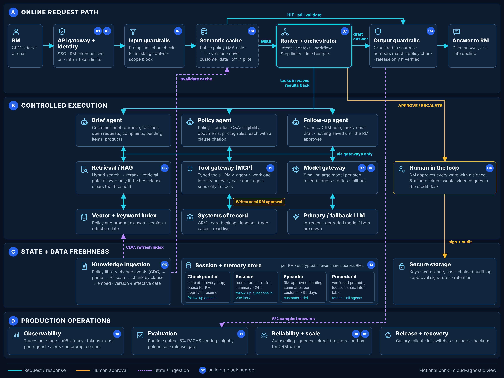
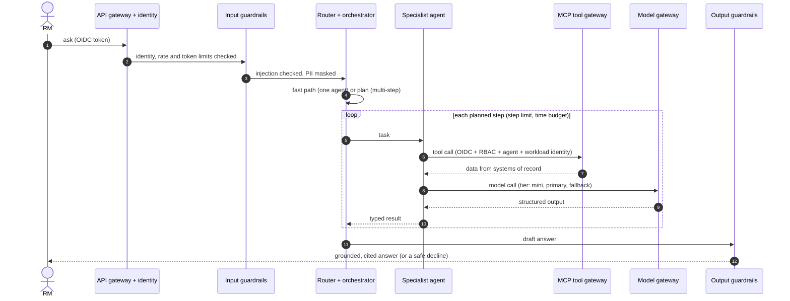

# SME RM Copilot

An AI assistant for SME relationship managers (RMs) at a commercial bank: it prepares customer briefs, answers policy and product questions with citations, and drafts follow-ups that the RM approves.

> Prototype for an architecture review. The bank, customers, figures and policies are fictional. Every external system and model is mocked behind an interface, so the whole system runs locally with one command.

| | |
|---|---|
| **Architecture document** | [docs/architecture-review.pdf](docs/architecture-review.pdf) (business problem, solution architecture, delivery approach, technical deep dive) |
| **Architecture diagram** | [docs/diagrams/hld.png](docs/diagrams/hld.png) |
| **Live demo** | [claude.ai/artifact/QMmwAsgAQZnoUtVf2iTkWA](https://claude.ai/artifact/QMmwAsgAQZnoUtVf2iTkWA) (recorded scenarios with traces; no install) |
| **Run it yourself** | `make setup && make demo` |

## Architecture



Four lanes. Every request flows through lane A; lane B does the controlled work; lane C keeps state and knowledge fresh; lane D keeps the system observable and safe to change.

## Use cases

| Use case | What it does |
|---|---|
| **Customer brief** | Meeting purpose, open requests, products and facilities, complaints, pending items from both sides, suggested products, talking points |
| **Policy and product Q&A** | Eligibility, document and policy answers with cited clauses; declines when unsure |
| **Follow-up actions** | Turns the RM's notes into a CRM note, tasks and an email draft; the RM approves before anything is saved |

## How a request flows



## Diagram to code

| Diagram box | Code |
|---|---|
| **A · Online request path** | [`src/copilot/request_path/`](src/copilot/request_path) (wired in order in `pipeline.py`) |
| RM and Answer to RM | `src/copilot/app.py` (API) and [`demo/ui/`](demo/ui) |
| API gateway + identity | `request_path/gateway.py` |
| Input guardrails | `request_path/input_guardrails.py` |
| Semantic cache | `request_path/semantic_cache.py` |
| Router + orchestrator | `request_path/router.py`, `request_path/orchestrator.py` |
| Output guardrails | `request_path/output_guardrails.py` |
| **B · Controlled execution** | [`src/copilot/execution/`](src/copilot/execution) |
| Brief, policy and follow-up agents | `execution/agents/` |
| Tool gateway (MCP) + MCP servers | `execution/tool_gateway.py`, `execution/mcp_servers/` |
| Model gateway | `execution/model_gateway.py` |
| Retrieval (hybrid RAG) + vector and keyword index | `execution/retrieval.py` |
| Primary / fallback LLM | [`mocks/llm/`](mocks/llm) (scripted, deterministic) |
| Systems of record | [`mocks/systems/`](mocks/systems) (CRM, core banking, lending, trade finance, cases) |
| Human in the loop | `execution/approvals.py` |
| **C · State + data freshness** | [`src/copilot/state/`](src/copilot/state) |
| Knowledge ingestion (CDC) | `state/ingestion.py` |
| Session + memory store | `state/memory/` (checkpointer, session, episodic, procedural) |
| Secure storage (audit) | `state/audit_log.py` |
| **D · Production operations** | [`src/copilot/operations/`](src/copilot/operations) |
| Observability | `operations/tracing.py` |
| Evaluation | `operations/evals/` (runtime checks, release gate, golden set) |
| Reliability + scale | `operations/resilience.py` |
| Release + recovery | `operations/flags.py` |
| Shared contracts | `src/copilot/contracts/` (Pydantic models at every boundary) |

## Quick start

Requires Python 3.11+.

```bash
make setup     # create .venv and install pinned dependencies
make demo      # run the Gulf Star scenarios in the terminal, with a trace per lane
make test      # unit, end-to-end and security tests
make evals     # release gate: RAGAS-style benchmark on the golden set
make serve     # API + demo UI on http://localhost:8000
```

## Demo scenarios

| # | Scenario | What it shows |
|---|---|---|
| 1 | "Prepare brief" for Gulf Star Trading LLC | Fast path, brief agent, figures filled from source systems, product suggestions |
| 2 | "Can we go to AED 3.5m unsecured? If not, what collateral is acceptable?" | Planner path, two policy steps, hybrid RAG, cited clauses |
| 3 | "Draft follow-up: owner will send audited financials by 5 Dec" | Drafts, checkpoint, RM approval token, resume, outbox write |
| 4 | Failure cases | Prompt injection blocked, other RM's customer denied, source down (degraded answer), weak evidence (decline) |

## Real vs mocked

| Implemented in this repo | Mocked |
|---|---|
| Router, planner loop, orchestrator, agents | LLM responses (deterministic, scripted) |
| Guardrails, hybrid retrieval (BM25 + vector + filter + rerank + gate) | Azure OpenAI, AI Search, Content Safety |
| Tool gateway access checks (OIDC + RBAC + agent + workload identity) | Entra ID tokens |
| Memory, checkpoint and resume, approval tokens, outbox | Cosmos DB, Key Vault |
| Retries, circuit breakers, tracing, evals | CRM, core banking, lending, trade finance, case management |

External systems and models sit behind interfaces in `src/copilot/contracts/ports.py` (ports and adapters). Moving to Azure means adding adapters, not changing the design.

## Prototype simplifications

| Area | In this prototype | In production (per the architecture document) |
|---|---|---|
| LLM | Scripted, deterministic responses | Azure OpenAI via the model gateway (adapter stub in `mocks/llm/azure_openai_adapter.py`) |
| Identity | Mock OIDC issuer; agent and workload identities are names set in code | Entra ID tokens, a service principal per agent, managed workload identities |
| Plan execution | Steps run in sequence | Independent steps can run in parallel (LangGraph) |
| Stores | In-memory memory, cache, index, audit log and outbox | Cosmos DB, AI Search, Managed Redis, immutable Blob Storage |
| Outbox | Drained in-process right after approval | Async worker with retries |
| Evals | Lexical mock judge; release gate on a 16-case golden set | RAGAS with an LLM judge; 5% online sampling, nightly runs |
| Network and region | Not modelled | UAE North, private endpoints, no public path |

## Key design decisions

1. **Model gateway:** model-agnostic, with routing and fallback
2. **MCP / tool gateway:** granular access control, OIDC + RBAC per call
3. **Hybrid RAG:** sparse (BM25) + dense search with metadata filters
4. **Groundedness:** citations for every policy answer
5. **Human in the loop:** approval on critical paths
6. **Specialised agents:** clear tool and responsibility boundaries
7. **Layered memory:** checkpointer, session, episodic, procedural
8. **Plan-and-execute:** agentic loop for multi-step asks
9. **Regional deployment:** data residency
10. **Evals:** runtime scoring and a release quality gate

One page per decision in [`docs/decisions/`](docs/decisions).

## Repository layout

```
docs/          architecture document, diagrams, decision records
src/copilot/   the copilot, one folder per diagram lane
mocks/         simulated systems of record, LLM, identity, fictional data
demo/          terminal demo, web UI, static export
tests/         unit, end-to-end, security, evals
```
