# SME RM Copilot on Azure: high-level design

Status: **Draft for ARB** · Workstream A1 · Owner: solution architecture · Date: 26 Nov 2026 · Baseline: `00-plan.md` v2.6 (aligned to v2.4 after the ARB review, `07-review-log.md`; v2.6 adds the multi-agent orchestration (orchestrator and specialist agents, named per plan v2.9), the MCP gateway, agent identities and memory: §5, §5.1, §7, §7.1, §8.2; v2.7 adds the evaluation architecture and runtime operations metrics: §5.2, §12; v2.9 names the intent classifier, the orchestrator and the specialist agents and replaces agent hops with waves: §5, §7.1)

This document is the high-level design (HLD) for the SME RM Copilot on Microsoft Azure. It is derived from
`00-plan.md` (the contract) and uses its service names, flows, step numbers, targets and phases unchanged. Where
this document refers to "the plan" with a section number (for example §3.4), it means `00-plan.md`. Everything is
fictional and unbranded ("the Bank"); figures are illustrative in an AED / UAE-style context. Items marked
**[confirm]** must be verified with the Bank or Microsoft before go-live (consolidated in plan §10). Where this HLD
disagrees with the plan, it does not diverge: the objection is recorded in §15 "Open points for the lead".

Contents: 1 Purpose and scope · 2 Architecture principles · 3 Business context and use cases · 4 System context
view · 5 Container view (5.1 Memory architecture, 5.2 Evaluation architecture) · 6 Network topology view · 7 Identity view (7.1 Agents, MCP gateway
and identities) · 8 Data flows · 9 Trust boundaries and data classification · 10 Deployment view by phase · 11 Azure
service mapping · 12 Quality attributes · 13 Cross-references · 14 Glossary · 15 Open points for the lead

---

> Rendered images of every diagram in this document are in [`diagrams/`](diagrams/) (`hld-*.png` and `.svg`).

## 1. Purpose and scope

**Purpose.** Give the Architecture Review Board (ARB) one coherent view of how the copilot is built on Azure: what
runs where, which identity each call carries, which data crosses which boundary (masked or not), and which
decisions (ADRs) the design rests on. The low-level design (`02-lld.md`), interfaces and SLAs
(`04-interfaces-and-slas.md`), NFRs, failure scenarios, DR and model risk (`05-nfr-scenarios-and-dr.md`), and
deployment and operations (`06-deployment-and-operations.md`) elaborate this HLD; they do not override it.

**In scope.** Three use cases (UC1 pre-meeting brief, UC2 policy and product copilot, UC3 post-meeting follow-up
agent) for SME relationship managers (RMs), delivered in the CRM sidebar and a Teams personal tab; the Azure
landing zone footprint in UAE North; integration with the Bank's systems of record over ExpressRoute; Phase 1
(pilot, 30 RMs) and Phase 2 (scale, 300 RMs) as defined in plan §2.

**Out of scope.** Deployment to a real subscription, real bank data, vendor contracts, applied IaC (plan §1);
other customer segments and further write actions (Phase 3, separate review); changes inside the systems of
record beyond the interface agreements in `04-interfaces-and-slas.md`.

**Assumptions.** The Bank operates an Azure landing zone with a hub VNet, ExpressRoute and Azure Firewall; the Bank
standardises on AKS with an existing platform team (plan C11); the CRM supports an external reference for
idempotent writes **[confirm]** (plan §10 items 11 and 12); the residency and outsourcing approvals and the modified abuse
monitoring approval (plan §3.5, C17) are obtained before real data is used.

## 2. Architecture principles

| # | Principle | Rationale |
|---|---|---|
| P1 | **Azure only, UAE North, Regional deployments; no cross-border processing or failover.** | Residency is a hard constraint; region loss is handled as business continuity, not by sending data abroad (ADR-001, ADR-015). |
| P2 | **The model never decides access.** Entitlements are enforced in `tool-gateway` code using the RM's own identity. | A prompt cannot be trusted as a control; injected text then has no more privilege than the RM (ADR-008). |
| P3 | **Customer data is read live as the RM, never embedded or indexed.** | No second copy of PII to secure; freshness and access rules come from the source system (ADR-007). |
| P4 | **Writes are proposals until the RM approves with a signed, draft-bound token.** | The model and the orchestrator cannot approve on the RM's behalf, even if manipulated (ADR-009, ADR-010). |
| P5 | **Verify, then release.** Nothing unverified reaches the RM; figures come from tools, not the model. | Hallucinated numbers or promises are the highest-impact failure; buffering costs seconds, not trust (ADR-011, ADR-022). |
| P6 | **Deterministic workflows first, model calls only where language is needed.** | Predictable, testable, explainable to audit and model risk; bounded cost and latency (ADR-005). |
| P7 | **One gateway for every model call and every system-of-record call.** | Single place for authentication, quotas, token metrics, circuit breaking and version routing (ADR-003). |
| P8 | **Private by default.** No public endpoints on PaaS, egress only via the firewall allow-list, local auth disabled. | Reduces exfiltration paths and the attack surface the ARB must reason about (ADR-017). |
| P9 | **Telemetry is metadata only; content lives only in the encrypted audit content store.** | Prompts and completions contain customer data; observability must not become a shadow data store (ADR-013, ADR-014). |
| P10 | **Degrade, do not fail; and every capability has a kill switch.** | A flagged data-only answer is better than an outage; risk can stop a use case in minutes (ADR-015, ADR-020). |
| P11 | **Three identities on every tool call; effective permission is their intersection.** The RM (OBO), the agent (its own service principal) and the workload (managed identity, the agent's federated credential). | A manipulated agent cannot exceed the RM, and an RM cannot use a tool their agent was not given (plan §3.7, C24; ADR-024, ADR-023). |
| P12 | **Memory never holds customer facts and never crosses RMs.** Facts are read live; only RM-approved or RM-authored content becomes episodic memory; procedural memory changes only through the eval gate. | Memory is a new place for injected text to hide and for data to leak; scope and provenance make it auditable (plan §3.8, C26, C27; ADR-026). |

## 3. Business context and use cases

SME RMs spend preparation time assembling customer context from five or more systems, answering policy and product
questions from long documents, and writing call reports and follow-up tasks after meetings. The copilot reduces that
effort inside tools the RM already uses, without changing who is accountable: the RM approves every write and sends
every email.

| Id | Use case | Pattern (plan §2) | Systems touched | Writes? | p95 target (plan §5) |
|---|---|---|---|---|---|
| UC1 | Pre-meeting brief | Fixed workflow: fan-out read tools, model writes wording with `{placeholders}`, system inserts figures | CRM, core banking ODS, LOS, KYC/CDD, news feed, Graph calendar | No | ≤ 8 s |
| UC2 | Policy and product copilot | RAG over approved documents, cited, groundedness check, decline when weak | AI Search index (from policy DMS) | No | ≤ 7 s |
| UC3 | Post-meeting follow-up agent | Extract JSON drafts from notes; RM edits; signed approval; write API verifies | CRM (write after approval), Outlook compose deeplink | Yes, after approval | draft ≤ 10 s; commit ≤ 2 s |

Actors: SME RM (primary user); team lead (read-only role, plan C22); delegate RM during holiday cover (from CRM
delegation records with expiry, C22). Stakeholders without runtime access: model risk management, operational risk,
compliance, information security / SOC, internal audit, the regulator (via the Bank's outsourcing and model risk
files).

Volumes (plan §5): pilot 30 RMs; scale 300 RMs; peak 0.5 requests/s; about 5,400 requests/day at scale. Availability
SLO: pilot 99.0% in business hours (Mon to Fri 07:00 to 20:00 GST), scale 99.5% committed only after 3 months of
pilot measurements (plan §5); "available" means a correct answer, a clearly flagged degraded answer, a partial
brief or a UC2 decline (composite maths in `04-interfaces-and-slas.md` §9).

## 4. System context view

The copilot is one system inside the Bank's Azure estate. RMs reach it only through the Bank's channels; it reaches
systems of record only through APIM over ExpressRoute; it reaches Microsoft cloud services over the Microsoft
backbone. Risk, compliance, audit and the regulator are stakeholders who consume evidence, not runtime users.

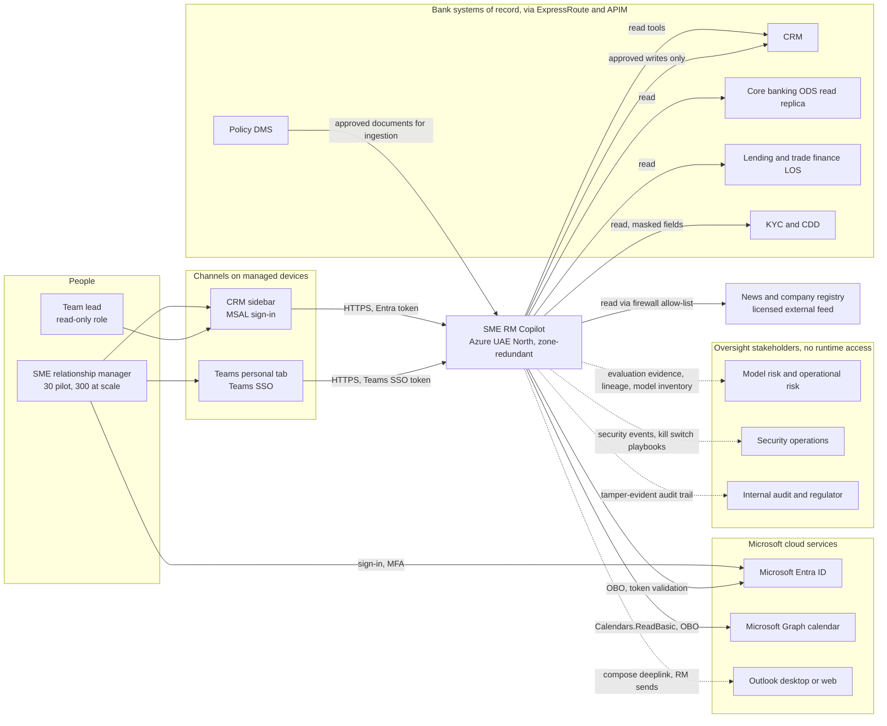

Context notes:
- The copilot never sends email and holds no mail scope: the approved email opens in Outlook via a compose deeplink
  (plan C20).
- Call reports written to the CRM are marked "AI-assisted, RM-approved" (plan §4.2 step 10, C23).
- The Teams bot channel (Azure Bot Service) is absent in Phase 1 by design (plan C1); see §10.

## 5. Container view

All copilot services run in the AKS namespace `rm-copilot` (plan §3.2). APIM is one instance exposing two API
products: the **AI gateway** (in front of Azure OpenAI) and the **system API facade** (in front of the systems of
record). Solid arrows are synchronous calls on the request path; dotted arrows are asynchronous, batch or
telemetry paths.

From plan v2.6 (§3.7, ADR-025 amending ADR-005; names from plan v2.9) the `orchestrator` service hosts the **intent
classifier** (rules first, `gen-small` only for free text), the **orchestrator** itself (a deterministic workflow
engine in code that never calls a model; it has no agent identity and runs under the `orchestrator` workload
identity, with no data tools) and three
**specialist agents** (`brief-agent`, `policy-agent`, `followup-agent`). Agents reach data only through
MCP servers exposed by `tool-gateway` (`customer-data`, `policy-search`, `crm-drafts`, `memory`) behind a third APIM
API product, the **MCP gateway** (ADR-023). The commit and the internal audit endpoint are not MCP tools: they stay
direct REST calls from deterministic graph nodes. Memory stores (plan §3.8, ADR-026) are Cosmos DB containers in the
same account, shown separately because their access rules differ (§5.1).

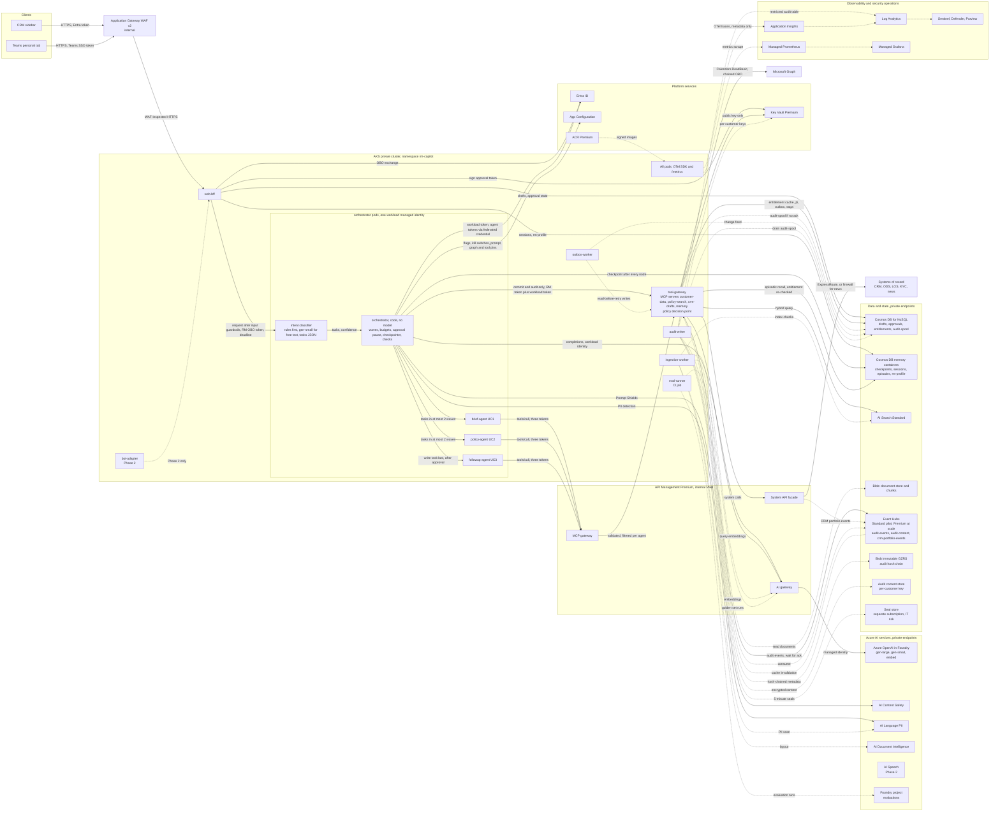

Responsibilities are exactly as in plan §3.2; the points an ARB reviewer usually asks about:

| Question | Answer in this design |
|---|---|
| Where is the security boundary? | `tool-gateway`. It validates the RM token (`iss`, `aud`, `tid`, `scp`; RM = `oid`) and the caller's workload token, runs the entitlement check first, minimises and masks fields, and verifies approval tokens. The orchestrator is treated as potentially manipulated by model output. |
| Who can sign an approval? | Only `web-bff` (Key Vault `sign`). `tool-gateway` holds the public key only; the orchestrator holds no key (plan §3.3 Keys). |
| Where do model calls go? | Only through the APIM AI gateway, from `orchestrator`, `tool-gateway` (embeddings), `ingestion-worker` (embeddings) and `eval-runner`. |
| Where do system-of-record calls go? | Only from `tool-gateway`, through the APIM system API facade. `tool-gateway` also owns the Graph calendar call (`get_upcoming_meetings`) and the UC1 fan-out (`get_brief_inputs`). |
| Who produces audit events? | Only `tool-gateway` (plan v2.3). `orchestrator` and `web-bff` post use-case events to its internal audit endpoint. If Event Hubs does not acknowledge, events go to the Cosmos `audit-spool`, which `audit-writer` drains; a commit needs the Event Hubs ack of `approval_verified` before any CRM write (ADR-013). |
| Why separate `outbox-worker` and `audit-writer`? | Different scaling, failure and privilege profiles: the outbox worker needs CRM write paths; the audit writer needs storage and key access but no business APIs. |
| How do agents reach data? (v2.6) | Only through `tool-gateway` MCP servers behind the APIM MCP gateway, with three tokens per call (§7.1). The orchestrator has no agent identity and no data tools (it runs under its workload identity); each specialist's agent identity holds app roles for exactly its tools; `tool-gateway` stays the policy decision point. Agents never call each other and report back to the orchestrator; at most 2 waves per request (C28). |
| Can an agent commit a write? (v2.6) | No. The commit is a deterministic graph node that calls `POST /internal/v1/commits` with the RM-signed approval token, not an MCP tool (plan §3.7). `crm-drafts` only creates drafts in the copilot's own store. |
| Where does memory live? (v2.6) | Cosmos DB containers `checkpoints`, `sessions`, `episodes`, `rm-profile`; AI Search for semantic memory; Git plus App Configuration pins for procedural memory (§5.1). |

### 5.1 Memory architecture

Plan §3.8 defines seven kinds of memory (ADR-026). The rule that shapes all of them: **customer facts are never
memorised**; they are read live through tools as the RM (ADR-007). Memory holds conversation context, what the RM did
and approved, and how the system is configured to work.

| Memory | Holds | Store | Scope and key | Retention (plan §7) | Written by | Read by |
|---|---|---|---|---|---|---|
| Working | The current request's graph state: messages, tool results, plan | In-process, then checkpointed | One request | Request | Graph runtime | The agent running the node |
| Checkpointer | Graph state after every node; pause for RM approval (interrupt) and resume; replay for debugging | Cosmos DB `checkpoints`, state encrypted with a per-customer data key | Thread = RM session (UC3: the draft's thread); one checkpoint per node | 7 days; 30 days while a UC3 draft is open | Graph runtime (`orchestrator`) | Graph runtime; PIM-gated replay (C29) |
| Session | Last turns and a rolling summary of the current session | Cosmos DB `sessions` | RM `oid` + session | 24 h | `web-bff` persists; the session summariser (small model, after release, outside orchestration) proposes the summary | `web-bff`, passed to the intent classifier as context |
| Episodic | What happened before with this customer: past briefs (metadata), approved call reports, RM notes; the CRM stays the source of truth | CRM (via tools) plus Cosmos DB `episodes` (the RM's own interactions) | RM `oid` + customer; entitlement re-checked at recall | Episode log 90 days | `tool-gateway`, only from RM-approved or RM-authored content | `brief-agent` via the `memory` MCP server |
| Semantic | Bank knowledge: policies, products | AI Search (versioned, effective-dated) | Clearance filter | Per policy lifecycle | `ingestion-worker` | `policy-agent` via `policy-search` |
| Procedural | Prompts, graph definitions, tool schemas, few-shot examples, guardrail rules | Git and the prompt registry, pinned in App Configuration | Global, versioned, hashed | Versioned forever | Engineers, through the eval gate only | Graph runtime at start-up and on pin change |
| Profile | RM preferences: language, brief format, default customers | Cosmos DB `rm-profile` | RM `oid` | Until changed or the RM leaves | The RM (through `web-bff`) | `web-bff`, passed as context |

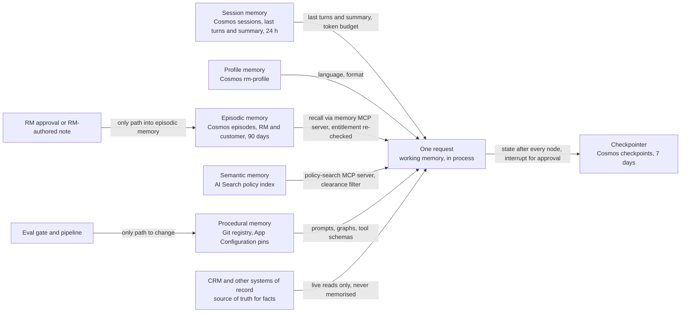

Memory rules (plan §3.8, C26, C27, C29):
- No memory crosses RMs: every memory partition key starts with, or is checked against, the RM `oid` from the token.
  A delegate RM does not see the delegator's episodes.
- Every memory item carries provenance (source, author, time, version and, for approved content, the approval `jti`).
- Quarantine and Prompt Shields run before any memory write; quoted or injected instructions are never stored, and
  recalled episodes are passed to the model as quoted data, never as instructions or as figures.
- Procedural memory is never changed at runtime by a model; a pin may only point to a version with a passing eval run.
- Erasure crypto-shreds checkpoints and episodes with the customer key (C21); the short TTLs bound the rest.
- Detail (containers, partition keys, checkpointer semantics, recall algorithm, registry) is in `02-lld.md` §16.

### 5.2 Evaluation architecture

Plan §3.9 evaluates the copilot in four tiers (ADR-027, extending ADR-018). Metric names follow the RAGAS definitions
(faithfulness, answer relevancy, context precision, context recall, context utilisation, answer correctness), so a
release report, a nightly report and the production dashboard mean the same thing. No LLM judge runs on the request
path.

| Tier | Where it runs | When | What it decides |
|---|---|---|---|
| 1 Runtime gates | `orchestrator`, inline | Every request | UC2: decline before calling the model when the best passage is below threshold (weak passages dropped, context relevance monitored); after generation, faithfulness (every claim cited and supported) and answer relevancy; retry once if ≥ 4 s remain, else decline. UC1: no brief without the CRM profile; lines with invented numbers or promises dropped. Budget guards on tokens, steps, waves and deadline |
| 2 Online sampled | `eval-runner` online worker in prod, in-region judge (`gen-large`) | Minutes after the answer | 5% of UC1 and UC2 answers (cap 200 per day) scored from masked audit content; alert if faithfulness < 0.90 or answer relevancy < 0.80 over 1 h |
| 3 Scheduled | `eval-runner` CronJobs, pre-prod Azure OpenAI with the production configuration | Nightly, weekly, monthly | Golden-set regression with reference-based metrics; drift report; red team of ≥ 1,000 attacks; a regression opens an incident |
| 4 Release gate | CI stage on pre-prod | Every prompt, model, tool, index or threshold change | Ships only if every RAGAS, security, latency and token threshold holds |

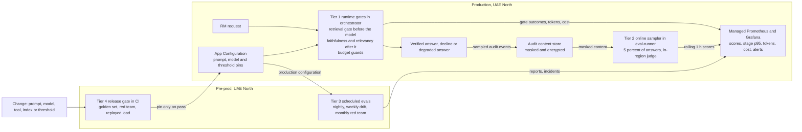

Runtime operations metrics (plan §3.9) are collected on every request as metadata only: p50, p95 and p99 latency per
use case and per stage, tokens per request (input and output, per use case, agent and deployment), estimated cost per
request and per day in AED from a price table in App Configuration, gate outcomes and budget exceedances. Detail:
`02-lld.md` §11.8 (metrics and alerts) and §17 (formulas, gate algorithm, online sampler, scheduled jobs, release
gate); operations in `06-deployment-and-operations.md` §5.4, §5.5 and RB-20.

## 6. Network topology view

Hub-spoke within the Bank's landing zone in UAE North. The copilot spoke has no public IP and no public PaaS
endpoint. All egress, including from AKS nodes, is forced through Azure Firewall Premium in the hub (user-defined
route `0.0.0.0/0` to the firewall). Azure Monitor ingestion uses Azure Monitor Private Link Scope (AMPLS).

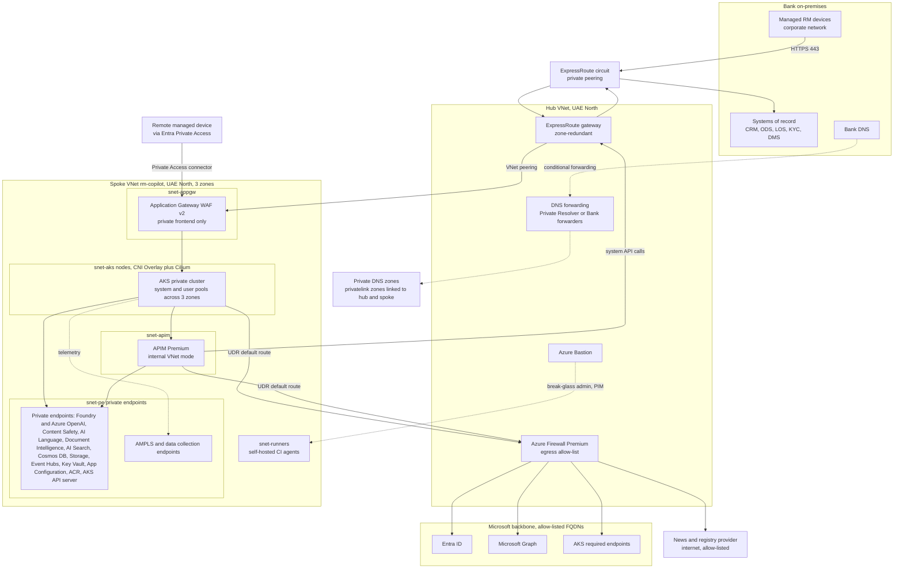

Network design points:

| Concern | Design | Reference |
|---|---|---|
| Ingress | Internal Application Gateway WAF v2 is the only ingress for the sidebar and the Teams tab, reached from managed devices on the corporate network or via Entra Private Access (plan §3.3 Edge). No public listener in Phase 1. | ADR-016, ADR-017 |
| East-west in the cluster | Cilium network policies: default deny; `web-bff` → `orchestrator` → `tool-gateway` only; only `tool-gateway` reaches the APIM system API facade (`outbox-worker` delivers through the `tool-gateway` write adapters); `web-bff` and `tool-gateway` signer/verifier pods isolated (plan C11). | ADR-002 |
| PaaS access | Private endpoints only; public network access disabled; `disableLocalAuth` everywhere; Entra auth with managed or workload identity. | ADR-017 |
| Systems of record | APIM (internal) → ExpressRoute → Bank data centre. Legacy systems receive `tool-gateway`'s managed identity plus the RM `oid` in an APIM-signed header (plan §3.4 step 5). | ADR-008 |
| Internet egress | Firewall allow-list only: Entra ID, Microsoft Graph, AKS required FQDNs, the licensed news feed. Everything else denied and logged. Exact FQDN list in `02-lld.md` **[confirm AKS egress list for the chosen features]**. | ADR-017 |
| DNS | Azure Private DNS zones for each `privatelink` namespace, linked to hub and spoke; conditional forwarding from Bank DNS so managed devices resolve the Application Gateway private name **[confirm zone names for Foundry resources]**. | `02-lld.md` |
| Telemetry | AMPLS with data collection endpoints for Application Insights, Log Analytics and managed Prometheus from a private cluster **[confirm]** (plan §3.3 Metrics). | ADR-014 |
| Admin access | Azure Bastion plus PIM for break-glass; routine changes through CI/CD from self-hosted runners in the spoke (a private cluster and internal APIM are not reachable from hosted runners). | ADR-021, `06-deployment-and-operations.md` |

## 7. Identity view

The identity chain is plan §3.4 (C4), extended in plan v2.6 §3.7 with the agent identity and the MCP gateway (C24,
ADR-024). The sequence below shows sign-in and a read call; the approval and write additions are in §8.2, and one
tool call with the full three-token decision is in §7.1. Step numbers on arrows are the §3.4 numbers.

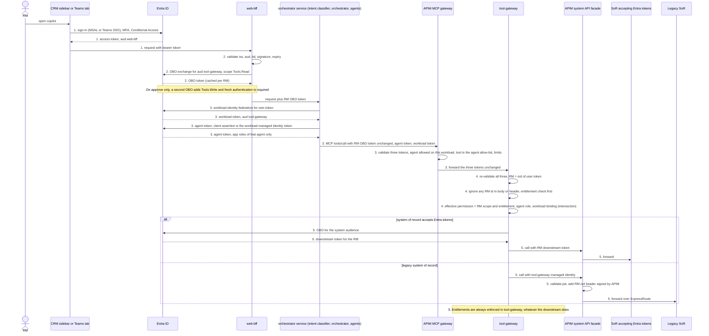

Identity design points:
- Every service authenticates to Azure resources with AKS workload identity (federated credentials); no client
  secrets in pods. Secrets exist only for non-Entra APIs, in Key Vault (plan §3.3 Keys).
- Approval requires the Conditional Access authentication context `approve-write` (Entra id `c1`, sign-in
  frequency 10 min): `web-bff` checks that `acrs` contains `c1`, else returns a claims challenge (step-up); the ID
  token's `auth_time` ≤ 10 min is the fallback (plan §3.4) **[confirm `acrs` on the access token, plan §10 item 8]**.
- PIM for all admin roles; no standing access to production data planes.
- Graph is called with `Calendars.ReadBasic` via OBO only (plan C20).
- Agents (v2.6): one Entra identity per agent (Entra Agent ID where available, else an app registration with a
  service principal **[confirm, plan §10 item 12]**). The agent's only credential is a federated credential that
  trusts the orchestrator's workload managed identity, so there is no agent secret and an agent token cannot be
  minted outside the orchestrator pods (ADR-024). Agent app roles are reviewed quarterly (C24).

Identities and the memory stores (v2.6; data-plane RBAC per container, `disableLocalAuth`, detail in `02-lld.md` §16):

| Identity | `checkpoints` | `sessions` | `episodes` | `rm-profile` | AI Search (semantic) | App Configuration (procedural pins) |
|---|---|---|---|---|---|---|
| `orchestrator` workload identity (graph runtime) | read, create, replace | none | none | none | none | read |
| `tool-gateway` workload identity (`memory`, `policy-search` servers) | none | none | read, create (approved or RM-authored content only) | none | read (`policy-search`) | read |
| `web-bff` workload identity | none | read, create, replace | none | read, create, replace | none | read |
| Agent identities | none directly; memory reaches an agent only through MCP tools or as context from its runtime | | | | | |
| Operators (PIM, `acrs` contains `c1`) | read for replay, audited | none | none | none | none | write through the pipeline only |
| `ingestion-worker` workload identity | none | none | none | none | write | read |

### 7.1 Agents, MCP gateway and identities

Plan §3.7 (ADR-023, ADR-024, ADR-025). Four terms, used with these meanings throughout (plan v2.9):

| Term | What it is |
|---|---|
| Intent classifier | First step after the input guardrails. Rules first (button, launch context, clear phrase: no model call); `gen-small` only for free text, with structured output `{tasks: [{id, intent, query, depends_on}], confidence}`. Confidence ≥ 0.8 proceeds, 0.5 to 0.8 asks the RM to clarify, below 0.5 or out of scope declines. Decides whether the semantic cache may be consulted (public policy intents only). One decision, no loop |
| Orchestrator | Deterministic workflow engine in code; never calls or picks a model, never writes to the CRM. Plans tasks from a fixed intent table into at most 2 waves, splits and enforces the budgets (12k tokens, the request deadline), reads each agent's typed result and acts by fixed rules, checkpoints, pauses for approval, combines results for the output guardrails |
| Specialist agents | `brief-agent`, `policy-agent`, `followup-agent`. Each reasons with a model and calls only its own tools through the MCP gateway; agents never call each other and report back to the orchestrator |
| Supervisor (LLM planner) | Phase 2 option only, not in the pilot: a model proposes the plan and the orchestrator validates it against the intent table, falling back to the fixed table if it is invalid |

We deliberately use a deterministic orchestrator instead of an LLM supervisor: the model understands the request
(intent classifier) and the specialist agents reason, but code controls execution, so ordering, budgets and
approvals are guaranteed and auditable. An LLM supervisor (planner) is a Phase 2 option, with the orchestrator still
validating every plan.

Independent read tasks run concurrently in wave 1; a dependent task (for example, only if the first answer is "no")
or a write task runs in wave 2; a write runs last and alone, after RM approval. Specialists call tools only through
the MCP gateway. Verification (numeric, policy and groundedness checks) stays deterministic code, and the commit
stays outside MCP.

| Component | Job | MCP tools it may call | Agent app roles (on `tool-gateway`) | Model |
|---|---|---|---|---|
| Intent classifier (in the `orchestrator` service, uses the `orchestrator` workload identity for the model gateway) | Task list and confidence | none | none (no agent identity) | rules; `gen-small` for free text only |
| Orchestrator (`orchestrator` workload identity; no agent identity, cannot obtain agent or tool tokens) | Plan, waves, budgets, approval pause, combine results | none | none (no agent identity) | none |
| `brief-agent` (UC1) | Customer brief | `customer-data` (profile, facilities, transactions summary, KYC status, news, the composite `get_brief_inputs`); `memory` (`recall_episodes`) | `Tools.CustomerData.Read`, `Tools.Memory.Recall` | `gen-large` |
| `policy-agent` (UC2) | Cited policy answers | `policy-search` (`search_policies`) only | `Tools.PolicySearch` | `gen-small` rewrite, `gen-large` answer |
| `followup-agent` (UC3) | Notes to drafts | `customer-data` (`get_customer_profile` only); `crm-drafts` (`create_followup_draft`, no commit) | `Tools.CustomerData.Profile`, `Tools.CrmDrafts.Create` | `gen-small` |

**Three identities on every tool call.** Each call carries three tokens, all with audience `tool-gateway`:

| Token | Identity | Proves | Obtained by |
|---|---|---|---|
| User token (U) | The RM, signed in with OIDC | Which RM; delegated scope (`Tools.Read`; `Tools.Write` never on MCP routes); the agent as actor where Entra supports agent OBO **[confirm]** | `web-bff` OBO (plan §3.4 step 2), forwarded unchanged |
| Agent token (A) | The agent's service principal | Which agent; app roles for exactly its tools | Client credentials for the agent identity, with the workload token as client assertion (federated credential) |
| Workload token (W) | The orchestrator pods' managed identity | Which runtime; that the agent is hosted where it should be | AKS workload identity federation (plan §3.4 step 3) |

**Effective permission = intersection.** A call is allowed only if the RM's token has the tool's delegated scope and
the RM is entitled to the customer with clearance for the tool's data class, **and** the agent token holds the
tool's app role, **and** the workload is the runtime registered for that agent. The MCP gateway checks tokens, the
agent-to-tool allow-list and limits, and filters `tools/list`; `tool-gateway` re-checks everything and adds the
entitlement, clearance and pinned-schema checks (it is the policy decision point). Only internal, registered MCP
servers exist; tool names, descriptions and schemas are versioned and hashed, so a changed description is rejected
(tool poisoning, C25).

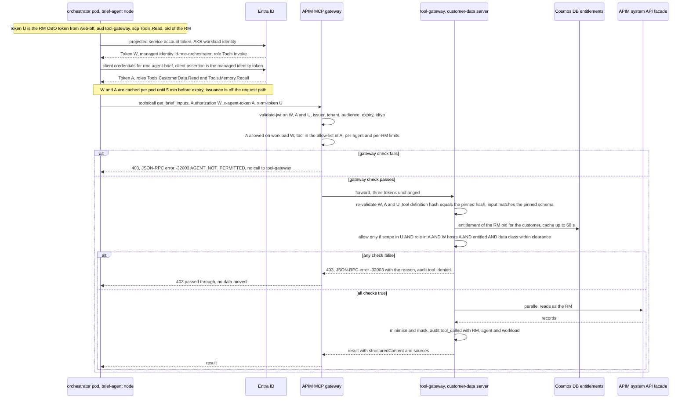

Design points:
- At most 2 waves per request; independent reads run concurrently in wave 1; dependent or write tasks in wave 2;
  agents never call each other. A request still has at most 6 tool steps across agents (plan §5, C28). The pilot
  runs one task per request (a single wave: the orchestrator plus one specialist); multi-task waves are the
  production design.
- Agent identities exist only for the three specialist agents. The orchestrator has none: it runs under the
  `orchestrator` workload identity, which can neither obtain agent tokens nor tool tokens from the MCP gateway.
- In the pilot no agent uses model function calling: each specialist's tool calls are nodes of its fixed graph, and
  the model only fills bounded arguments (for example the rewritten UC2 query) validated against the pinned schema.
  The filtered `tools/list` and the roles still hold if model-selected tool calls are enabled later (ADR-025).
- APIM's MCP server support (GA status and availability in UAE North) is **[confirm, plan §10 item 12]**; if a
  needed feature is missing, the MCP gateway runs as a standard APIM API with the same `validate-jwt` and rate-limit
  policies, and `tool-gateway` filters `tools/list` itself (it is authoritative either way).
- Contracts, claims, the decision algorithm and JSON-RPC examples are in `02-lld.md` §15; the gateway's SLO, timeouts
  and error mapping are interface IF-23 in `04-interfaces-and-slas.md`, and agent token issuance is IF-24.

## 8. Data flows

Step numbers below match plan §4 exactly. Where one plan step involves several messages, each message carries the
same step number. From plan v2.6 the `orchestrator` steps run as the intent classifier, the orchestrator and a specialist agent, and tool
calls pass through the APIM MCP gateway with three tokens (§7.1); the step numbers do not change. §8.1 and §8.3 keep
the v2.4 drawing with `orchestrator` as one participant; §8.2 shows the agents, the MCP gateway and the checkpointer
because the approval pause and resume depend on them.

### 8.1 Read path: UC1 pre-meeting brief (plan §4.1)

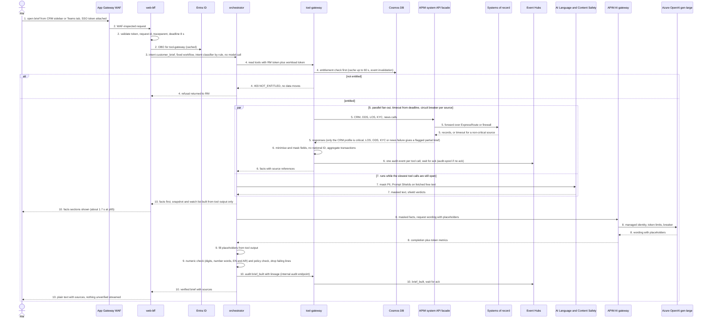

Network boundary for this flow (plan §4.1): private from the Application Gateway inwards, including Azure OpenAI and
every PaaS service on private endpoints; outbound only to Entra ID and Graph (Microsoft backbone), Azure Monitor
ingestion via AMPLS, and the news feed through the firewall allow-list.

### 8.2 Write path: UC3 follow-up agent (plan §4.2)

v2.6 additions (plan §3.7, §3.8; ADR-025, ADR-026): the orchestrator plans one write task for `followup-agent`; the profile read
and the draft creation go through the MCP gateway; when the drafts are ready the graph **interrupts** for RM
approval and the checkpointer saves the paused state (status `interrupted`, TTL 30 days while the draft is open).
Approve **resumes** the same thread from that checkpoint on any pod; the commit is a deterministic node, not an
agent tool. If the checkpoint is missing (expired, crash before it was written, store throttled) the commit runs as a
cold resume from the saved draft, because the commit needs only the draft and the approval token.

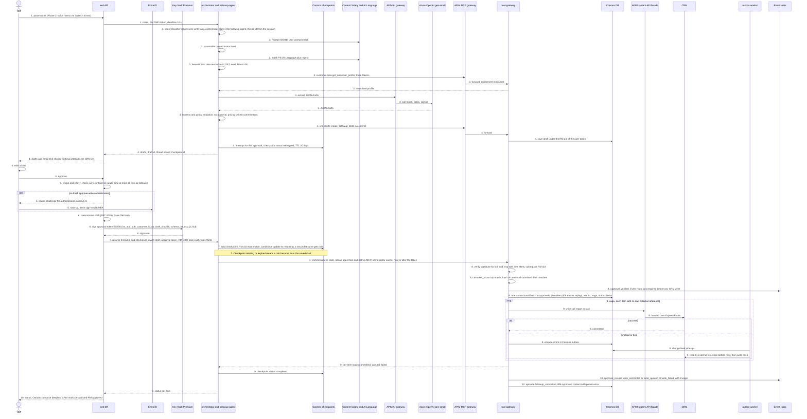

Note: `outbox-worker` calls the CRM through the `tool-gateway` write adapters and APIM (plan §3.2); the diagram
abbreviates that hop. The persisted verdict makes retries valid after the token's `exp` (plan C7). The MCP gateway
also forwards the agent and workload tokens on steps 3 and 4 (§7.1); the profile read in step 3 is the entitlement
check of plan §4.2. Resume is idempotent on the `Idempotency-Key` of the approve request, so a retried approve never
starts a second commit (`02-lld.md` §16.3).

### 8.3 UC2 policy question (plan §4.3)

The step numbers below are plan §4.3 steps 1 to 11 (adopted in plan v2.1). At p95 the first attempt ends near
5.8 s, so the step 10 retry rule (at least 4 s left) usually declines instead of retrying (plan v2.3).

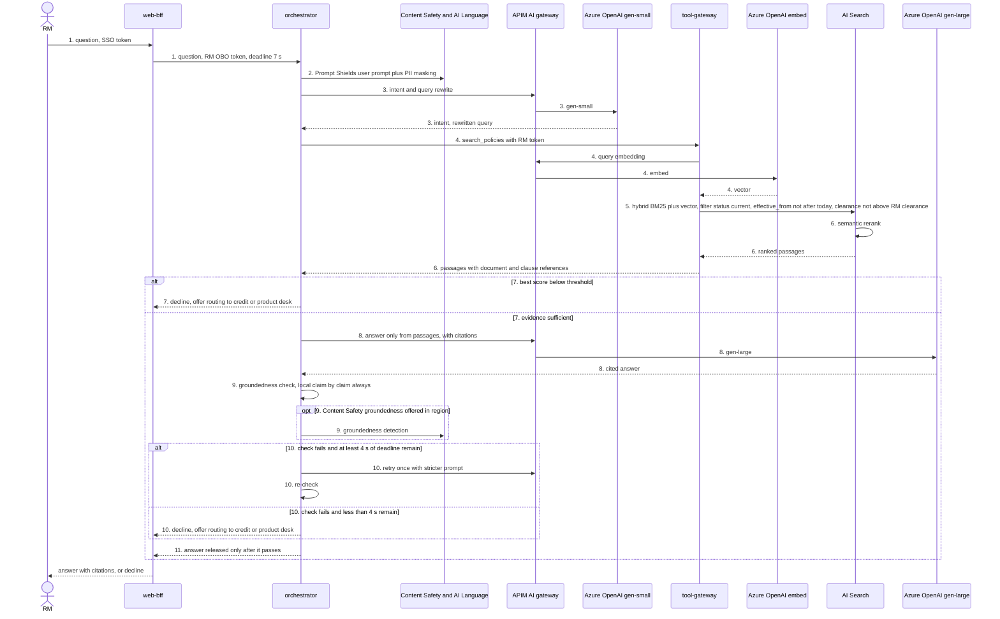

Degraded mode for all three flows (plan C3): when the model path is unavailable or the deadline does not allow a
second backend (at least 4 s must remain), UC1 returns a data-only brief (facts, no wording), UC2 returns ranked
passages without a generated answer, UC3 offers a manual call report. Degraded answers are flagged in the UI and
counted as degraded (ADR-015). Only the CRM profile is critical for UC1; LOS facilities, ODS transactions, KYC and
news failures produce a flagged partial brief (plan §4.1 step 5).

## 9. Trust boundaries and data classification

### 9.1 Trust boundaries

| Id | Boundary | Between | Control at the boundary |
|---|---|---|---|
| TB1 | Device to edge | Managed device / Teams client and Application Gateway | Entra sign-in, MFA, Conditional Access (managed device), TLS 1.2+, WAF |
| TB2 | Edge to session | Application Gateway and `web-bff` | Token validation, Origin/CSRF, session binding, CSP headers |
| TB3 | Session to model-facing logic | `web-bff` and `orchestrator` | OBO token scoped to `tool-gateway`; the orchestrator never holds signing keys; deadline header |
| TB4 | Model-facing logic to data boundary | `orchestrator` and `tool-gateway` | Dual token validation, entitlement first, field minimisation and masking, approval verification |
| TB5 | Bank tenant to Microsoft-operated AI services | APIM AI gateway / orchestrator and Azure OpenAI, Content Safety, AI Language, Document Intelligence | Private endpoints, Regional deployments, `store=false`, PII masked before any model call, modified abuse monitoring approval (plan §3.5) |
| TB6 | Azure to Bank data centre | APIM system API facade and systems of record | ExpressRoute private peering, APIM `validate-jwt`, per-consumer quotas, RM `oid` in APIM-signed header for legacy systems |
| TB7 | Azure to internet | Firewall and news feed, Entra ID, Graph | FQDN allow-list, TLS, licensed feed contract |
| TB8 | Runtime to evidence stores | Services and Event Hubs / WORM / content store / telemetry | Metadata-only telemetry; content only in per-customer-key encrypted store; immutable retention |
| TB9 (v2.6) | Agent runtime to tool layer | Agents in `orchestrator` and the APIM MCP gateway in front of `tool-gateway` MCP servers | Three tokens per call (user, agent, workload), intersection decision, filtered `tools/list`, pinned tool definition hashes, per-agent and per-RM limits, internal registered servers only (§7.1, C24, C25) |
| TB10 (v2.6) | Runtime to memory stores | Graph runtime, `tool-gateway`, `web-bff` and the Cosmos memory containers | Per-container data-plane RBAC, partition by RM `oid`, entitlement re-check at recall, quarantine before write, provenance, per-customer encryption of checkpoint state and episodes, PIM-gated replay (§5.1, C26, C27, C29) |

### 9.2 Classification scheme used here

The Bank's own scheme governs **[confirm labels with information security]**; this HLD uses four illustrative
levels: **Restricted** (identifiable customer data: national ID, account numbers, IBAN, full transactions, KYC
documents), **Confidential** (minimised customer facts, masked prompts and completions, drafts, audit content),
**Internal** (policy documents by clearance, telemetry metadata, configuration), **Public**.

### 9.3 UC1 brief (§8.1)

| Data | Class | Crosses | Masked? |
|---|---|---|---|
| RM token | Confidential (credential) | TB1 to TB4 | n/a; OBO token audience-restricted to `tool-gateway` |
| Raw system-of-record responses | Restricted | TB6 into `tool-gateway` only | No (raw); never leaves `tool-gateway` |
| News feed response | Internal (public-source content about a customer) | TB7 into `tool-gateway` | n/a; treated as untrusted text, Prompt Shields applied (step 7) |
| Facts with source references | Confidential | TB4 to `orchestrator` | Yes: field-minimised, national ID removed, transactions aggregated (step 6) |
| Facts sent to `gen-large` | Confidential | TB5 | Yes: PII replaced by placeholders before the call (step 7); mapping held in `orchestrator` memory for the request (detail in `02-lld.md`) |
| Model wording | Confidential | TB5 back | Contains placeholders, not figures |
| Verified brief | Confidential | TB3, TB2, TB1 to the RM | Figures inserted by the system; plain text, no images or external links (C19) |
| Audit events | Metadata Internal; content Confidential | TB8 | Metadata hash-chained in WORM; masked content encrypted per customer key (C21) |
| Telemetry | Internal | TB8 | Metadata only (C5) |

### 9.4 UC3 follow-up (§8.2)

| Data | Class | Crosses | Masked? |
|---|---|---|---|
| RM notes | Confidential to Restricted (free text may contain anything) | TB1 to TB3 | Raw until step 2 |
| Notes sent to `gen-small` | Confidential | TB5 | Yes: AI Language plus regex (Emirates ID, IBAN, trade licence, phone); quoted instructions quarantined |
| JSON drafts and email text | Confidential | TB5 back, TB9, TB3, TB1 | Shown to the RM only; stored in Cosmos DB `drafts` by the `crm-drafts` MCP server with 30-day TTL (plan §7) |
| Paused graph state (checkpoint) | Confidential | TB10 | Masked state, encrypted with a data key wrapped by the customer key; 30 days while the draft is open (C29) |
| Episode after commit | Confidential | TB10 | RM-approved text only, with provenance and approval `jti`; 90 days; crypto-shredded on erasure (C26) |
| Approval token | Confidential (integrity-critical) | TB3, TB4 | Not secret but unforgeable: ES256, bound to RM, customer, operation, schema, draft hash |
| CRM write payload | Confidential | TB6 | Unmasked by design: it is the RM-approved record, written as the RM |
| Email | Confidential | Device only (compose deeplink) | Never transits a mailbox API |

### 9.5 UC2 policy (§8.3)

| Data | Class | Crosses | Masked? |
|---|---|---|---|
| RM question | Internal to Confidential | TB1 to TB5 | PII masked before `gen-small` and embedding |
| Policy passages | Internal, with per-document clearance | TB4, TB5 | Not masked (no customer data); filtered by RM clearance before ranking |
| Index content | Internal | Inside the spoke (AI Search private endpoint) | PII-scanned at ingestion by `ingestion-worker` |

## 10. Deployment view by phase

Environments: dev, test, pre-prod, prod; synthetic data only outside prod; a separate Azure OpenAI resource per
environment (plan §3.3 Delivery). Promotion and runbooks are in `06-deployment-and-operations.md`.

| Component | Phase 1 Pilot (30 RMs) | Phase 2 Scale (300 RMs) | Notes |
|---|---|---|---|
| Channels | CRM sidebar, Teams personal tab | Same, plus Teams bot after residency sign-off | Plan C1, ADR-016 |
| `web-bff`, `orchestrator`, `tool-gateway` | Yes, ≥ 3 replicas each across zones | Same, KEDA / HPA scaled | Replica counts illustrative; sizing in `06` |
| `outbox-worker` | Yes, Cosmos change feed | Yes; Service Bus Premium if delivery volume or ordering needs it | ADR-010 |
| `ingestion-worker` | Yes | Yes | |
| `audit-writer` | Yes | Yes | ADR-013 |
| `eval-runner` | CI job (release gate) | CI job plus nightly regression; online sampling only with an in-region judge | ADR-018 |
| `bot-adapter` | No | Only after residency sign-off (C1) | |
| Models | Regional Standard `gen-large`, `gen-small`, `embed` | PTU if measured volume justifies it, else Regional Standard | ADR-004 |
| Voice (AI Speech) | No | Yes, UC3 voice memos | Plan §2 |
| Cache | In-process plus Cosmos DB | Re-evaluated on measured latency; Managed Redis only if available in UAE North **[confirm]** | Plan §2, §10.5 |
| Async messaging | Cosmos outbox | Service Bus Premium | Plan §2 |
| Audit stream | Event Hubs Standard with the Cosmos `audit-spool` fallback | Event Hubs Premium (SLA, CMK, geo-replication) | Plan §3.3, ADR-013 |
| APIM | Premium, 2 units across zones | Premium, 3 units **[confirm]** | Plan §3.3, ADR-003 |
| Audit query | Log Analytics restricted table | ADX if audit volume needs it | Plan §2 |
| Resilience | Zone redundancy, BCP for region loss | Re-evaluate warm standby if UAE Central offers the services **[confirm]** | Plan §3.1 |
| Brief prefetch (C9) | No | After risk sign-off | Plan C9 |
| Languages | English; Arabic evaluated | Arabic GA | Plan §2 |

```mermaid
flowchart LR
  subgraph P1["Phase 1 Pilot"]
    A1["web-bff, orchestrator, tool-gateway"]
    A2["outbox-worker, ingestion-worker, audit-writer"]
    A3["eval-runner as CI job"]
    A4["Regional Standard models"]
    A5["Cosmos outbox, Log Analytics audit query"]
  end
  subgraph P2["Phase 2 Scale"]
    B1["Same services, scaled"]
    B2["bot-adapter after C1 sign-off"]
    B3["AI Speech voice memos"]
    B4["PTU if justified"]
    B5["Service Bus Premium, ADX if needed"]
    B6["Brief prefetch after C9 sign-off"]
  end
  P1 -->|"pilot exit gates in 05 and 06"| P2
```

## 11. Azure service mapping

SKU and tier columns are planning positions, not quotes. Where the plan does not fix a size, the value is marked
illustrative and is sized in `06-deployment-and-operations.md`. No prices are given here; costs are modelled in
`05`/`06` and must be confirmed in the Azure pricing calculator.

| Logical capability | Azure service | Pilot SKU / tier | Scale SKU / tier | Why this service |
|---|---|---|---|---|
| Identity, SSO, OBO, step-up | Microsoft Entra ID | Bank tenant; Conditional Access; authentication context for approve; PIM | Same; Entra Private Access for remote RMs **[confirm licensing]** | Only identity provider that gives OBO, Teams SSO and workload identity natively (ADR-008) |
| Ingress and WAF | Application Gateway WAF v2 (internal) | Autoscale, minimum 2 instances across zones (illustrative) | Minimum sized on peak | Internal L7 ingress with OWASP rules; no public listener (ADR-017) |
| Compute | AKS private cluster | Standard tier; four pools (`system`, `signer`, `verifier`, `core`), 3 nodes each, one per zone (illustrative, `05` §2.7) | `signer`, `verifier` and `core` autoscaled; KEDA for workers | Bank standard; network policy, workload identity, PodMonitor (ADR-002) |
| AI gateway, MCP gateway (v2.6) and system API facade | API Management Premium, internal VNet | 2 units across zones (plan v2.2) | 3 units across zones **[confirm]** | Token limits and metrics, backend pools with breaker, one facade for systems of record (ADR-003); MCP server support for the agent tool layer **[confirm GA and UAE North]** (ADR-023) |
| Generation and extraction | Azure OpenAI in Azure AI Foundry | `gen-large`, `gen-small` Regional Standard | PTU only if measured volume justifies it | In-region inference with enterprise data terms (ADR-004) |
| Embeddings | Azure OpenAI `embed` (text-embedding-3-large) | Regional Standard | Regional Standard | Multilingual embeddings; availability in UAE North **[confirm]** (ADR-004, ADR-006) |
| Prompt and document attack detection | Azure AI Content Safety | Standard (S0) | Standard (S0) | Prompt Shields where available in UAE North **[confirm]**; local rules always on (ADR-011) |
| PII detection | Azure AI Language | Standard (S) | Standard (S) | Managed PII NER; Arabic coverage **[confirm]**; regex fallback always on (ADR-012) |
| Policy retrieval | Azure AI Search Standard | S1, 2 replicas (read SLA), 1 partition (tier illustrative) | 3 replicas | Hybrid plus semantic ranker plus filters in one managed service (ADR-006) |
| Document parsing | Azure AI Document Intelligence | S0, layout model | S0 | Tables, headings, Arabic, scans; results deleted after processing **[confirm retention]** |
| Speech to text | Azure AI Speech | Not deployed | S0 | UC3 voice memos, audio deleted after transcription |
| Operational state | Azure Cosmos DB for NoSQL | Zone-redundant, autoscale throughput (max RU/s illustrative, sized in `06`), CMK, periodic backup with geo-redundant backup storage **[confirm]**, `audit-spool` container | Same, raised maximum | Atomic create for jti, TTLs, change feed for the outbox (ADR-019) |
| Feature flags and kill switches | Azure App Configuration | Standard **[confirm zone redundancy option]** | Same | Audited flag changes, Sentinel playbook can flip switches (ADR-020) |
| Audit stream | Azure Event Hubs | Standard, zone-redundant, throughput units sized in `06`; Cosmos `audit-spool` fallback | **Premium** (SLA, CMK, geo-replication **[confirm]**), plan §3.3 | Durable, acknowledged audit ingestion (ADR-013) |
| Audit hash chain | Blob Storage, immutable time-based retention, GZRS; 5-minute seals copied to a seal store in a separately administered subscription | Same | Same | WORM evidence, in-country geo copy (ADR-013) |
| Audit content | Encrypted content store, per-customer key | Separate storage account, keys in Key Vault (detail in ADR-013) | Same | Crypto-shredding on erasure without breaking the chain (C21) |
| Asynchronous write delivery | Cosmos DB outbox plus `outbox-worker` | Cosmos outbox | Service Bus Premium if needed | Avoids a second messaging platform in the pilot (ADR-010) |
| Keys and secrets | Azure Key Vault Premium (HSM-backed keys) | Premium | Premium | ES256 approval key with sign/verify split, CMKs, per-customer keys (ADR-009) |
| Traces and logs | Application Insights (OpenTelemetry), Log Analytics | Workspace-based, pay-as-you-go | Commitment tier if ingestion justifies it | Metadata-only telemetry enforced by Azure Policy and a CI test (ADR-014) |
| Metrics and dashboards | Managed Prometheus, Managed Grafana | Standard | Standard | PodMonitor scraping, AI metrics, breaker state (ADR-014) |
| Security operations | Defender for Cloud (Containers, AI threat protection), Sentinel, Purview | Prompt evidence off until residency confirmed | Same | Posture, runtime threat, SIEM analytics for misuse (C15) |
| Network | Hub-spoke, Azure Firewall Premium, ExpressRoute gateway, Private DNS zones, Bastion | Bank landing zone shared hub | Same | Private by default, egress allow-list (ADR-017) |
| Supply chain | ACR Premium, Notation signing, Azure Policy admission | Premium | Premium | Private endpoint registry, signed images only (ADR-021) |
| Teams bot | Azure Bot Service, Microsoft 365 Agents SDK | Not deployed | After residency sign-off | Plan C1 (ADR-016) |
| Evaluations | Azure AI Foundry project; `eval-runner` (CI, CronJobs, online worker); in-region judge deployment | Golden set runs from CI; runtime gates; online sampling behind a flag | Plus nightly, weekly and monthly runs | RAGAS metric definitions; judge only in-region; Foundry evaluators where they run against our judge **[confirm regions and features]** (ADR-018, ADR-027) |
| CI/CD and IaC | GitHub Actions or Azure DevOps with OIDC; Bicep with Azure Verified Modules | Self-hosted runners in the spoke | Same | No stored cloud secrets; reproducible environments (ADR-021) |

## 12. Quality attributes

| Attribute | Target (plan §5) | How the architecture achieves it | Residual risk / where detailed |
|---|---|---|---|
| Availability | Pilot 99.0% business hours; scale 99.5%; degraded counted as available | Every stateful and gateway service zone-redundant across 3 zones; AKS Standard tier; ≥ 3 replicas per service; per-source circuit breakers; partial brief when non-critical sources fail; degraded mode per use case when models fail; region loss handled as BCP (RTO 24 h best effort) | No in-country model DR (C3); scale 99.5% depends on CRM ≥ 99.9%, the application tier ≥ 99.85% and Event Hubs Premium. Composite maths in `04` §9: pilot UC1 99.31%, UC2 99.41%, UC3 draft 99.31%, commit 99.25% |
| Latency | UC1 ≤ 8 s, UC2 ≤ 7 s, UC3 draft ≤ 10 s, commit ≤ 2 s (p95) | Deadline set at `web-bff` and propagated; hop timeout = min(own cap, remaining deadline − reserve); tool cap 2 s; parallel fan-out; PII and shields overlapped with tool calls; no intent classifier model call when launched from a CRM record; `gen-small` for extraction and free-text intent classification; failover only if ≥ 4 s remain; runtime eval gates use no LLM judge and fit the existing checks lines (≤ 250 ms p95 on UC2); a weak retrieval declines without a model call; p95 measured per stage and alerted against the plan §5 budget for 15 min | Buffer-then-release adds perceived wait (C18); Regional Standard has no latency guarantee, PTU is the post-pilot lever (ADR-004). Budget table in plan §5; stage metrics in `02` §11.8 |
| Security | Entitlement leaks = 0; injection success = 0 | Entitlements in `tool-gateway` with dual token validation; signed draft-bound approvals with sign/verify key split; Prompt Shields plus local rules; plain-text rendering with strict CSP; private endpoints and egress allow-list; signed images and admission policy; PIM | STRIDE and threat model in `05`; ADR-008, ADR-009, ADR-011, ADR-017 |
| Privacy | No PII to models beyond need; data stays in the UAE | Live reads, no customer index (ADR-007); field minimisation; PII masking before every model call; `store=false`; Regional deployments; modified abuse monitoring as a go-live gate; Document Intelligence and Speech results deleted | Masking is imperfect (C21): content store is per-customer-key encrypted and crypto-shreddable. Arabic PII coverage **[confirm]** |
| Auditability | Every call, approval and write traceable to an RM and a model version | One audit event per tool call; `brief_built`, `approval_issued`, `write_*` with lineage (model version, prompt hash, tool contract versions, guardrail version); hash chain in immutable GZRS Blob with 5-minute seals; `tool-gateway` (the only producer) waits for the Event Hubs ack, with the Cosmos `audit-spool` as fallback; CRM records marked "AI-assisted, RM-approved" | Audit query in Log Analytics in Phase 1; ADX in Phase 2 if needed. ADR-013 |
| Cost | Per request ≤ 6 tool steps, ≤ 12k input and 1.5k output tokens; 400k tokens per RM per day | APIM `llm-token-limit` per RM and per use case; budget guards before every call; `gen-small` for high-volume steps; deterministic UC1 workflow without an intent classifier model call; Phase 1 cuts (no PTU, Redis, Service Bus, ADX, warm DR, bot); tokens per request and estimated cost per request measured on every request (price table in App Configuration), alerts at p95 tokens > 1.2 × the 7-day baseline and daily cost > 80% of budget; online judge capped at 200 items per day; Azure budgets per environment with 80% alerts | Fixed platform cost (APIM Premium, Firewall, AKS) dominates at pilot scale; model and capacity in `05`/`06` |
| AI output quality | Release: faithfulness and citation accuracy ≥ 0.95, context recall ≥ 0.90, context precision, answer relevancy and answer correctness ≥ 0.85, correct-decline ≥ 0.90 (lower bounds); online faithfulness ≥ 0.90 and answer relevancy ≥ 0.80 over 1 h | Four evaluation tiers (§5.2): runtime gates on every request, online sampled RAGAS scoring with an in-region judge, nightly, weekly and monthly scheduled evals, and the release gate; thresholds pinned in App Configuration and changed only through the gate; judge prompts versioned as procedural memory | Runtime approximations are weaker than the judge, so some unfaithful answers are caught only on the 5% sample; pilot volume makes 1 h windows noisy (sample-size guard). ADR-018, ADR-027; `05` §8.5 |
| Evolvability | Model upgrades about yearly; Phase 2 and 3 additions without rewrite | Model access only via APIM with version pins and auto-upgrade off; eval gate before upgrade (C12); typed tool contracts with versions; feature flags per use case; mock-Azure prototype with identical REST shapes; Bicep AVM modules | Framework lock-in avoided by thin orchestrator (ADR-005) at the price of owning more code |

## 13. Cross-references

### 13.1 Architecture decision records

Full index: [`adr/README.md`](adr/README.md).

| ADR | Title | HLD sections |
|---|---|---|
| [ADR-001](adr/ADR-001-azure-uae-north-regional-residency.md) | Azure only, UAE North, Regional deployments, zone redundancy, no cross-border failover | 2, 6, 10, 12 |
| [ADR-002](adr/ADR-002-aks-compute.md) | AKS private cluster for compute | 5, 6, 11 |
| [ADR-003](adr/ADR-003-apim-ai-gateway.md) | APIM as AI gateway and system API facade | 5, 8, 11 |
| [ADR-004](adr/ADR-004-model-hosting-and-tiering.md) | Model hosting and tiering on Azure OpenAI in Foundry | 8, 10, 11 |
| [ADR-005](adr/ADR-005-orchestration-approach.md) | Thin custom orchestrator with deterministic workflows (amended by ADR-025) | 5, 8 |
| [ADR-006](adr/ADR-006-retrieval-azure-ai-search.md) | Retrieval on Azure AI Search, hybrid plus semantic ranker | 8.3, 11 |
| [ADR-007](adr/ADR-007-customer-data-live-not-indexed.md) | Customer data read live, not indexed | 2, 8.1, 9 |
| [ADR-008](adr/ADR-008-identity-obo-and-entitlements.md) | Entra OBO plus workload identity, entitlements in `tool-gateway` | 7, 9 |
| [ADR-009](adr/ADR-009-approval-token-es256-key-vault.md) to [ADR-022](adr/ADR-022-no-unverified-streaming.md) | Approval token, write reliability, guardrails, PII masking, audit, observability, resilience, channels, network, evaluation and MRM, state store, feature flags, IaC and CI/CD, no unverified streaming | See index |
| ADR-023 (v2.6) | APIM as the MCP gateway in front of `tool-gateway` MCP servers | 5, 7.1, 9.1 |
| ADR-024 (v2.6) | Agent identity: one identity per agent, workload managed identity as its federated credential, intersection of user, agent and workload | 2, 7, 7.1 |
| ADR-025 (v2.6, v2.9) | Multi-agent orchestration: deterministic orchestrator instead of an LLM supervisor, amends ADR-005 | 5, 7.1, 8.2 |
| ADR-026 (v2.6) | Memory architecture: working, checkpointer, session, episodic, semantic, procedural, profile | 5.1, 8.2, 9.4 |
| [ADR-027](adr/ADR-027-evaluation-architecture.md) (v2.7) | Evaluation architecture in four tiers: runtime gates, online sampling, scheduled evals, release gate (extends ADR-018) | 5.2, 12 |

### 13.2 Companion documents

| Document | What it adds to this HLD |
|---|---|
| `00-plan.md` | The contract: names, numbers, phases, [confirm] list |
| `02-lld.md` | API contracts, token claims, Cosmos containers and partition keys, PII placeholder mapping, firewall FQDN list, per-service sequence detail |
| `04-interfaces-and-slas.md` | Per-system interface agreements: SLA/OLA, timeouts, retries, error contract, data class, owner, support hours |
| `05-nfr-scenarios-and-dr.md` | Composite availability, failure-mode catalogue, DR and BCP, STRIDE, model risk management, capacity and cost |
| `06-deployment-and-operations.md` | Environments, pipelines, sizing, runbooks (model upgrade, key rotation, kill switch), on-call |

## 14. Glossary

| Term | Meaning |
|---|---|
| OBO | Entra ID On-Behalf-Of flow: exchange a user token for a token to a downstream API, keeping the user identity |
| Workload identity | AKS feature federating a Kubernetes service account with an Entra identity, so pods get tokens without secrets |
| Regional Standard | Azure OpenAI pay-per-token deployment processed in the resource's region |
| PTU | Provisioned throughput units: reserved model capacity |
| AMPLS | Azure Monitor Private Link Scope |
| WORM | Write once, read many (immutable storage) |
| Degraded mode | A flagged, model-free fallback answer per use case (plan C3) |
| GST | Gulf Standard Time (UTC+4) |
| MCP | Model Context Protocol: JSON-RPC protocol through which agents discover (`tools/list`) and call (`tools/call`) tools on MCP servers |
| MCP gateway | The APIM API product in front of the `tool-gateway` MCP servers: token validation, per-agent filtering and limits (ADR-023) |
| Agent identity | The Entra identity (Entra Agent ID or a service principal) of one agent; holds app roles for that agent's tools only (ADR-024) |
| Checkpointer | The graph runtime component that saves graph state after every node, so a graph can pause (interrupt) for RM approval and resume on any pod |
| Interrupt | A deliberate pause of a graph at a node, here to wait for the RM's approval of UC3 drafts |
| Intent classifier, orchestrator, specialist agents, Supervisor (LLM planner) | The four orchestration terms, defined in §7.1 |
| Wave | A set of tasks the orchestrator runs together; independent reads share wave 1, dependent or write tasks run in wave 2; at most 2 per request |

## 15. Open points for the lead

These were raised against plan v2. **All nine are resolved** in plan v2.1 to v2.4 (status after each item); they
are kept as the record of why the plan changed.

1. **Per-RM token limits have no RM identity at APIM.** Plan §3.3 says `llm-token-limit` applies per RM (§5 token
   budget, C10), but the orchestrator calls the AI gateway with its own workload identity (§3.2, §3.4), so APIM
   only sees the orchestrator. Either (a) the orchestrator sends the RM `oid` in a header that APIM trusts only
   from the orchestrator's identity and uses as the counter key (cost control, not access control), or (b)
   `web-bff` obtains a second OBO token for an APIM audience. Recommendation: (a), stated explicitly in §3.4, with
   a separate per-caller ceiling so a compromised orchestrator cannot exceed the global budget.
   *Status: resolved in v2.1 (option a, `x-rm-oid` accepted only from the orchestrator's identity; `02` §7.1).*
2. **Pilot APIM is a single unit on every critical path.** §3.1 states zone redundancy across 3 zones, but §3.3
   sets APIM Premium at 1 unit in the pilot. One unit cannot span zones, so a zone loss takes down all three use
   cases (the AI gateway and system facade are both on it). Recommendation: 2 units in the pilot, or record the
   single unit as an accepted pilot risk and include it in the composite availability maths in `05`.
   *Status: resolved in v2.2 (2 units across zones from the pilot).*
3. **Source of portfolio-change events in Phase 1.** §4.1 step 4 invalidates the entitlement cache on portfolio
   change events, but Phase 1 has no Service Bus and §3.2 names no consumer. Proposal: CRM publishes changes via
   an APIM-fronted webhook into `tool-gateway`, or `tool-gateway` consumes a dedicated Event Hubs consumer group;
   the 60 s TTL remains the backstop. Needs a line in §3.2 and an interface in `04`.
   *Status: resolved in v2.3 (Event Hub `crm-portfolio-events` fed through APIM; `04` IF-01, `02` §7.3).*
4. **§4.3 has no step numbers.** The deck and prototype must "match these numbers" but UC2 has none. Proposal:
   adopt the 1 to 11 numbering used in HLD §8.3.
   *Status: resolved in v2.1.*
5. **`auth_time` source for step-up.** Entra access tokens do not reliably carry `auth_time` **[confirm]**. The
   fresh-authentication rule (§3.2 `web-bff`, §4.2 step 5) should state whether it uses the ID token from a
   forced interactive sign-in, or an authentication context (`acrs` claim) bound to a Conditional Access
   sign-in-frequency policy. Affects ADR-009.
   *Status: resolved in v2.1 and v2.4 (`acrs` contains `c1`, ID token `auth_time` fallback, plan §10 item 8).*
6. **Region-loss backup mechanics are under-specified.** §3.1 says "Cosmos DB backup copies": Cosmos continuous
   backup restores within the account's own regions, so surviving loss of UAE North needs periodic backup with
   geo-redundant backup storage or a second region **[confirm]**. GZRS replication has no RPO guarantee by default,
   so "audit RPO ≤ 15 min" should be stated as a target unless geo priority replication is used **[confirm
   availability in UAE North]**.
   *Status: resolved in v2.1 and v2.4 (periodic geo-redundant backup, RPO stated as a target; plan §10 items 13, 15).*
7. **The audit content store has no named Azure service.** §3.2 and §7 reference a "separate per-customer-key
   encrypted store" but §3.3 does not list it. Proposal: name it in §3.3 (a separate Storage account, GZRS, keys
   in Key Vault Premium) so the container view, network view and cost model are complete.
   *Status: resolved in v2.1.*
8. **Platform items missing from §3.3.** DNS forwarding for on-premises resolution of private names (Azure DNS
   Private Resolver or the Bank's forwarders) and self-hosted CI runners in the spoke (required to deploy to a
   private AKS cluster and an internal APIM) are needed but not listed. Proposal: add both to the Platform and
   Delivery rows.
   *Status: resolved in v2.1.*
9. **Key Vault Premium vs Managed HSM.** If the Bank's cryptographic standard requires single-tenant HSMs, the
   approval-signing key and CMKs move to Key Vault Managed HSM. No structural change; flag for ADR-009 and plan
   §10 item 12.
   *Status: resolved in v2.1 (Managed HSM option in plan §3.3 Keys).*
