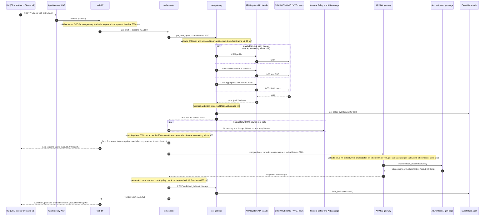
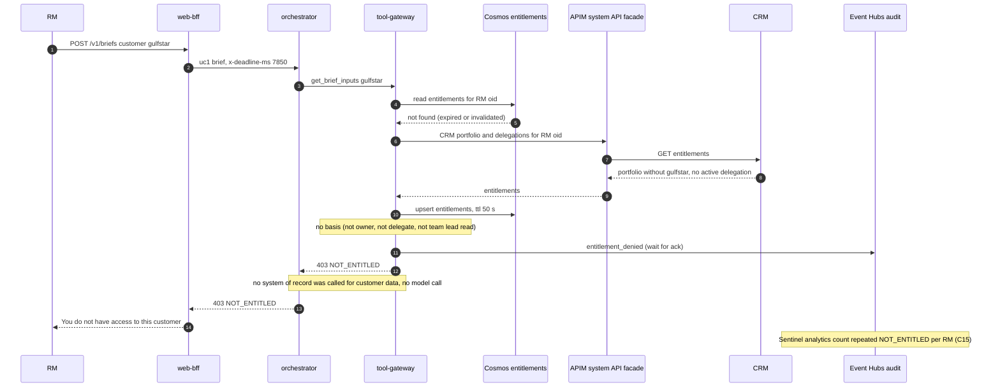
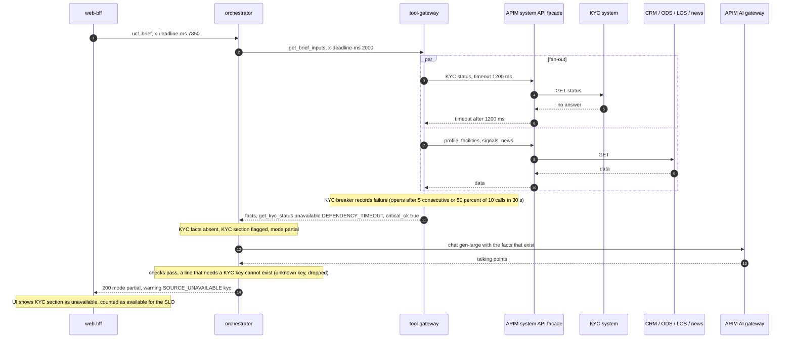
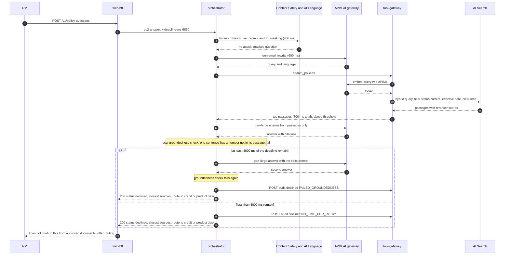
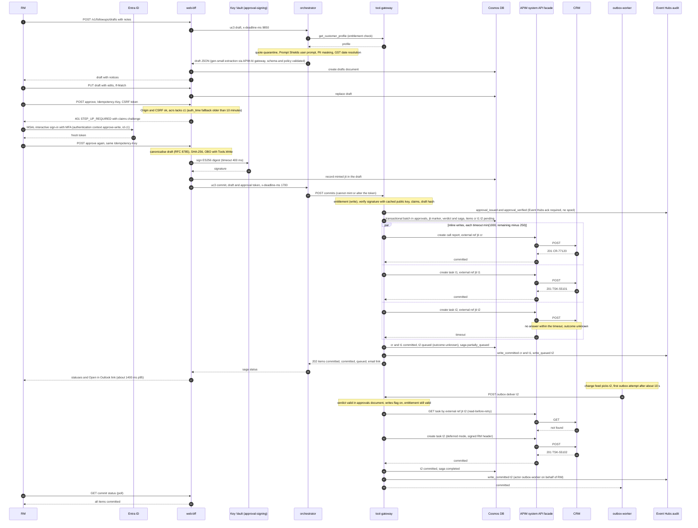
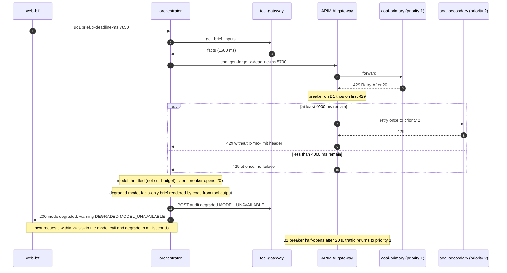
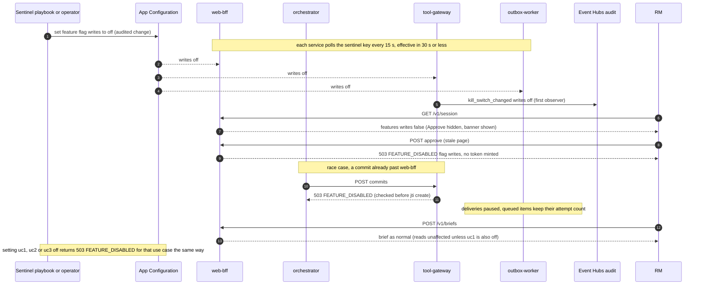

# SME RM Copilot on Azure: low-level design (LLD)

Status: **v1.2 (workstream B1, aligned to plan v2.4 after the ARB review, `07-review-log.md`; v2.6 additions for agents, the MCP gateway, agent identities and memory in §15 and §16; v2.7 evaluation in §17 and runtime operations metrics in §11.4 and §11.8)** · Contract: [`00-plan.md`](00-plan.md) v2.7 · Date: 26 Nov 2026 · Audience: engineering, security, platform, MRM

This document is the build specification for the services in `00-plan.md` §3.2. It uses the plan's names,
numbers and decisions. Where the plan is silent the LLD makes a decision and labels it **[LLD decision]**; where
the plan and an Azure fact may not agree the item is labelled **[confirm]** and listed in §14. Everything is
fictional and unbranded ("the Bank"); figures are illustrative, in AED, UAE-style context. Policy XML, KQL and
PromQL are illustrative and must be checked against current product documentation.

Reference code: `code/rm_copilot/` holds the reference logic (entitlement in the tool layer, placeholders and
numeric check, groundedness with retry then decline, quote quarantine, approval-gated writes). The mock-Azure
stack (`code/azmock/`, `code/services/`, workstream C) implements these contracts behind the same REST shapes;
`00-plan.md` wins over this LLD, and both win over the prototype on any conflict (differences found are in §14.3).

Contents

1. Conventions
2. Services
3. Tool contracts
4. Approval token
5. Write saga and outbox
6. Data design
7. AI gateway and system API facade (APIM) policies
8. Prompt and model management
9. Guardrail pipeline
10. Sequence diagrams
11. Observability specification
12. Security controls mapping
13. Traceability matrix (C1 to C29)
14. Open items, [confirm] list and plan inconsistencies
15. Agents, MCP gateway and identities (plan §3.7, v2.6)
16. Memory (plan §3.8, v2.6)
17. Evaluation (plan §3.9, v2.7)

---

## 1. Conventions

### 1.1 API style

| Rule | Value |
|---|---|
| Style | REST over HTTPS, JSON bodies (`application/json; charset=utf-8`), UTF-8, no HTTP/1.0 |
| Versioning | Major version in the path: `/v1/...` (RM-facing, via `web-bff`), `/internal/v1/...` (service to service), `/admin/v1/...` (operator, private admin ingress only). Additive changes (new optional fields, new enum values in responses) are non-breaking. A breaking change creates `/v2` and the old version gets `Deprecation` and `Sunset` response headers for at least 90 days |
| Tool contracts | Versioned separately with semver (`get_facilities@1.1.0`), see §3. Callers send the major version they accept; `tool-gateway` returns the exact version, which goes into audit lineage |
| Request validation | Every inbound body is validated against a JSON Schema with `additionalProperties: false` on service-to-service and tool inputs. Responses may add fields; clients ignore unknown fields |
| Body limits | 64 KiB per request; UC3 notes ≤ 8,000 characters; UC2 question ≤ 1,000 characters |
| Methods | `GET` (safe, no body), `POST` (create or run), `PUT` with `If-Match` (replace a draft). No `PATCH` in v1 |
| Pagination | **Not applicable.** Every list in v1 is bounded by contract (for example ≤ 5 facilities shown, ≤ 3 news items, ≤ 5 passages, ≤ 10 tasks). An unbounded list is a contract defect |
| Field names | `snake_case`; enum values lower `snake_case`; error codes UPPER_SNAKE_CASE |
| Identifiers | `request_id`: UUIDv7 minted by `web-bff`; `draft_id`, `saga_id`: UUIDv7; `jti`: 128-bit random, base64url; customer ids are CRM ids, never national ids |
| Money | `{"amount": "4600000.00", "currency": "AED"}` (decimal string, never float). Display formatting (`AED 4.6m`) happens only in `orchestrator` placeholder fill, never in the model |

### 1.2 Time and dates (C16)

- Instants (timestamps) are RFC 3339 in UTC with `Z` (`2026-11-26T05:41:09.120Z`) in APIs, storage and audit.
- Business dates (`due`, `meeting_date`, `effective_from`) are ISO dates (`YYYY-MM-DD`) interpreted in **GST
  (IANA `Asia/Dubai`, UTC+04:00, no daylight saving)**. "Today" is always computed in `Asia/Dubai`, never from the pod
  clock's local zone (pods run in UTC).
- Working week Monday to Friday. A task due date that resolves to a Saturday or Sunday is moved to the next
  Monday by the deterministic date resolver and the move is shown to the RM. Bank holidays come from a
  configuration list `rmc:calendar:holidays` (App Configuration) **[confirm source with the Bank]**.
- Business hours for the SLO: Monday to Friday 07:00 to 20:00 GST (03:00 to 16:00 UTC).

### 1.3 Headers

| Header | Direction | Set by | Rule |
|---|---|---|---|
| `Authorization: Bearer <jwt>` | request | caller | RM-facing calls: the RM's Entra token (audience `web-bff`). Service to service: the **caller's workload identity token** (audience = the callee). See §1.5 |
| `x-rm-token` | request (internal) | `web-bff` | The RM's **OBO token for the `tool-gateway` audience**, forwarded unchanged by `orchestrator` to `tool-gateway`, which forwards it to the APIM system API facade on interactive calls. It is **not** sent to the AI gateway. Never logged |
| `x-rm-oid` | request (internal) | `orchestrator` (AI gateway calls); `tool-gateway` (deferred facade writes) | The RM's `oid`, used by the AI gateway only as the per-RM token-quota key and accepted only when the caller's workload token is the orchestrator's (`azp`); on the facade it is accepted only on deferred writes with role `SystemApi.DeferredWrite` (plan §3.3 Gateway, §4.2 step 9). Cost control, not access control. Stripped by APIM before any backend |
| `traceparent`, `tracestate` | both | `web-bff` creates if absent | W3C Trace Context. A client-supplied `traceparent` is accepted only as a link (`rmc.client_trace_id`), never as the parent, to stop trace spoofing |
| `x-request-id` | both | `web-bff` | UUIDv7. A client value is recorded as `client_request_id` only. Echoed on every response, in every log line, span and audit event |
| `x-deadline-ms` | request | `web-bff`, then each hop | **Remaining budget in milliseconds at send time** (relative, like `grpc-timeout`), so pod clock skew does not matter. The receiver computes `deadline_at = receive_time + value`. See §1.6 |
| `x-use-case` | request (internal) | `web-bff` | `uc1` / `uc2` / `uc3_draft` / `uc3_commit` / `meetings` / `eval` / `ingest`. Used for budgets, APIM per-use-case limits and metric labels |
| `Idempotency-Key` | request | client (approve), `orchestrator` (commit) | Required on `POST .../approve` and `POST /internal/v1/commits`. UUIDv4. Same key + same body hash returns the stored response; same key + different body returns `409 IDEMPOTENCY_CONFLICT`. Stored 7 days (plan §7) |
| `If-Match` | request | client | Required on `PUT /v1/followups/drafts/{id}`; value = draft `etag`. Mismatch returns `412 DRAFT_CONFLICT` |
| `x-csrf-token` | request | client | Required on every state-changing RM call. Bound to the session (§2.1). Missing or wrong returns `403 CSRF_FAILED` |
| `Origin` | request | browser | Must be in `rmc:web-bff:allowed_origins`. Otherwise `403 ORIGIN_REJECTED` |
| `x-client-surface` | request | client | `crm_sidebar` / `teams_tab`. Metric label and audit field only |
| `Accept-Language` | request | client | `en` (default) or `ar`. Arabic generation behind flag `arabic` |
| `Retry-After` | response | any | Seconds; set on `429` and on `503` when a retry can help |
| `x-rm-remaining-tokens` | response (internal) | APIM AI gateway | Remaining daily tokens for the RM; read by `orchestrator` for budget decisions, never shown in UI |
| `x-rm-assertion` | request | APIM system API facade only | Signed RM identity for legacy systems of record (§7.2). Stripped if a caller sends it |
| `x-agent-token` (v2.6) | request (internal) | `orchestrator` (one per agent) | The calling agent's app-only token (audience `tool-gateway`), sent on every MCP call next to `Authorization` (workload token) and `x-rm-token` (§15.4). Validated by the APIM MCP gateway and again by `tool-gateway`. Never logged |
| `x-rmc-agent` (v2.6) | request (internal) | `orchestrator` | Agent id (`supervisor`, `brief-agent`, `policy-agent`, `followup-agent`) on AI gateway calls, used only as a metric dimension and per-agent token limit key; accepted only from the orchestrator's `azp`. Not an authorisation input |
| `MCP-Protocol-Version`, `Mcp-Session-Id` (v2.6) | both | MCP client (`orchestrator`), MCP server (`tool-gateway`) | Streamable HTTP transport headers (§15.6) **[confirm protocol version supported by APIM]** |

Headers that must never be logged or put on spans: `Authorization`, `x-rm-token`, `x-agent-token`, `x-rm-assertion`, `Cookie`,
`Set-Cookie`, `x-csrf-token`, `Idempotency-Key` (hash it if needed).

### 1.4 Error envelope and error-code catalogue

Every non-2xx response from every service has the same body:

```json
{
  "error": {
    "code": "APPROVAL_INVALID",
    "reason": "DRAFT_HASH_MISMATCH",
    "message": "The submitted draft does not match the approved draft. Approve again.",
    "request_id": "01937a4e-8f7d-7c1a-9b2e-5d0c1f6a2b3c",
    "retryable": false,
    "retry_after_ms": null,
    "details": {"field": null}
  }
}
```

`code`, `message`, `request_id` and `retryable` are mandatory. `reason` is mandatory for codes that list
reasons. `message` is safe to show to the RM: it never contains customer data, token contents, stack traces or
downstream error text. Upstream errors are mapped, never passed through.

| Code | HTTP | Retryable | Raised by | Meaning and client behaviour |
|---|---|---|---|---|
| `VALIDATION_FAILED` | 400 | no | any | Body or parameter fails schema. `details.field` = JSON pointer. Reasons: `SCHEMA`, `UNKNOWN_FIELD`, `TOO_LARGE`, `BAD_DATE`, `WEEKEND_DATE`, `POLICY_VIOLATION` (a task asks to approve, price or change a limit), `UNSUPPORTED_CONTRACT_VERSION` |
| `UNAUTHENTICATED` | 401 | no | any | Missing, expired or invalid token. Reasons: `MISSING_TOKEN`, `INVALID_TOKEN`, `WRONG_AUDIENCE`, `WRONG_TENANT`, `WORKLOAD_TOKEN_MISSING`, `WORKLOAD_NOT_ALLOWED`, `AGENT_TOKEN_INVALID` (v2.6, missing or invalid `x-agent-token`). Client re-acquires a token silently once |
| `SESSION_EXPIRED` | 401 | no | `web-bff` | Session document gone (24 h TTL) or idle > 8 h **[LLD decision]**. Client reloads the session |
| `STEP_UP_REQUIRED` | 401 | no | `web-bff` | Approve needs the authentication context `approve-write` (`acrs` contains `c1`; fallback: ID token `auth_time` ≤ 10 min, plan §3.4). Response carries `WWW-Authenticate: Bearer error="insufficient_claims", claims="<base64 claims challenge>"`. Client runs MSAL interactive with the claims, then retries the same request with the same `Idempotency-Key` |
| `INSUFFICIENT_SCOPE` | 403 | no | `tool-gateway`, `web-bff` | Token lacks `Tools.Read` / `Tools.Write` or an app role. Not shown to RMs as a normal path |
| `ORIGIN_REJECTED` | 403 | no | `web-bff` | `Origin` not allowed |
| `CSRF_FAILED` | 403 | no | `web-bff` | CSRF token missing or wrong |
| `NOT_ENTITLED` | 403 | no | `tool-gateway` | The RM may not access this customer (or may not write for it: team lead). No data has moved. Counted for C15 analytics. Reason `CLEARANCE` (v2.6): the tool's data class is above the RM's clearance (§15.5) |
| `AGENT_NOT_PERMITTED` (v2.6) | 403 | no | APIM MCP gateway, `tool-gateway` | The agent or workload may not call this tool. Reasons: `TOOL_NOT_ALLOWED` (tool not in the agent's allow-list or role missing), `WORKLOAD_MISMATCH` (agent token presented from a workload not registered for that agent), `UNEXPECTED_ROLES` (agent token carries roles beyond its manifest: over-privilege, C24), `ACTOR_MISMATCH` (user token actor is not the calling agent), `WRITE_TOOL_ON_MCP`. Always a defect or an attack: P1 security alert, never retried. The RM sees `500 INTERNAL` (generic) |
| `APPROVAL_INVALID` | 403 | no | `tool-gateway` | Approval token failed verification. Reasons in §4.6. Client must approve again |
| `NOT_FOUND` | 404 | no | any | Draft, saga or document does not exist **for this RM** (also used instead of 403 for another RM's draft id, to avoid enumeration) |
| `REPLAYED` | 409 | no | `tool-gateway` | `jti` already used by a different request (§4.5). Client shows existing saga status if `details.saga_id` is present |
| `IDEMPOTENCY_CONFLICT` | 409 | no | `web-bff`, `tool-gateway` | Same `Idempotency-Key`, different body |
| `RESUME_CONFLICT` (v2.6) | 409 | no | `orchestrator` | The checkpoint is already `resuming` or `completed` under another `Idempotency-Key` (§16.3). Client shows the existing saga status |
| `DRAFT_CONFLICT` | 412 | no | `web-bff` | `If-Match` etag stale. Client reloads the draft |
| `GUARDRAIL_BLOCKED` | 422 | no | `orchestrator` | Input blocked: Prompt Shields user-prompt attack, harmful content, or content filter on input. Reasons: `PROMPT_ATTACK`, `HARMFUL_CONTENT`, `CONTENT_FILTER`. The message is generic; the RM can rephrase. Counted in the false-positive review |
| `RATE_LIMITED` | 429 | yes | `web-bff`, APIM | Request-rate limit hit (per RM: 30 requests/min **[LLD decision]**; per backend at the facade). `Retry-After` set |
| `BUDGET_EXCEEDED` | 429 | no (until reset) | `orchestrator` (mapping APIM), APIM | Token budget exhausted. Reasons: `RM_DAILY` (400k tokens/RM/day), `USE_CASE` (per-use-case limit), `REQUEST_STEPS` (> 6 tool steps), `REQUEST_TOKENS` (> 12k input or 1.5k output), `HOP_LIMIT` (v2.6: a second handoff, more than 2 agent hops, §15.2), `AGENT_STEPS` (v2.6: an agent's own tool-call budget). `details.resets_at` for `RM_DAILY` (midnight GST **[confirm APIM daily window is UTC or configurable]**) |
| `FEATURE_DISABLED` | 503 | no | `web-bff`, `orchestrator`, `tool-gateway`, `outbox-worker` | Kill switch or feature flag off (`details.flag`). UI shows a banner and hides the action. Not counted against the SLO when set by an operator (counted separately) |
| `DEPENDENCY_UNAVAILABLE` | 503 | yes | any | Circuit open or dependency down and no degraded path exists (for example Cosmos down during commit). Reasons: `CIRCUIT_OPEN`, `AUDIT` (neither Event Hubs nor the Cosmos `audit-spool` acknowledged, or Event Hubs did not acknowledge `approval_verified` on a commit, so nothing was released or written), `ENTITLEMENT_SOURCE`, `KEY_VAULT`, `STATE_STORE`. `Retry-After` set |
| `DEPENDENCY_TIMEOUT` | 504 | yes | any | A required dependency did not answer within its deadline-derived timeout and no degraded path exists |
| `DEADLINE_EXCEEDED` | 504 | yes | any | The request's own deadline (`x-deadline-ms`) had expired on arrival or before work started (fail fast, no downstream call) |
| `TOOL_SCHEMA_MISMATCH` (v2.6) | 500 | no | `orchestrator` (MCP client), `tool-gateway` | A tool definition's hash (name, description, input and output schema) differs from the pin in App Configuration (§15.3, C25). The tool is refused for every caller until the pin and the served definition agree; P1 security alert |
| `INTERNAL` | 500 | yes | any | Unexpected. Message generic; exception text scrubbed (C5) |

**Degraded is not an error.** A degraded answer is `200` with `"mode": "degraded"` and a warning entry:

```json
{"mode": "degraded", "warnings": [{"code": "DEGRADED", "reason": "MODEL_UNAVAILABLE", "message": "Wording unavailable: facts only."}]}
```

`DEGRADED` reasons: `MODEL_UNAVAILABLE` (breaker open, 429 with no failover budget, 5xx), `MODEL_DEADLINE`
(remaining budget below the minimum viable generation budget, §1.6), `FORCED` (flag `degraded_force`),
`ALL_LINES_DROPPED` (UC1: every model line failed checks; facts-only brief). A partial brief is also `200`:
`"mode": "partial"` with `warnings[{code:"SOURCE_UNAVAILABLE", section:"kyc"}]`. A UC2 decline is `200` with
`"status": "declined"`. Both count as "available" for the SLO (`00-plan.md` §5).

### 1.5 Identity and tokens on every hop (C4)

App registrations **[LLD decision on names]**:

| App registration | Exposes | Consumers |
|---|---|---|
| `rmc-client` (SPA, public client) | n/a | CRM sidebar (MSAL.js), Teams tab (Teams SSO, `getAuthToken`) |
| `rmc-web-bff` (`api://rm-copilot-web-bff`) | delegated scope `Copilot.Use`; user app roles `RmCopilot.RM`, `RmCopilot.TeamLead` | `rmc-client` |
| `rmc-orchestrator` (`api://rm-copilot-orchestrator`) | app role `Orchestrator.Invoke` | `web-bff` workload identity |
| `rmc-tool-gateway` (`api://rm-copilot-tool-gateway`) | delegated scopes `Tools.Read`, `Tools.Write`; app roles `Tools.Invoke` (orchestrator), `Outbox.Deliver` (outbox-worker), `Audit.Append` (orchestrator, web-bff via orchestrator), `Ops.Outbox` (operators, PIM), user app roles `Clearance.Internal`, `Clearance.Restricted`, `RmCopilot.TeamLead` | `web-bff` (OBO), `orchestrator`, `outbox-worker`, operators |
| `rmc-ai-gateway` (`api://rm-copilot-ai-gateway`) | app roles `AiGateway.Generate`, `AiGateway.Embed`, `AiGateway.Judge` | `orchestrator` (Generate), `tool-gateway` and `ingestion-worker` (Embed), `eval-runner` (Generate, Embed, Judge) |
| `rmc-system-api` (`api://rm-copilot-system-api`) | app roles `SystemApi.Read`, `SystemApi.Write`, `SystemApi.DeferredWrite` | `tool-gateway` only |
| `rmc-audit-admin` (`api://rm-copilot-audit-admin`) | app roles `Audit.Verify` (auditors), `Audit.Erase` (data protection officer, PIM, four-eyes) | `audit-writer` admin endpoints |
| `rmc-tool-gateway` agent app roles (v2.6) | app roles `Tools.CustomerData.Read`, `Tools.CustomerData.Profile`, `Tools.PolicySearch`, `Tools.CrmDrafts.Create`, `Tools.Memory.Recall`; operator role `Ops.Replay` (PIM, checkpoint replay, §16.3) | agent identities (§15.2), operators |
| `rmc-agent-supervisor`, `rmc-agent-brief`, `rmc-agent-policy`, `rmc-agent-followup` (v2.6) | nothing exposed; each is a client holding the agent app roles above. Entra Agent ID agent identities where available, else app registrations with a service principal **[confirm, plan §10 item 12]**. Only credential: a federated identity credential trusting the managed identity `id-rmc-orchestrator` (no secrets, no certificates) | `orchestrator` (§15.4) |

Workload identities: one user-assigned managed identity per service, federated to its Kubernetes service account
(`id-rmc-web-bff`, `id-rmc-orchestrator`, `id-rmc-tool-gateway`, `id-rmc-outbox-worker`, `id-rmc-ingestion-worker`,
`id-rmc-audit-writer`, `id-rmc-eval-runner`). Workload tokens are app-only: `tool-gateway` and APIM require the
optional claim `idtyp = app` on the workload token and `idtyp = user` (or presence of `scp`) on the RM token, so a
user token can never be presented as a workload token and vice versa **[confirm `idtyp` optional claim
configuration]**.

Token on each hop:

| Hop | `Authorization` | `x-rm-token` |
|---|---|---|
| client → `web-bff` | RM token, `aud=api://rm-copilot-web-bff`, `scp` contains `Copilot.Use`, role `RmCopilot.RM` or `RmCopilot.TeamLead` | n/a |
| `web-bff` → `orchestrator` | `web-bff` workload token, `aud=api://rm-copilot-orchestrator`, role `Orchestrator.Invoke` | OBO token, `aud=api://rm-copilot-tool-gateway`, `scp=Tools.Read` (approve: `Tools.Read Tools.Write`) |
| `orchestrator` → `tool-gateway` (v2.6: commit, audit, saga status and the meetings list only; agent tools go through the MCP gateway) | `orchestrator` workload token, `aud=api://rm-copilot-tool-gateway`, role `Tools.Invoke` | forwarded unchanged |
| `orchestrator` → APIM AI gateway | `orchestrator` workload token, `aud=api://rm-copilot-ai-gateway`, role `AiGateway.Generate` | not sent; `x-rm-oid` = RM `oid` (quota key, accepted only from the orchestrator's `azp`) |
| `tool-gateway` → APIM system API facade | `tool-gateway` workload token, `aud=api://rm-copilot-system-api` | forwarded unchanged on interactive calls; absent on outbox deliveries (`SystemApi.DeferredWrite`) |
| `tool-gateway` → Graph | OBO token (second hop, from the validated `x-rm-token`) for Graph, `Calendars.ReadBasic` only (C20); `tool-gateway` owns the call (plan v2.3) | n/a |
| `outbox-worker` → `tool-gateway` | `outbox-worker` workload token, role `Outbox.Deliver` | absent (RM not present; authority = persisted verdict, §5) |
| `orchestrator` agent → APIM MCP gateway → `tool-gateway` MCP servers (v2.6) | `orchestrator` workload token, role `Tools.Invoke`; plus `x-agent-token` (agent app token with its tool roles) | forwarded unchanged (§15.4) |

`tool-gateway` derives the RM **only** from the `oid` of a validated `x-rm-token` (checks `iss`, `aud`, `tid`,
`exp`, `nbf`, `scp`). Any `rm_id`, `oid` or `user` field in a body or other header is ignored and, if present on a
tool input, rejected as `VALIDATION_FAILED/UNKNOWN_FIELD`.

### 1.6 Deadline propagation rule

From `00-plan.md` §5: `web-bff` sets the request deadline; each hop's timeout =
`min(own cap, remaining deadline − reserve)`. Concretely:

```text
on receive:   deadline_at = now() + header["x-deadline-ms"]        # relative header, local clock only
              if deadline_at - now() <= 0: return 504 DEADLINE_EXCEEDED (no downstream call)
before call:  remaining = deadline_at - now()
              timeout   = min(cap[dep], remaining - reserve[hop])
              if timeout < floor[dep]: skip call -> treat as DEPENDENCY_TIMEOUT for that dependency (fail fast)
              send with header x-deadline-ms = timeout
```

| Request | Deadline set by `web-bff` | `web-bff` reserve | Orchestrator reserve after generation | Min viable generation budget |
|---|---|---|---|---|
| UC1 brief | 8,000 ms | 150 ms | 300 ms (fill + numeric + policy checks + response) | 2,500 ms |
| UC2 answer | 7,000 ms | 150 ms | 500 ms (groundedness 400 + response) | 2,000 ms |
| UC3 draft | 10,000 ms | 150 ms | 300 ms (schema + policy validation) | 3,000 ms |
| UC3 commit | 2,000 ms | 150 ms | 50 ms | n/a (no model) |
| meetings list | 2,000 ms | 150 ms | 50 ms | n/a |

| Dependency | Cap | Floor | Reserve at caller |
|---|---|---|---|
| Tool call (orchestrator → tool-gateway) | 2,000 ms (plan) | 150 ms | min viable generation budget + post-generation reserve of the use case (UC1: 2,500 + 300 = 2,800 ms, so UC1 tool calls get `min(2,000, remaining − 2,800)`) |
| System of record via facade (tool-gateway → APIM → SoR) | CRM 1,500; ODS 1,500; LOS 1,500; KYC 1,200; news 1,000; Graph 800 | 100 ms | 100 ms (masking + audit ack) |
| AI Search query | 600 ms | 100 ms | 100 ms |
| Embedding (query) | 300 ms | 100 ms | 100 ms |
| Model generation (orchestrator → APIM AI gateway) | = remaining deadline (plan) | min viable generation budget | post-generation reserve |
| Router / rewrite (`gen-small`) | 1,000 ms | 300 ms | min viable generation budget + post reserve |
| Content Safety Prompt Shields | 500 ms | 100 ms | n/a (parallel) |
| AI Language PII | 500 ms | 100 ms | n/a (parallel); regex fallback always runs |
| Key Vault `sign` (approve) | 400 ms | 100 ms | 150 ms |
| Cosmos point read / create | 300 ms | 50 ms | 50 ms |
| Event Hubs send (audit, waits for ack) | 300 ms | 50 ms | n/a |

Failover to the second model backend happens **only if ≥ 4,000 ms remain** (enforced in the APIM retry condition,
§7.1); otherwise degraded mode (C3).

UC3 commit budget (p95, ms; the plan gives only the 2,000 ms target) **[LLD decision]**:

| Step | p95 |
|---|---|
| Edge + `web-bff` checks (Origin, CSRF, session, flags, `acrs` / `auth_time`) | 60 |
| OBO for `Tools.Read Tools.Write` (usually a cache miss on approve) | 150 |
| Schema validation, RFC 8785 canonicalisation, SHA-256 | 10 |
| Key Vault `sign` | 100 |
| `orchestrator` hop | 30 |
| `tool-gateway` verify (entitlement cached, signature, claims, hash) | 30 |
| Cosmos: one transactional batch in `approvals` (`jti` marker, verdict and saga, outbox items) | 60 |
| Event Hubs ack of `approval_verified` (required before CRM writes) | 30 |
| CRM writes in parallel (timeout `min(1,000, remaining − 250)`, else queued) | 900 |
| Responses back to the RM | 60 |
| **Total** | **≈ 1,430 (target 2,000)** |

### 1.7 Resilience defaults (all services) [LLD decision]

| Setting | Default | Override |
|---|---|---|
| Circuit breaker scope | Per pod, per dependency | n/a |
| Breaker opens when | ≥ 50% failures in a 30 s rolling window with ≥ 10 calls, or 5 consecutive failures. Failures = timeout, connection error, 5xx, 429 | CRM writes: 3 consecutive failures |
| Open duration | 30 s, then half-open with 2 trial calls | CRM: 60 s; AI gateway: handled by APIM pool breaker (§7.1) plus a client breaker of 20 s |
| Retries (reads) | At most 1, only on connection reset or 503 before any response bytes, only if `remaining ≥ 2 × p95(dep)` and breaker closed. **Never retry a timeout** (it amplifies load) | Model calls: no client retry (APIM owns failover) |
| Retries (writes) | **None inline.** A write that times out or returns 5xx goes to the outbox (§5) | n/a |
| Bulkhead (max in-flight per pod) | ODS 10, CRM 10, LOS 10, KYC 5, news 5, Graph 5, AI Search 10, AI gateway 20 | n/a |
| Backoff | Exponential with full jitter (§5.3 for outbox) | n/a |

---

## 2. Services

All services run in AKS namespace `rm-copilot`, Python 3.12 (FastAPI / uvicorn or equivalent), expose
`GET /healthz/live`, `GET /healthz/ready` (ready = config loaded, keys cached, breakers initialised) and
`GET /metrics` on a separate port `9090` (scraped by PodMonitor, not routed through ingress). All use pod topology
spread across 3 zones (`maxSkew: 1`), a PodDisruptionBudget of `minAvailable: 2` for 3-replica services, read-only
root filesystem, non-root user, no service account token automount except where workload identity needs it, and
Cilium network policies with default deny (allowed edges listed per service).

Common App Configuration conventions: key prefix `rmc:<service>:`, label = environment (`dev`, `test`,
`preprod`, `prod`). Refresh via sentinel key `rmc:sentinel` polled every **15 s**, so a kill switch takes effect
in ≤ 30 s **[LLD decision]**. Feature flags use the App Configuration feature-flag schema
(`.appconfig.featureflag/<name>`). If App Configuration is unreachable at start, the pod is not ready; if it
becomes unreachable later, the last loaded values stay in force, except that the **write kill switch fails
closed**: if `writes` has not been refreshed for > 15 min, writes are treated as disabled (plan §3.3 Config).

| Feature flag | Default (prod) | Checked by |
|---|---|---|
| `uc1`, `uc2`, `uc3` | on | `web-bff` (hide action), `orchestrator` (enforce) |
| `writes` (global write kill switch) | on | `web-bff`, `tool-gateway` (enforce), `outbox-worker` (pause) |
| `outbox_delivery` | on | `outbox-worker` |
| `degraded_force` (per use case filter) | off | `orchestrator` |
| `news` | on | `tool-gateway` |
| `facts_first` (UC1 early release of tool-only sections) | on | `web-bff`, `orchestrator` |
| `arabic` | off (pilot: evaluated only) | `orchestrator` |
| `model_canary` (targeting filter by RM group) | off | `orchestrator` (§8.5) |
| `online_eval` | off | `orchestrator`, `eval-runner` |
| `cs_groundedness` (Content Safety groundedness, only if in-region) | off **[confirm]** | `orchestrator` |

### 2.1 `web-bff`

**Responsibilities.** Single backend for the CRM sidebar and the Teams personal tab (C1). Validates the RM token,
creates the session, issues CSRF tokens, enforces Origin and CSRF, sets `x-request-id`, `traceparent` and the
deadline, gets OBO tokens for `tool-gateway`, applies per-RM request rate limits, checks feature flags, enforces
step-up on approve (authentication context `approve-write`, `acrs` contains `c1`), canonicalises and hashes the approved draft and mints the ES256 approval
token with Key Vault `sign` (§4). Sets security headers: strict CSP (`default-src 'self'; img-src 'self';
connect-src 'self'; frame-ancestors <CRM origin> https://teams.microsoft.com https://*.teams.microsoft.com
https://*.cloud.microsoft` **[confirm current Teams frame-ancestors list]**), `X-Content-Type-Options: nosniff`,
`Referrer-Policy: no-referrer`. Never renders model output as HTML or Markdown (C19): responses are plain text
fields; the client renders them as text nodes.

**Endpoints (RM-facing, through Application Gateway WAF).**

`GET /v1/session`: creates or refreshes the session, returns the CSRF token and the flags the UI needs.

```json
// 200
{
  "session_id_hint": "s-7f3a",
  "csrf_token": "b64url-32-bytes",
  "rm": {"display_name": "Layla H.", "roles": ["RmCopilot.RM"]},
  "features": {"uc1": true, "uc2": true, "uc3": true, "writes": true, "arabic": false},
  "server_time": "2026-11-26T05:40:00Z",
  "business_date_gst": "2026-11-26"
}
```

Session cookie: `__Host-rmc-sid` (`Secure; HttpOnly; SameSite=None; Path=/`), because the app is framed by CRM and
Teams; the CSRF token (stored hashed in the session document) is therefore mandatory on state changes.

`GET /v1/meetings?days=2`: upcoming meetings to brief (via orchestrator, tool `get_upcoming_meetings`).

```json
// 200
{"meetings": [{"meeting_id": "AAMk...hash", "start": "2026-11-26T06:00:00Z", "subject_masked": "Review with Harbourline", "customer_id": "harbourline", "match": "crm_contact_email"}]}
```

`POST /v1/briefs` (UC1)

```json
// request
{"customer_id": "harbourline", "meeting_id": "AAMk...hash"}
// 200
{
  "request_id": "01937a4e-8f7d-7c1a-9b2e-5d0c1f6a2b3c",
  "use_case": "uc1",
  "mode": "full",
  "customer": {"customer_id": "harbourline", "name": "Harbourline Logistics LLC"},
  "snapshot": {"text": "Customer since 2019 · turnover AED 48m · revenue to bank +12% YoY", "sources": ["CRM #4471"]},
  "watch": [
    {"text": "Working-capital line 92% utilised for 45 days (AED 4.6m of AED 5m)", "sources": ["LOS F-209"]},
    {"text": "Trade licence expires 14 Dec 2026", "sources": ["KYC"]}
  ],
  "opportunities": [{"text": "Outbound FX payments up 38% this quarter", "sources": ["ODS signals"]}],
  "talking_points": [
    {"text": "Ask whether the extra need on the working-capital line is seasonal; it has been at 92% for 45 days.", "sources": ["LOS F-209"]}
  ],
  "verification": {"numeric_check": "pass", "policy_check": "pass", "lines_dropped": 0},
  "warnings": [],
  "generated_by": "AI-assisted from bank systems; figures inserted from source systems",
  "audit_event_id": "01937a4e-9000-7b55-8c11-aa0000000001"
}
```

**Facts first (plan §4.1 step 10).** With flag `facts_first` on and `Accept: text/event-stream`, `POST /v1/briefs`
returns a short event stream of **verified sections, never model tokens** (C18, ADR-022): `event: progress` (step
names only), `event: facts` (the `customer`, `snapshot`, `watch` and `opportunities` fields, built by code from
`get_brief_inputs` output, sent as soon as plan step 6 completes, about 1.7 s at p95), then `event: brief` (the
full body above, after step 9 checks) or `event: error`. Clients without event-stream support (or with the flag off)
get the single JSON body. The SLO latency is measured on the final `brief` event.

`POST /v1/policy-questions` (UC2)

```json
// request
{"question": "Can a company trading for 2 years get an unsecured working capital line?", "language": "en"}
// 200 answered
{
  "request_id": "...", "use_case": "uc2", "status": "answered", "mode": "full",
  "answer": "Unsecured SME working capital lines require a minimum of 3 years audited trading history and annual turnover of at least AED 5m [1]. Businesses with less than 3 years trading history may be offered secured facilities only [2].",
  "citations": [
    {"n": 1, "doc_title": "SME Credit Policy v4.2", "clause_ref": "§5.3.1", "chunk_id": "credit-5.3.1", "effective_from": "2026-01-01"},
    {"n": 2, "doc_title": "SME Credit Policy v4.2", "clause_ref": "§5.3.4", "chunk_id": "credit-5.3.4", "effective_from": "2026-01-01"}
  ],
  "verification": {"groundedness": 1.0, "faithfulness": 1.0, "answer_relevancy": 0.86, "context_relevance": 1.0, "attempts": 1},
  "warnings": []
}
// 200 declined
{
  "request_id": "...", "use_case": "uc2", "status": "declined", "mode": "full",
  "decline_reason": "WEAK_RETRIEVAL",
  "message": "I can't confirm this from approved documents. I can route it to the credit or product desk.",
  "closest_sources": [{"doc_title": "Delegation of Authority matrix", "clause_ref": "row 14"}],
  "route_to": ["credit_desk", "product_desk"]
}
```

Decline reasons: `WEAK_RETRIEVAL`, `MODEL_INSUFFICIENT_EVIDENCE`, `FAILED_GROUNDEDNESS`, `LOW_ANSWER_RELEVANCY` (v2.7),
`NO_TIME_FOR_RETRY`. `verification` carries the runtime gate scores of §17.2 (`groundedness` is kept as an alias of
`faithfulness` for existing clients).

`POST /v1/followups/drafts` (UC3 draft)

```json
// request
{"customer_id": "harbourline", "meeting_date": "2026-11-26", "notes": "Met Mr Haddad. Wants 2 more trucks next quarter ..."}
// 201
{
  "draft_id": "01937a50-1111-7000-8000-000000000abc",
  "etag": "\"3\"",
  "schema": "followup/1",
  "mode": "full",
  "draft": {
    "schema": "followup/1",
    "customer_id": "harbourline",
    "meeting_date": "2026-11-26",
    "call_report": {"text": "Met Mr Haddad. Wants 2 more trucks next quarter ...", "opportunity_tags": ["vehicle_finance", "fx_hedging"]},
    "tasks": [
      {"item_id": "t1", "type": "send_document", "title": "Send limit-increase checklist", "due": "2026-11-27"},
      {"item_id": "t2", "type": "internal_referral", "title": "Book intro with the FX desk", "due": "2026-12-03"}
    ],
    "email": {"contact_ref": "crm-contact-88213", "subject": "Follow-up from today's meeting", "body": "Dear Mr Haddad, ..."}
  },
  "notices": [
    {"code": "QUOTE_QUARANTINED", "message": "A quoted instruction in the notes was removed."},
    {"code": "DATE_MOVED", "item_id": "t2", "message": "Due date fell on a weekend; moved to Monday."}
  ],
  "pii_masked": ["national_id"]
}
```

`PUT /v1/followups/drafts/{draft_id}` with `If-Match`: body = full `draft` object (RM edits). Returns the new
`etag`. Re-runs schema and policy validation (no model call). A task failing the policy check returns
`400 VALIDATION_FAILED/POLICY_VIOLATION` with `details.field = "/tasks/1/title"`.

`POST /v1/followups/drafts/{draft_id}/approve` (approve + commit, one RM click) with `Idempotency-Key`,
`x-csrf-token`, `If-Match`.

```json
// request
{"etag": "\"4\""}
// 200 (all items committed) or 202 (some items queued)
{
  "saga_id": "Xq3v9Kd2Q0yB5nT1ZsPq8w",
  "status": "partially_queued",
  "items": [
    {"item_id": "cr", "kind": "call_report", "state": "committed", "crm_ref": "CR-77120", "external_ref": "Xq3v9Kd2Q0yB5nT1ZsPq8w:cr"},
    {"item_id": "t1", "kind": "task", "state": "committed", "crm_ref": "TSK-55101", "external_ref": "Xq3v9Kd2Q0yB5nT1ZsPq8w:t1"},
    {"item_id": "t2", "kind": "task", "state": "queued", "external_ref": "Xq3v9Kd2Q0yB5nT1ZsPq8w:t2", "next_attempt_at": "2026-11-26T05:52:10Z"}
  ],
  "email_link": {"kind": "outlook_compose", "url": "https://outlook.office.com/mail/deeplink/compose?to=...&subject=...&body=..."}
}
```

Errors: `401 STEP_UP_REQUIRED`, `403 APPROVAL_INVALID`, `409 REPLAYED`, `412 DRAFT_CONFLICT`,
`503 FEATURE_DISABLED` (`writes` off), `503 DEPENDENCY_UNAVAILABLE` (Key Vault or Cosmos down).

`GET /v1/followups/commits/{saga_id}`: current per-item status (polled by the UI every 10 s while any item is
`queued`, max 30 min, then on demand).

**Approve algorithm in `web-bff`** (detail of `00-plan.md` §4.2 steps 5 and 6):

1. Check `Origin`, CSRF, session, `If-Match`, flag `writes` and `uc3`.
2. Read the RM token: require `acrs` contains `c1` (Conditional Access authentication context `approve-write`, MFA,
   sign-in frequency 10 min). Fallback where `acrs` is not issued on the access token: the ID token presented with
   the approve request has `auth_time` ≥ `now − 600 s` (plan §3.4) **[confirm `acrs` on access tokens, the
   authentication context id and Teams tab popup support, plan §10 item 8]**. Else `401 STEP_UP_REQUIRED` with the
   claims challenge `{"access_token":{"acrs":{"essential":true,"value":"c1"}}}`.
3. Load the draft (Cosmos `drafts`, point read with partition key `rm_oid` = token `oid`), check `etag`.
4. Server-side schema validation of the draft (`followup/1`), then RFC 8785 canonicalisation and SHA-256 (§4.2).
5. OBO for `api://rm-copilot-tool-gateway/Tools.Read Tools.Write` using the fresh RM token.
6. Mint the approval token (§4.3) with Key Vault `sign` (timeout `min(400, remaining − 150)`); record
   `approval.minted = {jti, kid, iat, draft_sha256}` in the draft document.
7. Call `orchestrator POST /internal/v1/uc3/commit` with draft, token and `Idempotency-Key`.
8. Return the saga status. Store the response under the idempotency key.

**Auth.** Inbound: RM token, issuer `https://login.microsoftonline.com/{tid}/v2.0`, `aud=api://rm-copilot-web-bff`,
`tid` = Bank tenant, `scp` contains `Copilot.Use`, app role `RmCopilot.RM` or `RmCopilot.TeamLead` (team lead:
read-only UI, no UC3). Outbound: OBO (confidential client using its federated workload identity credential, no
client secret **[confirm OBO with federated credential]**); workload token for `orchestrator`; Key Vault
custom role with `keys/sign/action` and `keys/read` on key `approval-signing` only.

**Dependencies.**

| Dependency | Timeout | Retries | Breaker | On failure |
|---|---|---|---|---|
| Entra ID (OBO, JWKS) | 1,000 ms (OBO miss), JWKS cached 24 h, refreshed on unknown `kid` | 1 on connection error | default | `503 DEPENDENCY_UNAVAILABLE` |
| `orchestrator` | `remaining − 150` | 0 | default | map error envelope through |
| Key Vault `sign` | `min(400, remaining − 150)` | 1 on 429/503 if `remaining ≥ 800` | default | `503 DEPENDENCY_UNAVAILABLE`; no token minted |
| Cosmos (`sessions`, `drafts`) | 300 ms | SDK retry on 429 within deadline | default | `503 DEPENDENCY_UNAVAILABLE` |
| App Configuration | background refresh | n/a | n/a | last known values; writes fail closed after 15 min stale |

**Scaling.** 3 replicas minimum (one per zone), HPA max 6 (pilot) / 12 (scale) on CPU 60% or KEDA Prometheus
trigger `sum(rmc_http_server_inflight_requests{service="web-bff"}) / replicas > 20`. Illustrative resources:
requests `250m` CPU / `512Mi`, limits `1` CPU / `1Gi`. Separate node pool `signer` (taint
`rmc/role=signer:NoSchedule`) so the signing identity never shares a node with the verifier (C11).

**Configuration keys.** `rmc:web-bff:allowed_origins`, `rmc:web-bff:deadline_ms:{uc1|uc2|uc3_draft|uc3_commit}`
(8000/7000/10000/2000), `rmc:web-bff:reserve_ms` (150), `rmc:web-bff:step_up:max_auth_age_s` (600),
`rmc:web-bff:step_up:auth_context` (`c1`), `rmc:web-bff:approval:ttl_s` (300), `rmc:web-bff:approval:key_name`
(`approval-signing`), `rmc:web-bff:approval:active_kid` (pinned version, §4.7), `rmc:web-bff:rate_limit:per_rm_per_min`
(30), `rmc:web-bff:session:idle_timeout_s` (28800).

**Failure behaviour.** Orchestrator unreachable: `503 DEPENDENCY_UNAVAILABLE`, UI shows "use CRM screens".
Key Vault down: approve fails closed (no unsigned path, ever). Session store down: new sessions cannot be created,
`503`.

### 2.2 `orchestrator`

**Responsibilities.** Runs the three use-case workflows (fixed workflows, not open-ended agents): UC1 fan-out and
placeholder fill; UC2 RAG with groundedness, retry once and decline; UC3 extraction and validation; deadline and
budget enforcement (≤ 6 tool steps, ≤ 12k input and 1.5k output tokens per request); guardrails (§9); degraded
mode (C3); calls `tool-gateway` with the RM token unchanged; emits use-case audit events through `tool-gateway`'s
audit endpoint (it holds no Event Hubs or Key Vault rights; plan v2.3: `tool-gateway` is the only audit producer). Holds no keys and no
customer data beyond request scope (no cache of tool output across requests).

**Endpoints (internal, ClusterIP only, callable only by `web-bff` per network policy).**

| Method and path | Purpose |
|---|---|
| `POST /internal/v1/uc1/brief` | `{customer_id, meeting_id?}` → brief (same body as `web-bff` response) |
| `POST /internal/v1/uc2/answer` | `{question, language}` → answer or decline |
| `POST /internal/v1/uc3/draft` | `{customer_id, meeting_date, notes}` → draft (no persistence; `web-bff` stores it) |
| `POST /internal/v1/uc3/commit` | `{draft_id, draft, approval_token}` + `Idempotency-Key` → saga status (pass-through to `tool-gateway`; the orchestrator cannot mint or change the token) |
| `GET /internal/v1/meetings?days=2` | upcoming meetings |

Example `POST /internal/v1/uc1/brief` internal trace of decisions returned in a debug-free form (only metadata):

```json
{
  "...": "same as web-bff brief",
  "internal": {"steps": [
    {"step": "entitlement", "ms": 18, "cache": "hit"},
    {"step": "get_brief_inputs", "ms": 1210, "tools": {"get_customer_profile": "ok", "get_facilities": "ok", "get_kyc_status": "ok", "get_transaction_signals": "ok", "get_news": "timeout"}},
    {"step": "pii_and_shields", "ms": 240},
    {"step": "generate", "deployment": "gen-large", "ms": 3120, "tokens_in": 1840, "tokens_out": 182},
    {"step": "checks", "ms": 21, "dropped": 0}
  ]}
}
```

`web-bff` strips `internal` before responding to the client; it feeds the progress UI ("Fetching facilities ...")
and metrics.

**Auth.** Inbound: workload token `aud=api://rm-copilot-orchestrator`, role `Orchestrator.Invoke`, `azp` = `web-bff`
identity; plus `x-rm-token` present and syntactically a JWT (the orchestrator does not need to trust it; it passes
it on; it reads `oid` only for metric hashing). Outbound: its workload token to `tool-gateway` (role
`Tools.Invoke`, `Audit.Append`) and to APIM AI gateway (role `AiGateway.Generate`); managed identity to Content
Safety and AI Language (Cognitive Services User role scoped to those resources), App Configuration Data Reader.
On AI gateway calls it sends `x-rm-oid` (the `oid` of `x-rm-token`) as the per-RM quota key, never the RM token.

**Dependencies.**

| Dependency | Timeout | Retries | Breaker | On failure |
|---|---|---|---|---|
| `tool-gateway` read tools | `get_brief_inputs` (UC1): `min(2,000, remaining − 2,800)`; other tools: `min(2,000, remaining − reserve − min_gen)` | per §1.7 | per tool | non-critical source (LOS facilities, ODS transactions, KYC, news): section flagged, `mode=partial`; the only critical source is the CRM profile: `503`/`504` mapped (plan §4.1 step 5) |
| `tool-gateway` `search_policies` | `min(1,000, remaining − 2,500)` | 0 | yes | UC2 `503 DEPENDENCY_UNAVAILABLE` (no answer without retrieval) |
| APIM AI gateway `gen-large` | `remaining − post_reserve` (≥ min viable budget, else skip) | 0 in client; APIM retries to backend 2 only if ≥ 4 s remain | client breaker 20 s | degraded mode |
| APIM AI gateway `gen-small` (router, rewrite, extract) | rewrite: `min(1,000, ...)`; extract: `remaining − 300` | 0 | yes | UC2 rewrite failure: use the raw masked question; UC3 extract failure: degraded (manual call report) |
| Content Safety Prompt Shields | 500 ms | 0 | yes | local injection rules decide (C2 floor) and `rmc_guardrail_fallback_total{service="content-safety"}` increments. UC1 and UC2: continue. UC3: continue with quote quarantine and a visible notice "safety check unavailable, review quoted text" (every draft is reviewed by the RM before approval) **[LLD decision]** |
| AI Language PII | 500 ms | 0 | yes | regex masking always runs; on AI Language failure, person names are masked by the CRM-known names list for the customer (contact names from profile) |
| App Configuration | background | n/a | n/a | last known values |

**Scaling.** 3 to 6 replicas (pilot), 3 to 12 (scale). HPA on CPU 60% and KEDA Prometheus trigger on
`rmc_http_server_inflight_requests{service="orchestrator"}` > 15 per pod (requests are I/O bound and long).
Illustrative resources: requests `500m` / `1Gi`, limits `2` / `2Gi`. Node pool `core`.

**Configuration keys.** `rmc:orchestrator:model:{gen-large|gen-small|embed}:deployment` (deployment names,
§8.2), `rmc:orchestrator:model:canary:deployment`, `rmc:orchestrator:prompt:{template_id}` (pinned version,
§8.1), `rmc:orchestrator:budget:max_tool_steps` (6), `rmc:orchestrator:budget:max_input_tokens` (12000),
`rmc:orchestrator:budget:max_output_tokens` (1500), `rmc:orchestrator:min_gen_ms:{uc1|uc2|uc3}`
(2500/2000/3000), `rmc:orchestrator:post_reserve_ms:{uc1|uc2|uc3}` (300/500/300),
`rmc:orchestrator:uc2:retry_min_remaining_ms` (4000), `rmc:orchestrator:guardrail:version` (e.g. `guardrails/2026.11.2`),
`rmc:orchestrator:guardrail:pii_min_confidence` (0.8). v2.7: the retrieval and groundedness thresholds
(`rmc:orchestrator:uc2:min_reranker_score`, `rmc:orchestrator:uc2:relative_keep`, `rmc:orchestrator:groundedness:min_support`)
are replaced by the runtime gate keys `rmc:orchestrator:gate:*` (§17.2); stage budgets
`rmc:orchestrator:stage_budget_ms:*` and the price table `rmc:finops:*` (§11.8).

**Failure behaviour.** See §9 and §10. Summary: model problems → degraded mode (UC1 facts-only, UC2 ranked passages
without a generated answer, UC3 manual call report form); entitlement denied → `403 NOT_ENTITLED` with no model
call; budget exceeded → `429 BUDGET_EXCEEDED`; nothing unverified is ever returned (C18).

**v2.6 changes (plan §3.7, §3.8).** The workflows above run as agent graphs: `supervisor` plus one specialist
(§15.1, §15.2). New endpoint `POST /internal/v1/threads/{thread_id}/resume` (caller `web-bff`, `Idempotency-Key`
required) resumes an interrupted UC3 thread after approval (§16.3); `POST /internal/v1/uc3/commit` remains as the
cold-resume path. Additional outbound rights: Entra token requests for the four agent identities (federated
credential from `id-rmc-orchestrator`, §15.4); APIM MCP gateway with workload token plus agent token; Cosmos
data-plane RBAC on `checkpoints` only (read, create, replace); Key Vault `wrapKey` and `unwrapKey` (no `sign`, no
`get` of private material) on the per-customer content keys for checkpoint encryption (§16.2) **[LLD decision; plan
§3.3 Keys lists the orchestrator as "none", see §14.2 item 16]**. Configuration keys added:
`rmc:orchestrator:agent:<agent_id>` (agent manifest version), `rmc:orchestrator:graph:<graph_id>` (graph version),
`rmc:orchestrator:max_hops` (2), `rmc:mcp:pins:<server>:<tool>` (tool definition pin, §15.3),
`rmc:orchestrator:session:max_turns` (6), `rmc:orchestrator:session:context_tokens` (1500).

### 2.3 `tool-gateway`

**Responsibilities.** The security boundary (C4). Validates both tokens on every call; entitlement check first
(cache ≤ 60 s); calls systems of record through the APIM system API facade; minimises and masks fields; returns
facts with source references; policy search (query embedding via APIM AI gateway, AI Search hybrid query with
mandatory filters); write API that verifies the approval token with the public key only; jti replay store;
saga and outbox; the **only** audit producer (Event Hubs, waits for ack; Cosmos `audit-spool` as fallback, §6.4);
owns the Graph calendar call (`get_upcoming_meetings`) and the UC1 fan-out (`get_brief_inputs`); consumes portfolio
change events to invalidate the entitlement cache.

**Endpoints.**

| Method and path | Caller | Purpose |
|---|---|---|
| `POST /v1/tools/{tool_name}` | `orchestrator` | Invoke a read tool (§3). Body `{"contract_major": 1, "input": {...}}` |
| `POST /internal/v1/commits` | `orchestrator` | Verify approval and run the write saga (§4, §5) |
| `GET /internal/v1/commits/{saga_id}` | `orchestrator` | Saga status (RM must be the saga's `sub`) |
| `POST /internal/v1/audit` | `orchestrator` | Append a use-case audit event (`brief_built`, `answer_released`, `declined`, `followup_drafted`, `degraded`). `tool-gateway` stamps actor from `x-rm-token`, validates schema, sends to Event Hubs |
| `POST /internal/v1/outbox/deliver` | `outbox-worker` | Deliver one outbox item using the persisted verdict (§5.4) |
| `GET /admin/v1/outbox?state=poison` | operator (role `Ops.Outbox`, PIM) | List poison items (metadata only) |
| `POST /admin/v1/outbox/{item_id}/retry` | operator | Reset to `queued`, attempt now (audited) |
| `POST /admin/v1/outbox/{item_id}/resolve` | operator + second operator approval | Mark `committed_manually` with a CRM reference (four-eyes, audited) |
| `POST /admin/v1/outbox/{item_id}/cancel` | operator | Mark `cancelled`; RM notified in UI (audited) |

Tool invocation example:

```json
// POST /v1/tools/get_facilities
{"contract_major": 1, "input": {"customer_id": "harbourline"}}
// 200
{
  "tool": "get_facilities",
  "contract_version": "1.1.0",
  "output": {"facilities": [
    {"facility_id": "F-209", "type": "working_capital_line", "limit": {"amount": "5000000.00", "currency": "AED"},
     "used": {"amount": "4600000.00", "currency": "AED"}, "utilisation_pct": 92, "days_above_90_pct": 45, "status": "active"}
  ]},
  "sources": [{"system": "LOS", "ref": "LOS F-209", "as_of": "2026-11-26T04:00:00Z"}],
  "cache": "miss",
  "entitlement": {"basis": "portfolio_owner", "cache": "hit"}
}
```

Commit example (`POST /internal/v1/commits`):

```json
// request
{
  "draft_id": "01937a50-1111-7000-8000-000000000abc",
  "draft": {"schema": "followup/1", "customer_id": "harbourline", "meeting_date": "2026-11-26", "call_report": {"...": "..."}, "tasks": ["..."], "email": {"...": "..."}},
  "approval_token": "eyJhbGciOiJFUzI1NiIsImtpZCI6ImFwcHJvdmFsLXNpZ25pbmcvM2Y5YyIsInR5cCI6InJtLWFwcHJvdmFsK2p3dCJ9.eyJ...In0.MEUC..."
}
// 202: body as in web-bff approve response
```

**Auth.** Inbound: (1) workload token `aud=api://rm-copilot-tool-gateway`, `idtyp=app`, role `Tools.Invoke` (tools,
commits, audit), `Outbox.Deliver` (deliver only); `azp` must match the expected identity for the route. (2)
`x-rm-token`: `iss` = Bank tenant v2 issuer, `aud=api://rm-copilot-tool-gateway`, `tid` = Bank tenant, `exp`/`nbf` with
60 s skew, `scp` contains `Tools.Read` (read tools, audit) or `Tools.Write` (commits). RM = `oid`. Admin routes:
user token with role `Ops.Outbox` and `acrs` contains `c1`, reached only through the private admin ingress.
Outbound: workload token to APIM facade (`SystemApi.Read`, `SystemApi.Write`, `SystemApi.DeferredWrite`) and AI
gateway (`AiGateway.Embed`); OBO to Graph (`Calendars.ReadBasic`); AI Search `Search Index Data Reader` on the
policy index; Cosmos data-plane RBAC (custom role, containers `entitlements`, `approvals`, `idempotency`,
`audit-spool` (create only); v2.6: `drafts` create only (the `crm-drafts` MCP server, partition = token `oid`) and `episodes` create and read (the `memory` server); no access to `sessions`, `checkpoints` or `rm-profile`); Event Hubs `Azure Event Hubs Data Sender` on `audit-events` and `audit-content`, `Azure Event Hubs Data Receiver` on
`crm-portfolio-events` (consumer group `tool-gateway`); Key
Vault custom role with `keys/read` only on `approval-signing` (public key).

**Entitlement check (first step of every customer-scoped tool and of commits).**

```text
entitled(rm_oid, customer_id, mode):          # mode = read | write
  e = in_process_cache.get(rm_oid)            # TTL 10 s
  if not e: e = cosmos.entitlements.read(rm_oid)       # TTL 50 s, deleted on portfolio change event
  if not e: e = facade.crm.get_entitlements(rm_oid) -> cosmos upsert -> in-process put
  basis = owner      if customer_id in e.portfolio
        | delegate   if any d in e.delegations: d.customer_scope covers customer_id and d.from <= now < d.to
        | team_lead  if role RmCopilot.TeamLead and customer_id in e.team_portfolio and mode == read
  if no basis: audit(entitlement_denied); raise 403 NOT_ENTITLED
```

Maximum staleness: 50 s (Cosmos) + 10 s (in-process) = 60 s (plan C22). Portfolio change events: CRM publishes
`portfolio.changed {rm_oid, customer_id, change}` and `delegation.changed` to the APIM API `rmc-crm-events`, which
forwards them to Event Hub `crm-portfolio-events` in the audit namespace (plan §4.1 step 4, §7.3) **[confirm CRM can
emit events, plan §10 item 17]**; consumer group `tool-gateway` deletes the Cosmos document and broadcasts an
in-process invalidation. Lag is measured as `rmc_portfolio_event_lag_seconds` (event time to consumption). If entitlements cannot be resolved (CRM down and no cache) the answer is **deny** with
`503 DEPENDENCY_UNAVAILABLE` (never allow on failure).

**Dependencies.**

| Dependency | Timeout | Retries | Breaker | On failure |
|---|---|---|---|---|
| APIM facade → CRM (reads, entitlements) | `min(1,500, remaining − 100)` | 1 on 503/reset per §1.7 | yes, 60 s open | entitlement: deny (503); profile: 503 |
| APIM facade → CRM (writes) | `min(1,000, remaining − 250)` | 0 | 3 consecutive | item → outbox `queued` |
| APIM facade → ODS | `min(1,500, remaining − 100)` | per §1.7 | yes | signals section flagged |
| APIM facade → LOS | `min(1,500, remaining − 100)` | per §1.7 | yes | facilities section flagged (partial) |
| APIM facade → KYC | `min(1,200, remaining − 100)` | per §1.7 | yes | KYC section flagged (partial) |
| APIM facade → news feed | `min(1,000, remaining − 100)` | 0 | yes | news section flagged (partial) |
| Graph (calendar) | `min(800, remaining − 100)` | 0 | yes | empty meeting list with warning |
| APIM AI gateway `embed` | `min(300, remaining − 100)` | 0 | yes | UC2: keyword-only (BM25 + semantic ranker) search, flagged `retrieval_mode=keyword` |
| AI Search | `min(600, remaining − 100)` | 0 | yes | 503 |
| Cosmos | 300 ms point ops | SDK 429 retry within deadline | yes | reads: entitlement deny; commit: 503 before jti create, or saga recovery after (§5.5) |
| Event Hubs (audit) | 300 ms, waits for ack | 1 within deadline | yes | write the event to Cosmos `audit-spool` (create, 300 ms) and continue; if the spool write also fails: **fail closed**, nothing is released, `503 DEPENDENCY_UNAVAILABLE/AUDIT`. Exception: `approval_verified` on a commit must be acknowledged by Event Hubs itself before any CRM write (ADR-013); otherwise `503` and the draft stays saved |
| Key Vault (public key) | cached per `kid` for 10 min, refreshed on unknown `kid` | 1 | yes | known `kid`s keep verifying from cache; unknown `kid` → `APPROVAL_INVALID/UNKNOWN_KID` |

**Scaling.** 3 to 6 replicas (pilot), 3 to 12 (scale), HPA CPU 60% plus KEDA Prometheus trigger on in-flight
requests > 30 per pod. Illustrative resources: requests `500m` / `768Mi`, limits `2` / `1.5Gi`. Node pool
`verifier` (taint `rmc/role=verifier:NoSchedule`), separate from `signer` (C11).

**Configuration keys.** `rmc:tool-gateway:entitlements:cosmos_ttl_s` (50), `rmc:tool-gateway:entitlements:local_ttl_s`
(10), `rmc:tool-gateway:timeouts:{crm|ods|los|kyc|news|graph|search|embed}_ms`,
`rmc:tool-gateway:approval:allowed_kids` (list, §4.7), `rmc:tool-gateway:approval:clock_skew_s` (30),
`rmc:tool-gateway:approval:max_ttl_s` (300), `rmc:tool-gateway:search:index_name` (e.g. `policies-v3`),
`rmc:tool-gateway:search:top_k` (5), `rmc:tool-gateway:search:candidates` (50),
`rmc:tool-gateway:search:candidate_floor` (1.0, v2.7, §17.2),
`rmc:tool-gateway:contracts:{tool}` (active version), `rmc:tool-gateway:crm_write_timeout_ms` (1000).

**Failure behaviour.** Fails closed on identity, entitlement, approval and audit (audit = neither Event Hubs nor the
spool acknowledged). Fails partial on non-critical sources. Writes never fail silently: every item ends in `committed`, `queued`, `failed` or `cancelled` with an
audit event.

### 2.4 `outbox-worker`

**Responsibilities.** Delivers queued CRM writes from the outbox item documents in the Cosmos `approvals` container
(ADR-019). Picks up new items via the change feed processor (lease container `leases`, filtered to
`type = "outbox_item"`) and due retries via a scheduler query every 15 s
(`type = "outbox_item" AND state IN ("queued","retry_wait") AND next_attempt_at <= now`, cross-partition), because the change feed fires only on writes
**[LLD decision]**. For each item: read-before-retry by external reference, then deliver through
`tool-gateway POST /internal/v1/outbox/deliver`. Applies the backoff schedule and poison rules (§5.3). Also runs
the **saga recovery sweep** (§5.5) and the **unused-approval sweep** (minted tokens never presented: emits
`approval_unused` via the audit endpoint after `exp`).

**Endpoints.** None besides health and metrics. Deliver request it sends:

```json
// POST tool-gateway /internal/v1/outbox/deliver
{"outbox_item_id": "Xq3v9Kd2Q0yB5nT1ZsPq8w:t2", "attempt": 3}
// 200
{"state": "committed", "crm_ref": "TSK-55102", "found_by_read_before_retry": false}
```

**Auth.** Workload token to `tool-gateway`, role `Outbox.Deliver`. Cosmos data-plane role on `approvals` (read,
conditional replace), `leases`, and read-only on `drafts` metadata for the unused-approval sweep. No access to Key
Vault or Event Hubs (audit via `tool-gateway`).

**Dependencies.** `tool-gateway` deliver: timeout 5,000 ms (no RM waiting; CRM cap inside `tool-gateway` 3,000 ms
for deferred writes); breaker per CRM endpoint opens after 3 consecutive failures, 60 s. Cosmos: 1,000 ms.

**Scaling.** 2 replicas (2 zones), no autoscale; change-feed leases spread work; the scheduler query uses a
Cosmos lease document (`leases/scheduler`) with a 30 s lease so only one replica runs it at a time.
Illustrative resources: `100m` / `256Mi`, limits `500m` / `512Mi`.

**Configuration keys.** `rmc:outbox-worker:schedule` (`10s,30s,2m,10m,30m,2h,6h,12h`),
`rmc:outbox-worker:max_attempts` (8), `rmc:outbox-worker:jitter` (`full`), `rmc:outbox-worker:poll_interval_s` (15),
`rmc:outbox-worker:business_hours_only` (false), flags `writes`, `outbox_delivery`.

**Failure behaviour.** Flag off: items stay `queued`, attempts are not consumed, `rmc_outbox_paused` = 1.
`tool-gateway` down: attempt counted as `retryable_failure`. Poison: item `failed`, alert, operator action (§5.6).

### 2.5 `ingestion-worker`

**Responsibilities.** Policy pipeline (`00-plan.md` §3.2): document store → Document Intelligence (layout) → PII
scan → injection scan (Prompt Shields document check, ingestion time) → clause chunking (§6.3) → embeddings via
APIM AI gateway (`embed`) → AI Search; stores chunks and embeddings in Blob (`policy-chunks`) for index rebuild;
marks superseded versions; deletes Document Intelligence results after processing.

**Trigger.** The policy DMS export (through the facade) drops approved documents with a manifest
(`doc_id`, `version`, `status`, `effective_from`, `effective_to`, `classification`, `owner`, `language`) into Blob
container `policy-inbox`. KEDA `azure-blob` scaler on `policy-inbox` (blob count > 0) **[LLD decision]**.

**Endpoints (admin, private admin ingress, role `Ops.Ingestion`).**

| Method and path | Purpose |
|---|---|
| `POST /admin/v1/ingest` | `{"blob": "policy-inbox/credit-policy-v4.2.pdf"}` → `{"job_id": "...", "state": "queued"}` |
| `GET /admin/v1/jobs/{job_id}` | `{"state": "indexed", "chunks": 214, "pii_findings": 0, "injection_findings": 0, "index": "policies-v3"}` |
| `POST /admin/v1/reindex` | `{"target_index": "policies-v4", "embed_deployment": "embed-2026-12"}` rebuild from stored chunks (re-embed if the deployment changed) |
| `POST /admin/v1/documents/{doc_id}/retire` | Set `status=retired` on all chunks of the document |

**Auth.** Workload token to AI gateway (`AiGateway.Embed`); managed identity: Document Intelligence and AI
Language (Cognitive Services User), Content Safety, AI Search `Search Index Data Contributor`, Storage Blob Data
Contributor on `policy-inbox`, `policy-chunks`, `policy-quarantine`.

**Dependencies.** Document Intelligence: async poll, 120 s per document, 2 retries with 10 s / 60 s backoff;
AI Language: 10 s per batch, 2 retries; embeddings: 10 s per batch of 16 chunks, retry on 429 honouring
`Retry-After`, max 5; AI Search upload: batch 100, retry 3. No deadline header (batch work); APIM use case
`ingest` has its own token limit so ingestion never starves RM traffic (C10).

**Scaling.** KEDA 0 to 3 replicas. Illustrative resources: `1` CPU / `2Gi`, limits `2` / `4Gi`.

**Configuration keys.** `rmc:ingestion:chunk:max_tokens` (512), `rmc:ingestion:chunk:min_tokens` (64),
`rmc:ingestion:chunk:split_overlap_pct` (15), `rmc:ingestion:target_index`, `rmc:ingestion:embed_dimensions` (3072),
`rmc:ingestion:pii:action` (`quarantine`).

**Failure behaviour.** Any PII finding above threshold or Prompt Shields document attack → document moved to
`policy-quarantine`, not indexed, owner notified. Partial failures never leave a half-indexed document visible:
chunks are uploaded with `status=staged` and flipped to `current` in one merge batch after all chunks succeed,
together with `superseded` on the previous version.

### 2.6 `audit-writer`

**Responsibilities.** Consumes `audit-events` (metadata) and `audit-content` (envelope-encrypted content) from
Event Hubs, and **drains the Cosmos `audit-spool`** (§6.4); validates schema; appends metadata to the per-partition **hash chain** in immutable Blob (WORM, GZRS);
writes content to the content store encrypted with a per-customer key; sends metadata to the restricted Log
Analytics table `RmCopilotAudit_CL` via the Logs Ingestion API (DCR); writes a signed **seal** every 5 minutes to
the seal store in the separately administered subscription (§6.5, plan §3.3).
Serves auditor verification and the erasure (crypto-shred) operation.

**Endpoints (admin, private admin ingress).**

| Method and path | Role | Purpose |
|---|---|---|
| `POST /admin/v1/chain/verify` | `Audit.Verify` | `{"chain_id": "p2", "from": "2026-11-01T00:00:00Z", "to": "2026-11-26T00:00:00Z"}` → `{"verified": 18233, "breaks": [], "seals_ok": true}` |
| `POST /admin/v1/erasure` | `Audit.Erase` (PIM) + second approver | `{"customer_id": "crescent", "legal_basis_ref": "DPO-2026-114"}` → `{"state": "pending_second_approval"}`, then crypto-shred (§6.6) |
| `GET /admin/v1/erasure/{id}` | `Audit.Erase` | status |

**Auth.** Event Hubs Data Receiver (consumer group `audit-writer`); Storage: data-plane write to `audit-worm`
(append only by immutability policy) and `audit-content`; Key Vault: `unwrapKey` on `audit-transport`, `wrapKey`
/ `unwrapKey` / `create` on per-customer keys in vault `kv-rmc-cust-<env>`, `sign` on `audit-seal`; Cosmos
`audit-spool` (read, delete) and `audit-chain-heads`; seal store container `audit-seals` (create only, granted by
the seal subscription's owner); Logs Ingestion `Monitoring Metrics Publisher` on the DCR.

**Dependencies.** Event Hubs (checkpoint every 100 events or 10 s in Blob `eh-checkpoints`); Blob append 2 s,
retry 5 with backoff; Key Vault 1 s, retry 3; Log Analytics ingestion 5 s, retry with backoff, buffered (the WORM
append is the system of record for audit; Log Analytics lag does not block). Ordering: per partition, sequential.
A failure to append to WORM stops the partition consumer (no skipping); alert `AuditConsumerLag`.

**Scaling.** KEDA `azure-eventhub` scaler on lag (> 500 events), min 2, max 4 (= partitions). Illustrative
resources: `250m` / `512Mi`, limits `1` / `1Gi`.

**Configuration keys.** `rmc:audit-writer:chain:blob_container` (`audit-worm`),
`rmc:audit-writer:chain:seal_interval_min` (5), `rmc:audit-writer:content:retention_days` (365),
`rmc:audit-writer:la:dcr_id`, `rmc:audit-writer:schema_version` (`audit/1`).

**Failure behaviour.** Schema-invalid event: written to the chain as `invalid_event` with its hash (never dropped)
and alerted. Event Hubs retention (3 days for `audit-events`, 1 day for `audit-content`) is the buffer during
outages; lag alert at 5 min. Spool drain: oldest spooled event > 15 min raises `RmcAuditSpoolBacklog`. Seal store
unreachable: seals are retried and the gap raises `RmcAuditSealStale` (seals are never skipped silently).

### 2.7 `eval-runner`

**Responsibilities.** CI job and nightly job (Kubernetes `CronJob` in the eval environment, plus a GitHub
Actions/Azure DevOps job for the release gate). Runs the golden set (≥ 300 UC2 items plus ≥ 50 UC1 briefs and ≥ 50 UC3 note sets: QA, brief, extraction,
access, restricted, superseded, injection, Arabic, false-positive banking language; plan §5) against a deployed stack or against
a candidate model deployment; computes gates (`00-plan.md` §5); writes a signed report; publishes `rmc_eval_metric`.
Online sampling (flag `online_eval`) judges a sample of production outputs with an in-region judge
(`gen-large` in the same environment, use case `eval`) using only already-masked content from the audit content
store, in prod only **[confirm with MRM; see §14]**. v2.7 (ADR-027): five modes, specified in §17: `release`
(tier 4, §17.5), `nightly`, `weekly-drift`, `redteam` and `judge-calibration` (tier 3, §17.4) as Jobs and CronJobs, and
`online` (tier 2, §17.3) as a long-running Deployment in prod that also serves the ops summary API (§11.8.4). Metric
names follow the RAGAS definitions of §17.1 (the report's `groundedness` becomes `faithfulness`).

**Interface (CLI, no HTTP API).**

```text
eval-runner run --suite release|nightly|weekly-drift|redteam|judge-calibration --target https://orchestrator.rm-copilot.svc \
  --deployment-override gen-large=gen-large-2026-12 --golden golden/v3.jsonl --out report.json
exit code 0 = all gates pass, 1 = a gate failed, 2 = run error
```

Report schema (excerpt):

```json
{
  "run_id": "eval-2026-11-26-0142", "suite": "release", "golden_set": {"version": "v3", "items": 312, "sha256": "..."},
  "lineage": {"gen-large": {"deployment": "gen-large-2026-08", "model_version": "[pinned]"}, "prompt_hashes": {"uc2.answer": "sha256:..."}, "guardrail_version": "guardrails/2026.11.2", "index_version": "policies-v3"},
  "gates": [
    {"metric": "faithfulness", "observed": 0.981, "lower_bound_95": 0.959, "threshold": 0.95, "pass": true},
    {"metric": "citation_accuracy", "observed": 0.977, "lower_bound_95": 0.954, "threshold": 0.95, "pass": true},
    {"metric": "context_precision", "observed": 0.91, "lower_bound_95": 0.89, "threshold": 0.85, "pass": true},
    {"metric": "context_recall", "observed": 0.94, "lower_bound_95": 0.92, "threshold": 0.90, "pass": true},
    {"metric": "answer_relevancy", "observed": 0.90, "lower_bound_95": 0.89, "threshold": 0.85, "pass": true},
    {"metric": "answer_correctness", "observed": 0.89, "lower_bound_95": 0.87, "threshold": 0.85, "pass": true},
    {"metric": "correct_decline_rate", "observed": 0.98, "lower_bound_95": 0.93, "threshold": 0.90, "pass": true},
    {"metric": "replayed_p95_latency_uc2_s", "observed": 5.7, "threshold": 7.0, "pass": true},
    {"metric": "replayed_p95_input_tokens_uc2", "observed": 10400, "threshold": 12000, "pass": true},
    {"metric": "entitlement_leaks", "observed": 0, "threshold": 0, "pass": true},
    {"metric": "injection_success", "observed": 0, "threshold": 0, "pass": true},
    {"metric": "numeric_mismatches", "observed": 0, "threshold": 0, "pass": true},
    {"metric": "false_positive_block_rate", "observed": 0.011, "threshold": 0.02, "pass": true}
  ],
  "pass": true
}
```

Confidence bound: the 95% Wilson lower bound as in plan §5 (lower limit of the two-sided 95% interval,
z = 1.96) for rates, a bootstrap lower bound for means (§17.1). With 300 scored UC2 answers, faithfulness needs ≥ 293 of 300 passing (observed ≥ 97.7%) to clear 0.95;
the example above (306 and 305 of 312) gives 0.959 and 0.954; the correct-decline example is 98 of 100 unanswerable
items **[agree method with MRM]**.

**Auth.** Workload identity `id-rmc-eval-runner` (federated to the CI OIDC subject or the CronJob service
account): `AiGateway.Generate`, `AiGateway.Embed`, `AiGateway.Judge`; `Orchestrator.Invoke` in the eval
environment only; synthetic RM identities (test tenant users) for entitlement tests. No access to prod customer
data outside prod; online sampling reads only masked content.

**Dependencies, scaling, configuration.** Concurrency 4 requests; per-item timeout = the use case deadline plus
2 s; judge calls 20 s. Runs as a Job (`1` CPU / `2Gi`). Keys: `rmc:eval:golden_set_version`,
`rmc:eval:gates:*` (thresholds above and §17.5), `rmc:eval:online:sample_rate` (0.05, ADR-018), `rmc:eval:online:max_per_day` (200);
the other online keys are in §17.3.

**Failure behaviour.** A gate failure blocks the release pipeline and the model pin change (§8.5). A run error
(not a gate failure) also blocks; it never passes by default.

---

## 3. Tool contracts (typed tool catalogue)

### 3.1 Rules common to every tool

- Tools are invoked only by `orchestrator` workflows (fixed code paths), never chosen freely by the model. The
  model never sees tool names, arguments or raw tool output; it sees masked facts (UC1), masked passages (UC2) or
  masked notes (UC3).
- v2.6: the read tools below are also exposed as MCP tools of the `customer-data`, `policy-search`, `crm-drafts`
  and `memory` servers (§15.3) and called by agents through the APIM MCP gateway. The rule above still holds: the
  tool-call nodes of each agent graph are code, not model function calling (§15.1). Contracts, versions, entitlement
  and masking are unchanged; MCP is a transport and discovery layer on top of them.
- Request envelope: `POST /v1/tools/{tool}` with `{"contract_major": <int>, "input": {...}}`. Response envelope:
  `{"tool", "contract_version", "output", "sources", "cache", "entitlement"}` (example in §2.3).
- Inputs are schema-validated with `additionalProperties: false`. Any field naming a user (`rm_id`, `oid`,
  `user`) is rejected. The RM is always the `oid` of `x-rm-token`.
- `customer_id` pattern: `^[A-Za-z0-9_-]{1,64}$`. It is the CRM customer id (fictional in this repo).
- Customer-scoped tools run the entitlement check (§2.3) **before** any downstream call. Denied: `403
  NOT_ENTITLED`, no downstream call, audit `entitlement_denied`.
- Every call emits one audit event `tool_called` (tool, contract version, outcome, source refs, latency, field
  counts; no values) and waits for the Event Hubs ack (§2.3).
- Masking vocabulary: **removed** = field never leaves `tool-gateway`; **masked** = transformed (for example last
  4 characters); **aggregated** = only totals or bands leave.
- Contract versioning: semver per tool. Major = breaking (removed field, changed meaning); minor = added optional
  output field; patch = no schema change. `tool-gateway` serves the latest minor of each supported major and
  rejects an unsupported major with `400 VALIDATION_FAILED/UNSUPPORTED_CONTRACT_VERSION`. Contract JSON Schemas live
  in `contracts/tools/<tool>/<version>.json` and their SHA-256 is part of the guardrail and lineage record.

### 3.2 Catalogue summary

| Tool | Version | Kind | Source system (via APIM facade unless noted) | Entitlement rule | Used by |
|---|---|---|---|---|---|
| `get_brief_inputs` (composite) | 1.0.0 | read | fans out to the five UC1 read tools below, in parallel, inside `tool-gateway`; only `get_customer_profile` is critical | one entitlement check for the customer | UC1 |
| `get_customer_profile` | 1.2.0 | read | CRM | owner, delegate, team lead (read) | UC1, UC3 |
| `get_facilities` | 1.1.0 | read | LOS (limits), core banking ODS (balances) | owner, delegate, team lead | UC1 |
| `get_transaction_signals` (transaction summary) | 1.0.0 | read | core banking ODS (aggregates) | owner, delegate, team lead | UC1 |
| `get_kyc_status` | 1.0.0 | read | KYC/CDD | owner, delegate, team lead | UC1 |
| `get_news` | 1.0.0 | read | licensed news feed and company registry (egress via Azure Firewall allow-list) | owner, delegate, team lead | UC1 |
| `search_policies` | 2.0.0 | read | Azure AI Search (+ `embed` via APIM AI gateway) | none customer-scoped; clearance from app roles | UC2 |
| `get_upcoming_meetings` **[added by LLD]** | 1.0.0 | read | Microsoft Graph (OBO, `Calendars.ReadBasic`) | own calendar only | UC1 entry |
| `create_call_report` | 1.0.0 | write (saga only) | CRM | owner or delegate (not team lead) + valid approval verdict | UC3 commit |
| `create_task` | 1.0.0 | write (saga only) | CRM | owner or delegate + valid approval verdict | UC3 commit |
| `compose_email_link` | 1.0.0 | derive (no system-of-record write) | CRM (contact email lookup) | owner or delegate + committed or queued saga for the same RM | UC3 commit |

**`get_brief_inputs` 1.0.0 (composite read, UC1).** Plan §4.1 steps 4 and 5 put the parallel fan-out to CRM,
ODS, LOS, KYC and news inside `tool-gateway`. The orchestrator therefore makes **one** call (one tool step of the
six allowed); `tool-gateway` runs the entitlement check once (denied: `403 NOT_ENTITLED` before any downstream
call), then calls `get_customer_profile`, `get_facilities`, `get_transaction_signals`, `get_kyc_status` and
`get_news` in parallel, each with `min(cap, remaining − 100)`, applies each tool's minimisation, and returns each
tool's output envelope plus a per-source status. Input `{"customer_id": string}`. Output:

```json
{"tools": {
   "get_customer_profile": {"status": "ok", "contract_version": "1.2.0", "output": {"...": "as 3.3"}, "sources": ["..."]},
   "get_facilities": {"status": "ok", "contract_version": "1.1.0", "output": {"...": "as 3.4"}, "sources": ["..."]},
   "get_transaction_signals": {"status": "ok", "contract_version": "1.0.0", "output": {"...": "as 3.5"}, "sources": ["..."]},
   "get_kyc_status": {"status": "unavailable", "error_code": "DEPENDENCY_TIMEOUT"},
   "get_news": {"status": "ok", "contract_version": "1.0.0", "output": {"...": "as 3.7"}, "sources": ["..."]}},
 "critical_ok": true}
```

`status` per source: `ok`, `unavailable` (timeout, breaker open, 5xx), `disabled` (flag). `critical_ok` is false only
if the CRM profile failed (plan §4.1 step 5); the orchestrator then returns `503`/`504` instead of a brief. Any other
failed source gives `mode=partial` with a `SOURCE_UNAVAILABLE` warning for its section (`facilities`, `transactions`,
`kyc`, `news`). The prototype exposes
this as `GET /tools/customers/{id}/brief-inputs` (§14.3).

Write tools have **no** `POST /v1/tools/{tool}` route: they run only inside the commit saga (§5), so no code path
lets the orchestrator or the model call them directly.

### 3.3 `get_customer_profile` 1.2.0 (read, CRM)

Input:

```json
{"type": "object", "additionalProperties": false, "required": ["customer_id"],
 "properties": {"customer_id": {"type": "string", "pattern": "^[A-Za-z0-9_-]{1,64}$"}}}
```

Output:

```json
{"type": "object", "additionalProperties": false,
 "required": ["customer_id", "name", "crm_id", "sector", "customer_since_year", "turnover", "revenue_to_bank_yoy_pct", "contact"],
 "properties": {
   "customer_id": {"type": "string"},
   "name": {"type": "string", "maxLength": 120},
   "crm_id": {"type": "string"},
   "sector": {"type": "string", "maxLength": 80},
   "customer_since_year": {"type": "integer", "minimum": 1950},
   "turnover": {"$ref": "#/$defs/money", "description": "Annual turnover, rounded to AED 100k"},
   "revenue_to_bank_yoy_pct": {"type": "integer", "minimum": -100, "maximum": 1000},
   "contact": {"type": "object", "additionalProperties": false, "required": ["contact_ref", "salutation"],
     "properties": {"contact_ref": {"type": "string"}, "salutation": {"type": "string", "maxLength": 60, "description": "Title and family name only"}}}
 },
 "$defs": {"money": {"type": "object", "required": ["amount", "currency"], "properties": {"amount": {"type": "string", "pattern": "^-?\\d+\\.\\d{2}$"}, "currency": {"const": "AED"}}}}}
```

Minimised and masked: **removed** national id (Emirates ID), trade licence number, shareholder and UBO data,
addresses, contact phone and email, internal risk grade, CRM free-text notes. **Masked**: contact reduced to
`salutation` ("Mr Haddad"); the model sees `{contact}` only (§9). Example output:

```json
{"customer_id": "harbourline", "name": "Harbourline Logistics LLC", "crm_id": "4471", "sector": "Freight and logistics",
 "customer_since_year": 2019, "turnover": {"amount": "48000000.00", "currency": "AED"}, "revenue_to_bank_yoy_pct": 12,
 "contact": {"contact_ref": "crm-contact-88213", "salutation": "Mr Haddad"}}
```

Critical for UC1 and UC3: failure → `503`/`504` (no brief or draft without the profile).

### 3.4 `get_facilities` 1.1.0 (read, LOS + ODS)

Input: `{"customer_id": string}` (as 3.3).

Output:

```json
{"type": "object", "additionalProperties": false, "required": ["facilities", "truncated"],
 "properties": {
   "truncated": {"type": "boolean"},
   "facilities": {"type": "array", "maxItems": 5, "items": {"type": "object", "additionalProperties": false,
     "required": ["facility_id", "type", "limit", "used", "utilisation_pct", "days_above_90_pct", "status"],
     "properties": {
       "facility_id": {"type": "string"},
       "type": {"enum": ["working_capital_line", "vehicle_finance", "import_lc_line", "term_loan", "guarantee_line", "other"]},
       "limit": {"$ref": "#/$defs/money"}, "used": {"$ref": "#/$defs/money"},
       "utilisation_pct": {"type": "integer", "minimum": 0, "maximum": 999},
       "days_above_90_pct": {"type": "integer", "minimum": 0},
       "status": {"enum": ["active", "suspended", "expired"]},
       "expiry_date": {"type": "string", "format": "date"}}}}}}
```

`utilisation_pct = round(used / limit × 100)` computed in `tool-gateway` (deterministic, half-up). Ordered by
`utilisation_pct` descending; at most 5. **Removed**: account numbers, collateral details, pricing and margins
(the model must never discuss pricing), covenant text, internal risk grade, limit approval history. Non-critical
(plan §4.1 step 5): LOS or ODS balance failure → the facilities section is flagged as a whole (the schema keeps `used`
mandatory, so no half-filled facility is shown).

### 3.5 `get_transaction_signals` 1.0.0 (read, core banking ODS; "transaction summary")

Input: `{"customer_id": string, "months": integer 1..6 (default 3)}`.

Output:

```json
{"type": "object", "additionalProperties": false, "required": ["period", "aggregates", "signals"],
 "properties": {
   "period": {"type": "object", "properties": {"from": {"format": "date"}, "to": {"format": "date"}}},
   "aggregates": {"type": "object", "additionalProperties": false, "properties": {
     "monthly_inflow": {"type": "array", "maxItems": 6, "items": {"type": "object", "properties": {"month": {"type": "string", "pattern": "^\\d{4}-\\d{2}$"}, "total": {"$ref": "#/$defs/money"}}}},
     "monthly_outflow": {"type": "array", "maxItems": 6, "items": {"$ref": "#/properties/aggregates/properties/monthly_inflow/items"}},
     "fx_outflow_change_pct": {"type": "integer"},
     "payroll_to_other_bank": {"type": "boolean"},
     "category_shares": {"type": "array", "maxItems": 5, "items": {"type": "object", "properties": {"category": {"enum": ["suppliers", "payroll", "fx", "tax_and_fees", "loan_repayment", "other"]}, "share_pct": {"type": "integer"}}}}}},
   "signals": {"type": "array", "maxItems": 3, "items": {"type": "object", "additionalProperties": false,
     "required": ["signal_id", "rule_id", "text", "nba"],
     "properties": {"signal_id": {"type": "string"}, "rule_id": {"type": "string"}, "text": {"type": "string", "maxLength": 160}, "nba": {"type": "string", "maxLength": 80}}}}}}
```

Signals are produced by deterministic, versioned rules in `tool-gateway` (`rule_id` such as `fx_outflow_up_30`,
`payroll_elsewhere`) over the aggregates, not by the model. Totals rounded to AED 10k. **Removed**: individual
transactions, counterparty names, IBANs and account numbers, narrative fields. Non-critical: failure → section
flagged.

Example: `{"signals": [{"signal_id": "s1", "rule_id": "fx_outflow_up_30", "text": "Outbound FX payments up 38% this quarter", "nba": "Discuss FX forwards"}], ...}`

### 3.6 `get_kyc_status` 1.0.0 (read, KYC/CDD)

Input: `{"customer_id": string}`. Output:

```json
{"type": "object", "additionalProperties": false, "required": ["status", "risk_rating", "next_review_due", "documents"],
 "properties": {
   "status": {"enum": ["valid", "review_due", "expired", "under_review"]},
   "risk_rating": {"enum": ["low", "medium", "high"]},
   "next_review_due": {"type": "string", "format": "date"},
   "documents": {"type": "array", "maxItems": 5, "items": {"type": "object", "additionalProperties": false,
     "required": ["doc_type", "expires"], "properties": {"doc_type": {"enum": ["trade_licence", "moa", "passport_signatory", "ubo_declaration", "proof_of_address"]}, "expires": {"type": "string", "format": "date"}}}}}}
```

**Removed**: document numbers, scans, UBO identities, **all sanctions, PEP and adverse screening results**
(tipping-off risk; not available to the copilot at all) **[confirm with Compliance]**. Non-critical: failure →
`mode=partial`, KYC section flagged (§10.3).

### 3.7 `get_news` 1.0.0 (read, licensed news feed and company registry)

Input: `{"customer_id": string}`. The orchestrator cannot pass a free-text query: `tool-gateway` resolves the legal
name from CRM, so the external call carries only the company's legal name (no personal data, no RM data).

Output:

```json
{"type": "object", "additionalProperties": false, "required": ["items", "registry", "trust"],
 "properties": {
   "trust": {"const": "untrusted_external"},
   "items": {"type": "array", "maxItems": 3, "items": {"type": "object", "additionalProperties": false,
     "required": ["headline", "published", "source_name", "snippet"],
     "properties": {"headline": {"type": "string", "maxLength": 200}, "published": {"type": "string", "format": "date"},
       "source_name": {"type": "string", "maxLength": 60}, "snippet": {"type": "string", "maxLength": 600}}}},
   "registry": {"type": "object", "properties": {"legal_status": {"enum": ["active", "suspended", "dissolved", "unknown"]}, "licence_expiry": {"type": "string", "format": "date"}}}}}
```

**Removed**: URLs, images, author names, HTML (stripped to plain text, control and zero-width characters
removed). Every item is treated as an untrusted document for Prompt Shields (§9). Non-critical; behind flag
`news`.

### 3.8 `search_policies` 2.0.0 (read, AI Search)

Input:

```json
{"type": "object", "additionalProperties": false, "required": ["query"],
 "properties": {"query": {"type": "string", "minLength": 3, "maxLength": 500, "description": "Masked, rewritten question"},
   "language": {"enum": ["en", "ar"], "default": "en"},
   "top_k": {"type": "integer", "minimum": 1, "maximum": 5, "default": 5}}}
```

Server-side mandatory filter (never from input): `status eq 'current' and effective_from le <today GST> and
(effective_to eq null or effective_to gt <today GST>) and clearance_rank le <RM clearance rank>`. RM clearance
rank from the RM token's app roles: `Clearance.Internal` = 1, `Clearance.Restricted` = 2, none = 0 (public).

Output:

```json
{"type": "object", "additionalProperties": false, "required": ["passages", "index_version", "retrieval_mode"],
 "properties": {
   "index_version": {"type": "string"},
   "retrieval_mode": {"enum": ["hybrid", "keyword"]},
   "passages": {"type": "array", "maxItems": 5, "items": {"type": "object", "additionalProperties": false,
     "required": ["n", "chunk_id", "doc_id", "doc_title", "clause_ref", "text", "effective_from", "reranker_score"],
     "properties": {"n": {"type": "integer"}, "chunk_id": {"type": "string"}, "doc_id": {"type": "string"},
       "doc_title": {"type": "string"}, "clause_ref": {"type": "string"}, "heading_path": {"type": "array", "items": {"type": "string"}},
       "text": {"type": "string", "maxLength": 4000}, "effective_from": {"format": "date"}, "language": {"enum": ["en", "ar"]},
       "reranker_score": {"type": "number", "minimum": 0, "maximum": 4}}}}}}
```

Example: query "minimum trading history unsecured working capital line" returns `credit-5.3.1` (score 3.1) and
`credit-5.3.4` (2.6); superseded `credit-5.3.1-v4.1` and restricted `cc-overrides` are excluded by the filter, not
by ranking.

### 3.9 `get_upcoming_meetings` 1.0.0 (read, Graph) [added by LLD]

Needed for UC1 entry from the Teams tab; `tool-gateway` owns the Graph call (plan v2.3, C20).
Input `{"days": 1..5}`. Output ≤ 20 items `{meeting_id (hashed Graph id), start, end, subject_masked,
customer_id|null, match: "crm_contact_email"|"crm_customer_name"|"none"}`. Matching to CRM customers happens in
`tool-gateway` against the RM's entitled portfolio only. **Removed**: body (not available with ReadBasic),
attendee addresses (used only for matching, then dropped), location.

### 3.10 `create_call_report` 1.0.0 (write, CRM; saga only)

Input (built by `tool-gateway` from the verified draft, never from the orchestrator directly):

```json
{"type": "object", "additionalProperties": false,
 "required": ["external_ref", "customer_id", "meeting_date", "text", "marking", "approved_by_oid", "approval_jti"],
 "properties": {
   "external_ref": {"type": "string", "pattern": "^[A-Za-z0-9_-]{22}:cr$"},
   "customer_id": {"type": "string"}, "meeting_date": {"format": "date"},
   "text": {"type": "string", "maxLength": 4000}, "opportunity_tags": {"type": "array", "maxItems": 5, "items": {"type": "string"}},
   "marking": {"const": "AI-assisted, RM-approved"},
   "approved_by_oid": {"type": "string", "format": "uuid"}, "approval_jti": {"type": "string"}}}
```

Output: `{"crm_ref": "CR-77120", "result": "created" | "found_existing"}`. Entitlement: write basis (owner or
active delegate); team leads cannot write. Masking: text is the RM-approved text (PII masked at draft time
unless the RM typed it back in; the RM is the author of record).

### 3.11 `create_task` 1.0.0 (write, CRM; saga only)

```json
{"type": "object", "additionalProperties": false,
 "required": ["external_ref", "customer_id", "type", "title", "due", "assignee_oid", "approval_jti"],
 "properties": {
   "external_ref": {"type": "string", "pattern": "^[A-Za-z0-9_-]{22}:t[1-9][0-9]?$"},
   "customer_id": {"type": "string"},
   "type": {"enum": ["send_document", "collect_document", "internal_referral", "call_back", "meeting", "other"]},
   "title": {"type": "string", "maxLength": 120},
   "due": {"type": "string", "format": "date", "description": "GST business date, Monday to Friday, >= today"},
   "assignee_oid": {"type": "string", "format": "uuid", "description": "Always the approving RM (sub)"},
   "approval_jti": {"type": "string"}}}
```

There is deliberately no task type for approving credit, changing a limit or committing pricing, and the policy
check rejects such titles (`VALIDATION_FAILED/POLICY_VIOLATION`). Max 10 tasks per draft. Output as 3.10.

### 3.12 `compose_email_link` 1.0.0 (derive, no system-of-record write)

Input `{"saga_id": string}`. `tool-gateway` loads the **approved snapshot** for that saga (so only RM-approved text
can become a link), checks the caller `oid` = saga `sub`, resolves the contact's email from CRM by `contact_ref`,
and builds an Outlook compose deeplink (`https://outlook.office.com/mail/deeplink/compose?to=&subject=&body=`,
URL-encoded) **[confirm deeplink format for the Bank's Outlook clients and the maximum URL length]**. If the URL
would exceed 2,000 characters, the body is omitted from the link and returned as `copy_text` for the RM to paste.

Output: `{"kind": "outlook_compose", "url": "https://outlook.office.com/mail/deeplink/compose?...", "copy_text": null}`.
The copilot never sends mail and holds no mail scope (C20). The URL contains the customer's email address and the
body: it is never logged, traced or audited in clear (audit stores its SHA-256).

---

## 4. Approval token (C6)

### 4.1 Format

JWS compact serialisation (RFC 7515), ES256 (ECDSA P-256 + SHA-256), signature in IEEE P1363 `R||S` form (64
bytes). Size ≤ 1 KiB.

Protected header (exact):

```json
{"alg": "ES256", "typ": "approval+jwt", "kid": "approval-signing/3f9c0d2a8b7e4f61a5d9c0b1e2f3a4b5"}
```

Payload (exact claim set from `00-plan.md` §4.2, no other claims allowed):

| Claim | Type | Value |
|---|---|---|
| `iss` | string | `"web-bff"` |
| `aud` | string | `"tool-gateway"` |
| `sub` | string (GUID) | RM `oid` from the fresh RM token |
| `customer_id` | string | `draft.customer_id` |
| `op` | string | `"crm.commit_followup"` |
| `draft_sha256` | string | lowercase hex SHA-256 of the canonical draft (§4.2), 64 characters |
| `schema` | string | `"followup/1"` |
| `iat` | integer | seconds since epoch (UTC) |
| `exp` | integer | `iat + 300` |
| `jti` | string | 16 random bytes, base64url (22 characters); also the `saga_id` |
| `kid` | string | same value as the protected header `kid`; the verifier requires both to be equal |

`kid` appears in both the protected header (RFC 7515 §4.1.4, used to select the key) and the payload (plan claim
set); a mismatch is rejected, so the key-selection input is also covered by the signature.

```json
{"iss": "web-bff", "aud": "tool-gateway", "sub": "6b1f8a2e-3c4d-4e5f-9a0b-1c2d3e4f5a6b", "customer_id": "harbourline",
 "op": "crm.commit_followup", "draft_sha256": "9f2c...e41a", "schema": "followup/1",
 "iat": 1795665600, "exp": 1795665900, "jti": "Xq3v9Kd2Q0yB5nT1ZsPq8w", "kid": "approval-signing/3f9c0d2a8b7e4f61a5d9c0b1e2f3a4b5"}
```

### 4.2 Canonicalisation and hash

1. Take the draft object exactly as stored and shown to the RM (schema `followup/1`, §6.1 `drafts`). The draft
   schema allows only strings, integers, booleans, arrays and objects: **no floating-point numbers** (money and
   percentages are strings or integers), which removes number-serialisation ambiguity in RFC 8785.
2. Apply Unicode NFC to every string value and key (done when the draft is saved and again by the verifier; both
   sides run the same library version, pinned in `contracts/canonical/VERSION`).
3. Serialise with RFC 8785 (JSON Canonicalization Scheme): UTF-8, no insignificant whitespace, object members
   sorted by UTF-16 code units of the key, minimal string escaping, ES6 number serialisation.
4. `draft_sha256 = lowercase_hex(SHA-256(canonical_bytes))`.

Test vectors (`contracts/canonical/vectors.json`): Arabic text, combining characters (NFC), emoji, escaped
control characters, key order permutations, nested arrays. Both `web-bff` and `tool-gateway` CI run them.

### 4.3 Signing (web-bff, Key Vault)

```text
header_b64  = b64url(JCS(header))
payload_b64 = b64url(JCS(payload))
signing_input = ASCII(header_b64 + "." + payload_b64)
digest = SHA-256(signing_input)
POST https://kv-rmc-sign-<env>.vault.azure.net/keys/approval-signing/<active_version>/sign?api-version=7.4
     {"alg": "ES256", "value": b64url(digest)}          # [confirm api-version]
signature = response.value                              # 64-byte R||S, base64url
token = header_b64 + "." + payload_b64 + "." + signature
```

Key: `approval-signing`, type `EC-HSM`, curve `P-256`, Key Vault Premium `kv-rmc-sign-<env>`, `key_ops: [sign,
verify]`, exportable false, purge protection on, Key Vault RBAC. `web-bff` identity: custom role with data actions
`keys/sign/action` and `keys/read` on that key only. `tool-gateway` identity: custom role with `keys/read` only
(public key). `orchestrator`: no role on this vault **[confirm custom data-action role names]**.

### 4.4 Verification algorithm (tool-gateway `POST /internal/v1/commits`)

```text
 1. Authenticate caller: workload token valid, idtyp=app, role Tools.Invoke, azp = orchestrator.
       else 401 UNAUTHENTICATED/WORKLOAD_NOT_ALLOWED
 2. Authenticate RM: x-rm-token valid (iss, aud=api://rm-copilot-tool-gateway, tid, exp, nbf), scp contains Tools.Write.
       rm_oid = token.oid                      else 401 UNAUTHENTICATED or 403 INSUFFICIENT_SCOPE
 3. Feature flags: writes and uc3 on (writes fresh within 15 min)  else 503 FEATURE_DISABLED
 4. Schema-validate the request body and the draft against followup/1 (NFC applied)
       else 400 VALIDATION_FAILED (reason SCHEMA or POLICY_VIOLATION)
 5. Entitlement first (write mode): entitled(rm_oid, draft.customer_id, write)   else 403 NOT_ENTITLED
 6. Parse token: 3 base64url parts, no padding, total <= 2 KiB, header and payload are JSON objects
       else APPROVAL_INVALID/MALFORMED
 7. Header: alg == "ES256" exactly                                      else ALG_NOT_ALLOWED
            typ == "approval+jwt"                                     else WRONG_TYPE
            no jku, x5u, jwk, x5c, crit members                          else MALFORMED
            kid in config allowed_kids                                   else UNKNOWN_KID
 8. Signature: pub = public_key_cache[kid] (fetched by exact versioned key id from Key Vault, refreshed 10 min)
            signature decodes to exactly 64 bytes; ECDSA-P256-SHA256 verify(pub, signing_input, R||S)
                                                                         else BAD_SIGNATURE
 9. Claims: set(payload) == {iss,aud,sub,customer_id,op,draft_sha256,schema,iat,exp,jti,kid}
            payload.kid == header.kid                                    else KID_MISMATCH
            missing -> MISSING_CLAIM; extra -> UNEXPECTED_CLAIM; wrong JSON type -> MALFORMED
10. iss == "web-bff"                                                     else WRONG_ISSUER
    aud == "tool-gateway"                                                else WRONG_AUDIENCE
11. Time (skew = 30 s): now <= exp + 30                                  else EXPIRED
                        iat <= now + 30                                  else NOT_YET_VALID
                        0 < exp - iat <= 300                             else TTL_TOO_LONG
12. sub == rm_oid                                                        else SUB_MISMATCH
13. customer_id == draft.customer_id                                     else CUSTOMER_MISMATCH
    op == "crm.commit_followup" (the route's operation)                  else OP_MISMATCH
    schema == draft.schema and schema in supported_schemas               else SCHEMA_MISMATCH
14. h = hex(SHA-256(JCS(NFC(draft)))); constant_time_equal(h, draft_sha256)  else DRAFT_HASH_MISMATCH
15. Idempotency-Key: if a stored response exists for (rm_oid, key): same body hash -> return it; else 409 IDEMPOTENCY_CONFLICT
16. Emit audit approval_issued + approval_verified; Event Hubs must acknowledge approval_verified (no spool)
                                                                         else 503 DEPENDENCY_UNAVAILABLE/AUDIT
                                                                         (nothing written; the draft stays saved)
17. One transactional batch in `approvals` (partition key = jti): jti marker create (4.5), approval document
    (verdict + saga state, 4.6), one outbox item document per item (5.2)  else 409 REPLAYED (or idempotent return;
    a replay also emits approval_rejected REPLAYED)
18. Run the saga (5) and return 200/202 with per-item status
Any failure in 6 to 14: emit audit approval_rejected {reason, kid, jti if parseable, token_sha256}; increment
rmc_approval_tokens_rejected_total{reason}; respond 403 APPROVAL_INVALID with that reason.
```

Libraries: a maintained JOSE library configured with an explicit algorithm allow-list (`["ES256"]`), never
"algorithm from header". Comparison of hashes in constant time.

### 4.5 Atomic `jti` create

Cosmos container `approvals` (partition key `/jti`, ADR-019). The `jti` marker is the document with `id = jti`. It is
created with `CreateItem` (not upsert) inside the same **transactional batch** as the approval document and the
outbox items; an existing id in the same logical partition fails the whole batch with 409, so two concurrent commits
with the same token cannot both succeed and a replay can never produce a verdict:

```json
{"id": "Xq3v9Kd2Q0yB5nT1ZsPq8w", "jti": "Xq3v9Kd2Q0yB5nT1ZsPq8w", "type": "jti", "sub": "6b1f8a2e-...", "draft_id": "01937a50-...",
 "draft_sha256": "9f2c...e41a", "idem_key_sha256": "c1d2...", "created_at": "2026-11-26T05:40:12.031Z", "ttl": 86400}
```

On `409 Conflict`: read the existing document. If `sub` and `draft_sha256` equal the current request's (a client
or network retry of the same approval), return the existing saga's status with `200` and `"replay_of_same_request":
true`, performing no new writes. Otherwise return `409 REPLAYED` with `details.saga_id` only if the caller is the
same RM. TTL 1 day (> token life of 300 s + skew, plan §7).

### 4.6 Verdict persistence

Written in the `approvals` container (`id = <jti>:approval`, partition `jti`, in the batch of §4.5) before any CRM call, so that
outbox retries after `exp` are authorised by the persisted verdict and never re-verify an expired token (C7). The
document holds the verdict, the approved snapshot of the draft ("verdict persisted with the draft", plan §4.2) and
the saga state. Only `tool-gateway` and `outbox-worker` can write `approvals`; `web-bff` (the signer) cannot write
or alter a verdict **[LLD decision]**.

```json
{
  "id": "Xq3v9Kd2Q0yB5nT1ZsPq8w:approval", "type": "approval", "draft_id": "01937a50-1111-7000-8000-000000000abc", "customer_id": "harbourline",
  "verdict": "valid", "jti": "Xq3v9Kd2Q0yB5nT1ZsPq8w", "kid": "approval-signing/3f9c...", "sub": "6b1f8a2e-...",
  "op": "crm.commit_followup", "schema": "followup/1", "draft_sha256": "9f2c...e41a",
  "iat": 1795665600, "exp": 1795665900, "verified_at": "2026-11-26T05:40:12.044Z", "verifier": "tool-gateway@sha256:ab12...",
  "token_sha256": "77aa...", "approved_snapshot": {"...": "the canonical draft object"}, "auth_time": 1795665420,
  "saga": {"state": "created", "items": []}, "ttl": -1
}
```

`APPROVAL_INVALID` reason codes (HTTP 403 unless stated):

| Reason | Cause |
|---|---|
| `MALFORMED` | Not a 3-part JWS, bad base64url, oversize, forbidden header member, wrong claim type |
| `ALG_NOT_ALLOWED` | `alg` other than `ES256` (including `none`, `HS256`) |
| `WRONG_TYPE` | `typ` not `approval+jwt` (stops a different JWT type being replayed here) |
| `UNKNOWN_KID` | `kid` not in `allowed_kids` (rotated out or revoked) |
| `BAD_SIGNATURE` | Signature does not verify |
| `MISSING_CLAIM`, `UNEXPECTED_CLAIM` | Claim set not exact |
| `KID_MISMATCH` | Payload `kid` differs from the header `kid` |
| `WRONG_ISSUER`, `WRONG_AUDIENCE` | `iss` or `aud` wrong |
| `EXPIRED`, `NOT_YET_VALID`, `TTL_TOO_LONG` | Time checks (30 s skew, 300 s max life) |
| `SUB_MISMATCH` | Token's RM is not the RM on the call |
| `CUSTOMER_MISMATCH`, `OP_MISMATCH`, `SCHEMA_MISMATCH` | Binding to the request |
| `DRAFT_HASH_MISMATCH` | Submitted draft differs from the approved draft |
| (separate code) `REPLAYED` (409) | `jti` already used by a different request |

### 4.7 Key rotation (every 90 days, with overlap)

| Day | Action | Who |
|---|---|---|
| D0 | Key Vault rotation policy (`lifetimeActions: rotate, timeAfterCreate P90D`; `expiryTime P120D`) creates version N+1. Event Grid `KeyNewVersionCreated` triggers the platform pipeline | Key Vault, pipeline |
| D0 + 1 h | Pipeline adds N+1 to `rmc:tool-gateway:approval:allowed_kids` (now N, N+1); `tool-gateway` refreshes in ≤ 30 s and pre-fetches the public key | pipeline (audited App Configuration change) |
| D0 + 24 h | Pipeline sets `rmc:web-bff:approval:active_kid` = N+1; `web-bff` signs with N+1 | pipeline |
| D0 + 8 d | Pipeline removes N from `allowed_kids`; version N keeps its public key for forensic verification (exported to the audit store as a JWKS snapshot) and its `exp` attribute stops further signing | pipeline |

The overlap (7 days) far exceeds the token life (300 s); persisted verdicts mean no in-flight saga depends on an old
key. **Emergency revocation**: remove the `kid` from `allowed_kids` (effective ≤ 30 s), rotate immediately, and
RMs re-approve; already-persisted verdicts stay valid (they were verified before revocation) unless the incident
commander also sets `writes` off and reviews queued items.

---

## 5. Write saga and outbox (C7)

### 5.1 Model

One approval = one saga (`saga_id = jti`). Items: the call report (`item_id = "cr"`) and each task
(`t1`..`t10`). Items are independent CRM records; the saga uses **forward recovery** (retry until committed or
poison), never compensating deletes, because a partially written follow-up is still correct and every item is
visible to the RM with its state **[LLD decision]**. External reference per item: `"<jti>:<item_id>"`, sent to
CRM as the idempotency / external reference field **[confirm CRM support, plan §10 item 11]**.

### 5.2 State machines

Saga states:

| State | Meaning | Next |
|---|---|---|
| `created` | Verdict persisted, saga document created | `executing` |
| `executing` | Inline writes in progress (bounded by the commit deadline) | `completed`, `partially_queued`, `completed_with_failures` |
| `partially_queued` | ≥ 1 item `queued` / `retry_wait` / `in_flight` in the outbox | `completed`, `completed_with_failures` |
| `completed` | Every item `committed` or `committed_manually` | terminal |
| `completed_with_failures` | All items terminal, ≥ 1 `failed` or `cancelled` | terminal (operator may still retry a failed item, which moves the saga back to `partially_queued`) |

Item states (RM-visible mapping in brackets):

```text
pending [queued] --inline attempt--> in_flight [queued]
in_flight --2xx--> committed [committed]
in_flight --409 duplicate external_ref--> read-before-retry --found--> committed
in_flight --timeout | 5xx | 429 | breaker open | deadline--> queued [queued]       (outbox, outcome may be unknown)
in_flight --400 | 422 | 404--> failed [failed]                                     (poison immediately)
queued --worker lease--> in_flight
in_flight(worker) --read-before-retry finds external_ref--> committed (found_by_read_before_retry=true)
in_flight(worker) --retryable failure, attempts < 8--> retry_wait [queued] --next_attempt_at--> queued
in_flight(worker) --attempts == 8 or non-retryable--> failed [failed]
failed --operator retry--> queued ; failed --operator resolve (four-eyes)--> committed_manually [committed]
failed | retry_wait | queued --operator cancel--> cancelled [failed]
```

Inline path (inside the 2,000 ms commit deadline): all items written in parallel with timeout
`min(1,000, remaining − 250)` each; any item not finished in time is set to `queued` with `outcome_unknown=true`.
The commit response therefore always returns within the deadline.

### 5.3 Retry and backoff schedule (outbox-worker)

| Outbox attempt (overall attempt) | Base delay after previous failure |
|---|---|
| 1 (2) | 10 s |
| 2 (3) | 30 s |
| 3 (4) | 2 min |
| 4 (5) | 10 min |
| 5 (6) | 30 min |
| 6 (7) | 2 h |
| 7 (8) | 6 h |
| 8 (9) | 12 h |

Delay = equal jitter: `base/2 + random(0, base/2)`; a CRM `Retry-After` larger than the delay wins. Total span
≈ 21 h, so an item is either delivered or poisoned by the next business morning. Classification of CRM responses:
retryable = timeout, connection error, 408, 429, 500, 502, 503, 504, 401/403 (first 2 only, then poison and alert as
a probable configuration fault); non-retryable = 400, 404, 422; 409 with "duplicate external reference" = success
after read.

**Read-before-retry.** Every outbox attempt starts with `GET` by external reference
(`/crm/api/v1/call-reports?external_ref=...` or `/crm/api/v1/tasks?external_ref=...` through the facade). Found → mark
`committed` with the found `crm_ref`, no write. Not found → write. This makes "timeout but actually created" safe.
If the CRM cannot search by external reference, the item is marked poison after the first unknown outcome instead
of retrying blind (no double posting, ever) **[confirm; see §14]**.

### 5.4 Deliver contract (outbox-worker → tool-gateway)

`tool-gateway` on `POST /internal/v1/outbox/deliver`: checks role `Outbox.Deliver`; loads the outbox item and the
`approvals` document (verdict, approved snapshot, saga state); requires `verdict == "valid"`, saga not cancelled, flag `writes`; re-runs
the entitlement check for `sub` in write mode (an RM who lost the customer since approval does not get the write;
item → `failed`, reason `ENTITLEMENT_REVOKED`, RM notified) **[LLD decision]**; builds the CRM payload from
`approved_snapshot`; calls the facade with `SystemApi.DeferredWrite` and header `x-rm-oid = sub` (APIM signs it
with `mode=deferred`, §7.2); audits `write_committed` / `write_queued` / `write_failed` with `on_behalf_of = sub`,
`actor = outbox-worker`.

### 5.5 Crash recovery

The hand-off is atomic (ADR-019, ADR-010): (1) Event Hubs ack of `approval_verified` (§4.4 step 16) → (2) one
`TransactionalBatch` in `approvals` (partition `jti`) creates the `jti` marker, the approval document (verdict,
snapshot, saga state `created`) and one item document per item in state `pending`, or nothing → (3) inline writes. A
crash between (1) and (2) leaves an audited verification with no verdict and no write; the RM approves again. Outbox item documents are
the source of truth for item state; the approval document's `saga.items` is a denormalised summary updated after
each transition. The worker selects only `queued` and due `retry_wait` items, so `pending` items are never
double-sent. The `outbox-worker` recovery sweep runs every 60 s:

- items `pending` > 60 s old (the `tool-gateway` pod died before the inline write): set `queued` with
  `outcome_unknown=true` and audit `saga_recovered` (`approval_verified` was acknowledged before the batch).
- a batch can never leave a marker without a verdict, so the earlier "reserved" and "abandoned" states are gone.
- items `in_flight` with `lease_until < now`: back to `queued` (read-before-retry protects against double posting).

### 5.6 Poison handling and operator actions

Poison = `failed`. Effects: alert `OutboxPoison` (ticket to RM operations, business hours), RM sees the item as
`failed` with "Not saved to CRM. RM operations has been notified; you can also enter it in CRM directly", audit
`write_failed`. Operator actions (admin ingress, role `Ops.Outbox` activated through PIM, auth context `c1`, every
action audited with operator `oid` and a mandatory reason):

| Action | Endpoint | Effect | Control |
|---|---|---|---|
| Retry now | `POST /admin/v1/outbox/{item_id}/retry` | `failed` → `queued`, attempts reset to 7 (one more try, then poison again) | single operator |
| Resolve manually | `POST /admin/v1/outbox/{item_id}/resolve` `{"crm_ref": "...", "reason": "..."}` | → `committed_manually` | **four-eyes**: second operator confirms within 24 h |
| Cancel | `POST /admin/v1/outbox/{item_id}/cancel` `{"reason": "..."}` | → `cancelled`; RM notified | single operator |
| Pause all deliveries | flag `outbox_delivery` off | items stay `queued` | change audited in App Configuration |

Operators see metadata only (item kind, state, attempts, last error code, external ref, timestamps); the payload
is not shown in the admin API.

### 5.7 Cosmos documents

Saga state (the `saga` part of the approval document in `approvals`, partition key `/jti`; `ttl` = -1 while any item
is open, set to 30 days when the last item reaches a final state, plan §7):

```json
{"id": "Xq3v9Kd2Q0yB5nT1ZsPq8w:approval", "jti": "Xq3v9Kd2Q0yB5nT1ZsPq8w", "type": "approval", "op": "crm.commit_followup", "sub": "6b1f8a2e-...",
 "customer_id": "harbourline", "draft_id": "01937a50-...", "verdict": "valid", "...": "verdict fields as in §4.6",
 "saga": {"state": "partially_queued", "items": [{"item_id": "cr", "kind": "call_report", "state": "committed", "crm_ref": "CR-77120"},
           {"item_id": "t1", "kind": "task", "state": "committed", "crm_ref": "TSK-55101"},
           {"item_id": "t2", "kind": "task", "state": "queued"}]},
 "idempotency_key_sha256": "c1d2...", "created_at": "2026-11-26T05:40:12.050Z", "updated_at": "2026-11-26T05:40:13.310Z",
 "trace_id": "4bf92f3577b34da6a3ce929d0e0e4736", "ttl": -1}
```

Outbox item (`approvals`, `type = "outbox_item"`, partition key `/jti`; `ttl` set to 30 days only when terminal, `-1` while open):

```json
{"id": "Xq3v9Kd2Q0yB5nT1ZsPq8w:t2", "jti": "Xq3v9Kd2Q0yB5nT1ZsPq8w", "type": "outbox_item", "saga_id": "Xq3v9Kd2Q0yB5nT1ZsPq8w", "kind": "task", "external_ref": "Xq3v9Kd2Q0yB5nT1ZsPq8w:t2",
 "state": "retry_wait", "attempts": 2, "next_attempt_at": "2026-11-26T05:41:05Z", "outcome_unknown": true,
 "last_error": {"class": "timeout", "http_status": null, "at": "2026-11-26T05:40:35Z"},
 "lease_owner": null, "lease_until": null, "crm_ref": null, "poison_reason": null,
 "created_at": "2026-11-26T05:40:13.300Z", "_etag": "\"0000a1b2-0000-0d00-0000-674566aa0000\"", "ttl": -1}
```

All updates use `If-Match` on `_etag` (optimistic concurrency), so two workers can never both take the same item.

---

## 6. Data design

### 6.1 Cosmos DB for NoSQL

Account `cosmos-rmc-<env>` (UAE North, zone-redundant, single write region, Session consistency default,
customer-managed key, `disableLocalAuth: true`, public network access disabled, **periodic backup mode with
geo-redundant backup storage** (an account runs either periodic or continuous backup, not both; continuous backup
does not survive region loss; restore of a periodic backup is a support request) **[confirm interval, retention
and backup storage location in UAE North, plan §10 item 13]**). Database `rmcopilot`, shared autoscale throughput
1,000 RU/s max in pilot, dedicated 1,000 to 4,000 RU/s autoscale for `approvals` at scale. Indexing policy per container excludes `/*` and includes only the
queried paths, so content fields are never indexed.

| Container | Partition key | Default TTL | Per-item TTL | Indexed paths | Writers | Readers |
|---|---|---|---|---|---|---|
| `sessions` | `/id` (SHA-256 of the session cookie) | 86,400 s (24 h, plan §7) | n/a | none | `web-bff` | `web-bff` |
| `drafts` | `/rm_oid` (ADR-019: a bug cannot read another RM's draft without the wrong partition key) | 2,592,000 s (30 days) | n/a | `/rm_oid/?` | `web-bff` | `web-bff`, `outbox-worker` (metadata, unused-approval sweep) |
| `idempotency` [LLD] | `/id` (SHA-256 of `rm_oid:key`) | 604,800 s (7 days, plan §7) | n/a | none | `web-bff`, `tool-gateway` | same |
| `approvals` (ADR-019: `jti` marker, verdict with approved snapshot and saga state, outbox items) | `/jti` | -1 (TTL on, no default) | `jti` marker 86,400 s (1 day); approval and item documents -1 while open, 2,592,000 s once the last item is final (plan §7) | `/type/?`, `/sub/?`, `/state/?`, `/next_attempt_at/?`, `/lease_until/?`, `/saga/state/?` | `tool-gateway`, `outbox-worker` | `tool-gateway`, `outbox-worker` |
| `leases` | `/id` | none | n/a | default | `outbox-worker` (change feed + scheduler lease) | same |
| `entitlements` | `/id` (`rm_oid`) | 50 s (+ 10 s in-process = 60 s, plan §7) | n/a | none | `tool-gateway` | `tool-gateway` |
| `audit-spool` (ADR-013, ADR-019) | `/producer_pod` | none (each document deleted when drained) | n/a | `/occurred_at/?` | `tool-gateway` (create only) | `audit-writer` (read, delete) |
| `audit-chain-heads` [LLD] | `/id` (`chain_id`) | none | n/a | none | `audit-writer` (ETag-guarded) | `audit-writer` |
| `checkpoints` (v2.6, ADR-026) | `/thread_id` | 604,800 s (7 days) | 2,592,000 s (30 days) while a UC3 draft is open | `/thread_id/?`, `/checkpoint_ns/?`, `/status/?`, `/created_at/?`, `/customer_ref/?` | `orchestrator` (graph runtime) | `orchestrator`; operators with `Ops.Replay` (PIM) |
| `episodes` (v2.6) | `/pk` (`<rm_oid>:<customer_id>`) | 7,776,000 s (90 days) | n/a | `/pk/?`, `/type/?`, `/created_at/?`, `/quarantined/?`, `/customer_ref/?`, `/rm_oid/?` | `tool-gateway` (create only) | `tool-gateway` (`memory` server) |
| `rm-profile` (v2.6) | `/id` (`rm_oid`) | none (deleted by the leaver process) | n/a | none | `web-bff` | `web-bff` |

Memory containers and the v2.6 fields added to `sessions` (`context.turns`, `context.summary`) are specified in §16.2.

Example `sessions`:

```json
{"id": "3e1a...sha256", "rm_oid": "6b1f8a2e-...", "tid": "0000-bank-tenant", "surface": "teams_tab",
 "csrf_sha256": "a9b8...", "created_at": "2026-11-26T05:39:58Z", "last_seen": "2026-11-26T05:41:09Z",
 "auth_time": 1795665420, "ttl": 86400}
```

No access or refresh tokens are stored in Cosmos; OBO results are cached in-process (MSAL in-memory cache keyed by
the hash of the incoming assertion) and re-acquired on a pod miss (within the 150 ms edge budget).

Example `drafts` (before approval; `approval` added by `tool-gateway`, §4.6):

```json
{"id": "01937a50-1111-7000-8000-000000000abc", "rm_oid": "6b1f8a2e-...", "customer_id": "harbourline", "etag_n": 4,
 "draft": {"schema": "followup/1", "customer_id": "harbourline", "meeting_date": "2026-11-26",
   "call_report": {"text": "Met Mr Haddad. Wants 2 more trucks next quarter ...", "opportunity_tags": ["vehicle_finance"]},
   "tasks": [{"item_id": "t1", "type": "send_document", "title": "Send limit-increase checklist", "due": "2026-11-27"}],
   "email": {"contact_ref": "crm-contact-88213", "subject": "Follow-up from today's meeting", "body": "Dear Mr Haddad, ..."}},
 "lineage": {"prompt": "uc3.extract@4", "prompt_sha256": "5d1e...", "deployment": "gen-small", "model_version": "[pinned]", "guardrail_version": "guardrails/2026.11.2"},
 "notices": ["QUOTE_QUARANTINED"], "approval": {"minted": {"jti": "Xq3v9Kd2Q0yB5nT1ZsPq8w", "kid": "approval-signing/3f9c...", "iat": 1795665600}},
 "created_at": "2026-11-26T05:38:40Z", "ttl": 2592000}
```

Example `entitlements`:

```json
{"id": "6b1f8a2e-...", "portfolio": ["harbourline", "crescent"], "team_portfolio_ref": "team-sme-north",
 "delegations": [{"delegator_oid": "9c0d...", "customer_scope": "portfolio", "from": "2026-11-20T00:00:00Z", "to": "2026-12-04T00:00:00Z", "source_ref": "CRM-DLG-311"}],
 "fetched_at": "2026-11-26T05:39:59Z", "source": "crm", "ttl": 50}
```

Examples of the three `approvals` document types (`jti`, `approval`, `outbox_item`): §4.5, §4.6 and §5.7. One
logical partition per `jti` makes the hand-off a single transactional batch (plan §3.3, ADR-019); the prototype's
separate `jti` and `outbox` containers are a mock simplification (§14.3).

### 6.2 Azure AI Search index (`policies-v{n}`)

Service `srch-rmc-<env>` (Standard, 2 replicas pilot / 3 production, private endpoint, `disableLocalAuth`, RBAC
only, semantic ranker enabled **[confirm semantic ranker and Arabic support in UAE North]**). Index versions are
immutable names (`policies-v3`); the active one is pinned in `rmc:tool-gateway:search:index_name` and recorded as
`index_version` in lineage. A rebuild creates `policies-v4` from stored chunks, runs the eval gate, then flips the
pin (no in-place schema changes).

Index definition (illustrative, REST shape **[confirm api-version and property names]**):

```json
{
  "name": "policies-v3",
  "fields": [
    {"name": "chunk_id", "type": "Edm.String", "key": true, "filterable": true},
    {"name": "doc_id", "type": "Edm.String", "filterable": true, "facetable": false},
    {"name": "doc_version", "type": "Edm.String", "filterable": true},
    {"name": "doc_title", "type": "Edm.String", "searchable": true, "analyzer": "en.microsoft"},
    {"name": "doc_title_ar", "type": "Edm.String", "searchable": true, "analyzer": "ar.microsoft"},
    {"name": "doc_type", "type": "Edm.String", "filterable": true},
    {"name": "clause_ref", "type": "Edm.String", "searchable": true, "filterable": true, "analyzer": "keyword"},
    {"name": "heading_path", "type": "Collection(Edm.String)", "searchable": true, "analyzer": "en.microsoft"},
    {"name": "heading_path_ar", "type": "Collection(Edm.String)", "searchable": true, "analyzer": "ar.microsoft"},
    {"name": "language", "type": "Edm.String", "filterable": true},
    {"name": "content_en", "type": "Edm.String", "searchable": true, "analyzer": "en.microsoft"},
    {"name": "content_ar", "type": "Edm.String", "searchable": true, "analyzer": "ar.microsoft"},
    {"name": "content_vector", "type": "Collection(Edm.Single)", "searchable": true, "retrievable": false,
     "dimensions": 3072, "vectorSearchProfile": "vp-hnsw-cosine"},
    {"name": "status", "type": "Edm.String", "filterable": true},
    {"name": "effective_from", "type": "Edm.DateTimeOffset", "filterable": true, "sortable": true},
    {"name": "effective_to", "type": "Edm.DateTimeOffset", "filterable": true},
    {"name": "classification", "type": "Edm.String", "filterable": true},
    {"name": "clearance_rank", "type": "Edm.Int32", "filterable": true},
    {"name": "owner", "type": "Edm.String", "filterable": true},
    {"name": "page", "type": "Edm.Int32", "retrievable": true},
    {"name": "chunk_sha256", "type": "Edm.String", "retrievable": true},
    {"name": "ingestion_run_id", "type": "Edm.String", "filterable": true}
  ],
  "vectorSearch": {
    "algorithms": [{"name": "hnsw-1", "kind": "hnsw", "hnswParameters": {"m": 4, "efConstruction": 400, "efSearch": 500, "metric": "cosine"}}],
    "profiles": [{"name": "vp-hnsw-cosine", "algorithm": "hnsw-1"}]
  },
  "semantic": {"configurations": [{"name": "sem-policies", "prioritizedFields": {
    "titleField": {"fieldName": "doc_title"},
    "prioritizedContentFields": [{"fieldName": "content_en"}, {"fieldName": "content_ar"}],
    "prioritizedKeywordsFields": [{"fieldName": "heading_path"}, {"fieldName": "clause_ref"}]}}]}
}
```

No integrated vectorizer: query vectors are computed by `tool-gateway` through the APIM AI gateway so every model
call (including embeddings) passes the gateway's identity, quota and metric policies **[LLD decision]**.

`status` values: `staged` (being ingested, never returned), `current`, `superseded`, `retired`.
`clearance_rank`: public 0, internal 1, restricted 2.

Query issued by `search_policies` (illustrative):

```json
{
  "search": "minimum trading history unsecured working capital line",
  "queryType": "semantic", "semanticConfiguration": "sem-policies",
  "searchFields": "content_en,heading_path,doc_title,clause_ref",
  "vectorQueries": [{"kind": "vector", "vector": [0.0123, "..."], "fields": "content_vector", "k": 50}],
  "filter": "status eq 'current' and effective_from le 2026-11-26T00:00:00+04:00 and (effective_to eq null or effective_to gt 2026-11-26T00:00:00+04:00) and clearance_rank le 1",
  "top": 20,
  "select": "chunk_id,doc_id,doc_title,clause_ref,heading_path,content_en,effective_from,language"
}
```

`tool-gateway` returns at most 5 results with `@search.rerankerScore ≥` the candidate floor (1.0, v2.7) in rank
order with `n` = 1..k; the orchestrator's pre-generation retrieval gate (§17.2 step 4) then requires the top score
`≥ 2.0` and a context relevance `≥ 0.5`, keeps passages `≥ max(2.0, top − 1.0)` and otherwise declines
(`WEAK_RETRIEVAL`) without calling the model. Thresholds are tuned on the golden set and stored in App Configuration. Arabic questions (`language=ar`) use `searchFields` with the
`_ar` fields. If the semantic ranker is unavailable, keyword + vector with RRF is used and a separate threshold
on `@search.score` applies (`retrieval_mode=keyword` only when embeddings are down).

### 6.3 Ingestion chunking rules

1. **Parse** with Document Intelligence `prebuilt-layout` (Markdown output): headings, paragraphs, tables, page
   numbers, reading order, Arabic right-to-left text **[confirm Arabic layout quality on the Bank's documents]**.
   The raw result is deleted after chunking (plan §3.3).
2. **Clause boundaries**: a chunk starts at each numbered clause heading (`^\d+(\.\d+){0,4}\s`, Arabic-Indic
   digits normalised first), at each lettered sub-clause in procedure documents, at each DoA matrix row, and at
   each product sheet section. A clause is the atomic unit: chunks never span two clauses.
3. **Heading path**: each chunk carries the full path (`["SME Credit Policy v4.2", "5 Unsecured lending", "5.3
   Eligibility", "5.3.1"]`). The text embedded is `"<doc_title> > <heading path> :: <clause text>"`; the text
   indexed in `content_*` is the clause text only.
4. **Size**: target ≤ 512 tokens, minimum 64 tokens. A clause > 512 tokens is split at sentence boundaries with
   15% overlap; parts share `clause_ref` and get suffixes (`§5.3.1 (part 2)`). A clause < 64 tokens is merged with
   its following sibling clause only if both share the parent heading, and both `clause_ref`s are kept.
5. **Tables**: kept whole when ≤ 512 tokens; otherwise split by rows with the header row repeated in every part;
   each DoA row is its own chunk.
6. **Language**: detected per chunk; Arabic text goes to `content_ar` / `heading_path_ar`, English to `_en`.
   Bilingual documents yield one chunk per language per clause, linked by `doc_id` + `clause_ref`.
7. **Metadata from the DMS manifest only** (never inferred by a model): `doc_id`, `doc_version`, `doc_type`,
   `status`, `effective_from`, `effective_to`, `classification` → `clearance_rank`, `owner`.
8. **Scans**: PII scan (AI Language + regex) and Prompt Shields document check on every chunk; any finding
   quarantines the whole document (§2.5).
9. **Supersession**: when version N+1 becomes `current`, all chunks of version N are merged to `superseded` in
   the same batch.
10. **Storage for rebuild**: `policy-chunks/<doc_id>/<doc_version>/chunks.jsonl` (text, metadata, embedding,
    embedding deployment and model version, `chunk_sha256`) in Blob (GZRS, CMK).

### 6.4 Audit event schema (`audit/1`)

Producer: `tool-gateway` only (all events, including those posted by `orchestrator` and `web-bff` via
`POST /internal/v1/audit`; plan v2.3). Metadata goes to Event Hub `audit-events` (partition key = `request_id`, so a
request's events stay ordered); content (masked prompts, model outputs, drafts) goes to Event Hub `audit-content`,
envelope-encrypted by the producer (§6.6).

**Spool.** If Event Hubs does not acknowledge within the timeout, `tool-gateway` writes the same envelope (metadata
and encrypted content) to Cosmos `audit-spool` and treats the spool create as the acknowledgement. The one exception
is `approval_verified` on a commit, which needs the Event Hubs ack before any CRM write (ADR-013). `audit-writer`
drains the spool every 10 s in `occurred_at` order into a dedicated chain `s0` (§6.5), deletes each document only
after the WORM append and head update, and alerts if the oldest spooled event is older than 15 min.

Event types: `tool_called`, `entitlement_denied`, `guardrail_triggered`, `brief_built`, `answer_released`,
`declined`, `degraded`, `followup_drafted`, `approval_issued`, `approval_verified`, `approval_rejected`,
`approval_unused`, `approval_abandoned`, `write_committed`, `write_queued`, `write_failed`, `saga_recovered`,
`outbox_operator_action`, `kill_switch_changed`, `model_pin_changed`, `erasure_executed`, `invalid_event`,
`chain_seal`. Guardrail fallbacks (Content Safety or AI Language unavailable) are recorded in the `guardrails[]`
entries of the use-case event with `result: "fallback_local"`, not as a separate event type.

```json
{
  "schema": "audit/1",
  "event_id": "01937a4e-9000-7b55-8c11-aa0000000001",
  "event_type": "brief_built",
  "occurred_at": "2026-11-26T05:40:06.512Z",
  "request_id": "01937a4e-8f7d-7c1a-9b2e-5d0c1f6a2b3c",
  "trace_id": "4bf92f3577b34da6a3ce929d0e0e4736",
  "span_id": "00f067aa0ba902b7",
  "environment": "prod",
  "producer": {"service": "tool-gateway", "image_digest": "sha256:ab12...", "posted_by": "orchestrator"},
  "actor": {"type": "rm", "oid": "6b1f8a2e-...", "tid": "0000-bank-tenant", "surface": "teams_tab", "on_behalf_of": null, "auth_time": 1795665420},
  "subject": {"customer_ref": "hmac:7d0e...", "customer_key_id": "cust-7d0e.../v1"},
  "use_case": "uc1",
  "outcome": {"status": "ok", "mode": "partial", "error_code": null, "reason": null, "warnings": ["SOURCE_UNAVAILABLE:kyc"]},
  "lineage": {
    "model": {"alias": "gen-large", "deployment": "gen-large-2026-08", "model_name": "[pinned GPT-class model]", "model_version": "[pinned]", "backend": "aoai-primary"},
    "prompt": {"template_id": "uc1.brief", "template_version": 3, "template_sha256": "5d1e9c..."},
    "tool_catalogue_version": "tools/1.2",
    "tool_contracts": {"get_brief_inputs": "1.0.0", "get_customer_profile": "1.2.0", "get_facilities": "1.1.0", "get_transaction_signals": "1.0.0", "get_kyc_status": "1.0.0", "get_news": "1.0.0"},
    "guardrail_version": "guardrails/2026.11.2",
    "index_version": null,
    "orchestrator_version": "sha256:cd34...",
    "eval_gate_run_id": "eval-2026-11-20-0907"
  },
  "metrics": {"latency_ms": 6214, "tokens_in": 1840, "tokens_out": 182, "tool_steps": 5, "lines_dropped": 0},
  "guardrails": [{"check": "prompt_shields_documents", "result": "pass"}, {"check": "numeric", "result": "pass"}, {"check": "policy", "result": "pass"}],
  "sources": [{"system": "CRM", "ref": "CRM #4471"}, {"system": "LOS", "ref": "LOS F-209"}],
  "approval": null,
  "content_ref": {"store": "audit-content", "blob": "c/7d0e.../2026/11/26/01937a4e-9000-....bin", "plaintext_sha256": "e3b0...", "key_id": "cust-7d0e.../v1"},
  "chain": {"chain_id": "p2", "seq": 18233, "prev_hash": "9a7c...", "hash": "41fe..."}
}
```

`chain` is added by `audit-writer`. For writes, `approval = {"jti", "kid", "draft_sha256", "token_sha256",
"verdict", "reason"}` and `items = [{"item_id", "external_ref", "state", "crm_ref"}]`. `customer_ref` is
`HMAC-SHA256(audit_pepper, customer_id)` so the immutable record holds no direct customer identifier; auditors
query by computing the HMAC through the audit admin API. `actor.oid` is the RM (an employee identifier, needed
for accountability; kept in the restricted table and WORM store).

### 6.5 Hash-chain format

- One chain per Event Hubs partition (`chain_id = "p<partition>"`, 4 chains), because the writer processes
  partitions in parallel and a single global chain would serialise them, plus chain `s0` for events drained from
  the Cosmos `audit-spool` (§6.4).
- `hash_n = SHA-256( prev_hash_n || 0x0A || JCS(event_without_chain.hash) )`, hex. `prev_hash_0` for a new chain is
  the SHA-256 of the chain's genesis record (`{"chain_id","created_at","environment","schema"}`).
- Storage: append blobs in container `audit-worm` (immutable, time-based retention 7 years, `allowProtectedAppendWrites`
  enabled, GZRS) **[confirm protected append writes with version-level immutability]**, path
  `<env>/<chain_id>/<yyyy>/<mm>/<dd>/<hh>.jsonl`, one JSON line per event.
- Chain head (`seq`, `hash`, blob path) in Cosmos `audit-chain-heads`, updated with `If-Match`; a second writer for the
  same partition fails the ETag check and stops (no forks).
- **Seals** (plan §3.3, ADR-013): every 5 minutes `audit-writer` appends a `chain_seal` record holding the head
  `seq` and hash of every chain and the previous seal's hash, signs it with Key Vault key `audit-seal` (ES256), and
  copies it to the **seal store**: container `audit-seals` (immutable, 7 years) in a storage account in a separately
  administered subscription owned by IT risk, where `audit-writer` can only create blobs. The seal is also written to
  the restricted Log Analytics table. Verification (`POST /admin/v1/chain/verify`) recomputes hashes and checks seal
  signatures against both copies.
- Erasure never edits the chain (C21): only the content key is destroyed.

### 6.6 Audit content store and per-customer keys (C21)

- **Transport** [LLD decision]: producers encrypt content before it enters Event Hubs, because Event Hubs
  customer-managed keys need Premium or Dedicated and the plan sizes Event Hubs Standard **[confirm]**. Producer:
  random AES-256-GCM DEK → encrypt content → wrap DEK with the RSA-OAEP-256 public key of Key Vault key
  `audit-transport` (public key distributed through App Configuration; producers never call Key Vault).
- **At rest**: `audit-writer` unwraps the DEK (`unwrapKey` on `audit-transport`), re-wraps it with the customer's
  key `cust-<customer_ref>` (RSA-HSM 3072 in vault `kv-rmc-cust-<env>`, created on first use), and stores
  `{header: {key_id, wrapped_dek, alg: "A256GCM", iv}, ciphertext, tag}` in container `audit-content`
  (`c/<customer_ref>/<yyyy>/<mm>/<dd>/<event_id>.bin`), CMK on the account as a second layer. Lifecycle policy
  deletes after 365 days (plan §7). Key hierarchy (plan §3.3): one Key Vault key per customer wraps per-event DEKs;
  erasure deletes that key. Content without a customer (UC2 policy questions) uses key `cust-none-<yyyy-mm>`
  rotated monthly.
- **Crypto-shred on erasure**: `POST /admin/v1/erasure` (role `Audit.Erase`, PIM, four-eyes) → audit
  `erasure_executed` → delete key `cust-<customer_ref>` (all versions) → purge after the vault's soft-delete
  retention. `kv-rmc-cust-<env>` uses the **minimum soft-delete retention (7 days)** so erasure completes within 7
  days; purge protection is on for this vault, which means the key cannot be purged earlier **[confirm erasure
  deadline with Records/Legal and per-vault key-count and throughput limits; consider Managed HSM at scale]**.
  WORM metadata and the chain remain intact and verifiable; content becomes unreadable.
- Masking is imperfect, so the content store is treated as containing personal data: access through the audit admin
  API only, PIM, every read audited.

---

## 7. APIM policies (illustrative)

APIM Premium, internal VNet mode, UAE North (2 units across zones from the pilot, 3 at scale **[confirm]**, plan
§3.3). Three API groups: the **AI gateway** (`/ai/...`, Azure OpenAI chat completions and embeddings) and the **system API
facade** (`/crm/api/...`, `/ods/api/...`, `/los/api/...`, `/kyc/api/...`, `/news/api/...`), and the inbound **CRM
events** API (`/crm-events/...`, §7.3). All XML below is
**illustrative**: element and attribute names, expression support and limits must be checked against current APIM
documentation **[confirm]**. Named values in `{{...}}` are Key Vault-backed where secret.

### 7.1 AI gateway API (`rmc-ai-gateway`)

Backends (Bicep, illustrative **[confirm resource API version and property names]**): two Foundry / Azure OpenAI
resources, **both in UAE North, both Regional Standard** (separate quota; no cross-border failover, plan §3.1),
named `aoai-primary` (priority 1, resource `aoai-rmc-uaen-01`) and `aoai-secondary` (priority 2, resource
`aoai-rmc-uaen-02`) as in plan v2.3 and the prototype, combined in priority pools per alias.

```bicep
resource aoaiPrimary 'Microsoft.ApiManagement/service/backends@2024-06-01-preview' = {
  parent: apim
  name: 'aoai-primary'
  properties: {
    url: 'https://aoai-rmc-uaen-01.openai.azure.com/openai'
    protocol: 'http'
    circuitBreaker: {
      rules: [
        { name: 'throttled', failureCondition: { count: 1, interval: 'PT10S', statusCodeRanges: [ { min: 429, max: 429 } ] }, tripDuration: 'PT20S', acceptRetryAfter: true }
        { name: 'server-errors', failureCondition: { count: 3, interval: 'PT30S', statusCodeRanges: [ { min: 500, max: 599 } ] }, tripDuration: 'PT30S' }
      ]
    }
  }
}
// aoai-secondary identical, url https://aoai-rmc-uaen-02.openai.azure.com/openai
resource poolAoai 'Microsoft.ApiManagement/service/backends@2024-06-01-preview' = {
  parent: apim
  name: 'pool-aoai'
  properties: {
    type: 'Pool'
    pool: { services: [ { id: aoaiPrimary.id, priority: 1 }, { id: aoaiSecondary.id, priority: 2 } ] }
  }
}
```

API-scope policy:

```xml
<!-- ILLUSTRATIVE: rmc-ai-gateway, API scope. [confirm] syntax and limits against current APIM docs -->
<policies>
  <inbound>
    <base />
    <!-- 1. Strip headers a caller must never set -->
    <set-header name="x-rm-assertion" exists-action="delete" />
    <set-header name="api-key" exists-action="delete" />

    <!-- 2. Caller = workload identity (orchestrator, tool-gateway, ingestion-worker, eval-runner) -->
    <validate-jwt header-name="Authorization" require-scheme="Bearer" failed-validation-httpcode="401"
                  failed-validation-error-message="UNAUTHENTICATED" output-token-variable-name="caller">
      <openid-config url="https://login.microsoftonline.com/{{tenant-id}}/v2.0/.well-known/openid-configuration" />
      <audiences><audience>api://rm-copilot-ai-gateway</audience></audiences>
      <issuers><issuer>https://login.microsoftonline.com/{{tenant-id}}/v2.0</issuer></issuers>
      <required-claims>
        <claim name="tid" match="all"><value>{{tenant-id}}</value></claim>
        <claim name="idtyp" match="all"><value>app</value></claim>
        <claim name="roles" match="any">
          <value>AiGateway.Generate</value><value>AiGateway.Embed</value><value>AiGateway.Judge</value>
        </claim>
      </required-claims>
    </validate-jwt>

    <!-- 3. Use case allow-list (drives per-use-case limits and metric dimensions) -->
    <set-variable name="useCase" value="@(context.Request.Headers.GetValueOrDefault("x-use-case", "unknown"))" />
    <set-variable name="requestId" value="@(context.Request.Headers.GetValueOrDefault("x-request-id", ""))" />
    <choose>
      <when condition="@(!new[] { "uc1", "uc2", "uc3_draft", "eval", "ingest" }.Contains((string)context.Variables["useCase"]))">
        <return-response>
          <set-status code="400" reason="Bad Request" />
          <set-header name="Content-Type" exists-action="override"><value>application/json</value></set-header>
          <set-body>@("{\"error\":{\"code\":\"VALIDATION_FAILED\",\"reason\":\"USE_CASE\",\"message\":\"Unknown use case\",\"request_id\":\"" + (string)context.Variables["requestId"] + "\",\"retryable\":false}}")</set-body>
        </return-response>
      </when>
    </choose>

    <!-- 4. RM identity for per-RM quota (plan §3.3): x-rm-oid is accepted ONLY when the validated caller is the
         orchestrator's workload identity; it is a cost-control key, not an access control -->
    <set-variable name="callerAzp" value="@(((Jwt)context.Variables["caller"]).Claims.GetValueOrDefault("azp", "none"))" />
    <choose>
      <when condition="@(context.Request.Headers.ContainsKey("x-rm-oid") &amp;&amp; (string)context.Variables["callerAzp"] != "{{orchestrator-client-id}}")">
        <return-response><set-status code="403" reason="Forbidden" /></return-response>
      </when>
      <when condition="@(context.Request.Headers.ContainsKey("x-rm-oid"))">
        <set-variable name="quotaKey" value="@("rm:" + context.Request.Headers.GetValueOrDefault("x-rm-oid", "none"))" />
      </when>
      <when condition="@(new[] { "uc1", "uc2", "uc3_draft" }.Contains((string)context.Variables["useCase"]))">
        <!-- RM use cases must carry x-rm-oid from the orchestrator -->
        <return-response><set-status code="401" reason="Unauthorized" /></return-response>
      </when>
      <otherwise>
        <set-variable name="quotaKey" value="@("svc:" + ((Jwt)context.Variables["caller"]).Claims.GetValueOrDefault("azp", "none"))" />
      </otherwise>
    </choose>

    <!-- 5. Deadline: relative header -> absolute time inside this gateway -->
    <set-variable name="deadlineAt" value="@(DateTime.UtcNow.AddMilliseconds(double.Parse(context.Request.Headers.GetValueOrDefault("x-deadline-ms", "30000"))))" />

    <!-- 6. Body guard: store=false always; output cap 1,500 tokens (plan §5) -->
    <set-body>@{
        var body = context.Request.Body.As<JObject>(preserveContent: true);
        body["store"] = false;
        var cap = body["max_completion_tokens"] ?? body["max_tokens"];
        if (cap != null && (int)cap > 1500) { body["max_completion_tokens"] = 1500; body.Remove("max_tokens"); }
        return body.ToString(Newtonsoft.Json.Formatting.None);
    }</set-body>

    <!-- 7. Token limits: per RM per day (RM traffic only; service callers such as ingest are bounded by their use-case TPM),
         per use case per minute, and a per-caller ceiling so a compromised orchestrator cannot exceed the global budget
         (plan §3.3) [confirm several llm-token-limit policies in one scope; else move some to product scope] -->
    <llm-token-limit counter-key="@("caller:" + (string)context.Variables["callerAzp"])" tokens-per-minute="150000" estimate-prompt-tokens="true" />
    <choose>
      <when condition="@(((string)context.Variables["quotaKey"]).StartsWith("rm:"))">
        <llm-token-limit counter-key="@((string)context.Variables["quotaKey"])"
                         token-quota="400000" token-quota-period="Daily"
                         estimate-prompt-tokens="true"
                         remaining-quota-tokens-header-name="x-rm-remaining-tokens" />
      </when>
    </choose>
    <choose>
      <when condition="@((string)context.Variables["useCase"] == "uc1")">
        <llm-token-limit counter-key="uc:uc1" tokens-per-minute="60000" estimate-prompt-tokens="true" />
      </when>
      <when condition="@((string)context.Variables["useCase"] == "uc2")">
        <llm-token-limit counter-key="uc:uc2" tokens-per-minute="40000" estimate-prompt-tokens="true" />
      </when>
      <when condition="@((string)context.Variables["useCase"] == "uc3_draft")">
        <llm-token-limit counter-key="uc:uc3" tokens-per-minute="40000" estimate-prompt-tokens="true" />
      </when>
      <otherwise>
        <llm-token-limit counter-key="@("uc:" + (string)context.Variables["useCase"])" tokens-per-minute="30000" estimate-prompt-tokens="true" />
      </otherwise>
    </choose>

    <!-- 8. Token metrics (no RM dimension: cardinality and privacy; per-RM analytics use the audit table) -->
    <llm-emit-token-metric namespace="rmc-ai-gateway">
      <dimension name="API ID" />
      <dimension name="Operation ID" />
      <dimension name="use_case" value="@((string)context.Variables["useCase"])" />
      <dimension name="deployment" value="@(context.Request.MatchedParameters.GetValueOrDefault("deployment-id", "none"))" />
      <dimension name="caller" value="@(((Jwt)context.Variables["caller"]).Claims.GetValueOrDefault("azp", "none"))" />
      <dimension name="environment" value="{{environment}}" />
    </llm-emit-token-metric>

    <!-- 9. Route to the regional pool and authenticate with APIM's managed identity -->
    <set-backend-service backend-id="pool-aoai" />
    <set-header name="x-rm-oid" exists-action="delete" />
    <set-header name="x-rm-token" exists-action="delete" />
    <authentication-managed-identity resource="https://cognitiveservices.azure.com" />
    <!-- traceparent and x-request-id pass through unchanged (default); never add body or token headers -->
  </inbound>

  <backend>
    <!-- Failover to the priority-2 backend only if >= 4 s of the request deadline remain (plan §5) -->
    <retry condition="@((context.Response.StatusCode == 429 || context.Response.StatusCode >= 500)
                        &amp;&amp; (((DateTime)context.Variables["deadlineAt"]) - DateTime.UtcNow).TotalMilliseconds >= 4000)"
           count="1" interval="0" first-fast-retry="true">
      <forward-request buffer-request-body="true"
                       timeout="@(Math.Max(1, (int)((((DateTime)context.Variables["deadlineAt"]) - DateTime.UtcNow).TotalSeconds)))" />
    </retry>
  </backend>

  <outbound>
    <base />
    <set-header name="x-served-by" exists-action="override"><value>@(context.Request.Url.Host)</value></set-header>
  </outbound>

  <on-error>
    <base />
    <!-- Tell the orchestrator whether a 429/403 is OUR budget (BUDGET_EXCEEDED) or the model being throttled (degraded) -->
    <choose>
      <when condition="@(context.LastError.Source == "llm-token-limit")">
        <set-header name="x-rmc-limit" exists-action="override">
          <value>@(context.Response.StatusCode == 403 ? "rm_daily" : "use_case")</value>
        </set-header>
      </when>
    </choose>
  </on-error>
</policies>
```

Notes:

- `llm-token-limit` with `token-quota` returns **403** when the quota is spent and **429** when tokens per minute
  are exceeded **[confirm]**; the `x-rmc-limit` header lets the orchestrator map them to `BUDGET_EXCEEDED`
  (`RM_DAILY` / `USE_CASE`). A 429 **without** `x-rmc-limit` means the model backends are throttled after the
  allowed retry, and the orchestrator enters degraded mode (§10.6). Whether the daily quota window is UTC or
  configurable and how counters behave across units is plan §10.6 **[confirm]**.
- Retry and pool interplay: the `throttled` breaker trips on the first 429, so the single retry is routed to
  priority 2. If less than 4 s remain, no retry happens and the 429 returns at once (fast degraded mode).
- **Body logging off.** Diagnostic settings for Application Insights and Azure Monitor on this API:
  `frontend.request.body.bytes = 0`, `frontend.response.body.bytes = 0`, `backend.request.body.bytes = 0`,
  `backend.response.body.bytes = 0`, `headers = []`, `logClientIp = false`, sampling 100% for errors; LLM message
  logging (prompt and completion logging) **disabled** **[confirm setting name]**. No
  `azure-openai-semantic-cache-lookup` / `llm-semantic-cache-lookup` anywhere (C8); an Azure Policy plus CI lint
  of exported APIM policies fails the build if those elements or body bytes > 0 appear.
- Request size limit at APIM: 256 KiB; responses are buffered (no streaming to the client of APIM is required,
  but internal streaming to the orchestrator is allowed for TTFT measurement; C18 is enforced in the
  orchestrator).

### 7.2 System API facade (`rmc-system-api`)

Product `rmc-copilot` with one subscription-less API per system of record. Global policy for the facade APIs:

```xml
<!-- ILLUSTRATIVE: rmc-system-api, product scope. [confirm] -->
<policies>
  <inbound>
    <base />
    <!-- 1. Never accept a caller-supplied assertion -->
    <set-header name="x-rm-assertion" exists-action="delete" />

    <!-- 2. Only tool-gateway's workload identity may call -->
    <validate-jwt header-name="Authorization" require-scheme="Bearer" failed-validation-httpcode="401" output-token-variable-name="caller">
      <openid-config url="https://login.microsoftonline.com/{{tenant-id}}/v2.0/.well-known/openid-configuration" />
      <audiences><audience>api://rm-copilot-system-api</audience></audiences>
      <issuers><issuer>https://login.microsoftonline.com/{{tenant-id}}/v2.0</issuer></issuers>
      <required-claims>
        <claim name="idtyp" match="all"><value>app</value></claim>
        <claim name="azp" match="all"><value>{{tool-gateway-client-id}}</value></claim>
        <claim name="roles" match="any"><value>SystemApi.Read</value><value>SystemApi.Write</value><value>SystemApi.DeferredWrite</value></claim>
      </required-claims>
    </validate-jwt>
    <set-variable name="roles" value="@(((Jwt)context.Variables["caller"]).Claims.GetValueOrDefault("roles", ""))" />

    <!-- 3. Method vs role -->
    <choose>
      <when condition="@(context.Request.Method == "GET" &amp;&amp; !((string)context.Variables["roles"]).Contains("SystemApi.Read"))">
        <return-response><set-status code="403" reason="Forbidden" /></return-response>
      </when>
      <when condition="@(context.Request.Method != "GET" &amp;&amp; !((string)context.Variables["roles"]).Contains("SystemApi.Write") &amp;&amp; !((string)context.Variables["roles"]).Contains("SystemApi.DeferredWrite"))">
        <return-response><set-status code="403" reason="Forbidden" /></return-response>
      </when>
    </choose>

    <!-- 4. RM identity: interactive = validated RM token; deferred (outbox) = oid header, writes only, DeferredWrite role only -->
    <choose>
      <when condition="@(context.Request.Headers.ContainsKey("x-rm-token"))">
        <validate-jwt header-name="x-rm-token" failed-validation-httpcode="401" output-token-variable-name="rm">
          <openid-config url="https://login.microsoftonline.com/{{tenant-id}}/v2.0/.well-known/openid-configuration" />
          <audiences><audience>api://rm-copilot-tool-gateway</audience></audiences>
          <issuers><issuer>https://login.microsoftonline.com/{{tenant-id}}/v2.0</issuer></issuers>
        </validate-jwt>
        <set-variable name="rmOid" value="@(((Jwt)context.Variables["rm"]).Claims.GetValueOrDefault("oid", ""))" />
        <set-variable name="mode" value="interactive" />
      </when>
      <when condition="@(context.Request.Method == "POST" &amp;&amp; ((string)context.Variables["roles"]).Contains("SystemApi.DeferredWrite") &amp;&amp; context.Request.Headers.ContainsKey("x-rm-oid"))">
        <set-variable name="rmOid" value="@(context.Request.Headers.GetValueOrDefault("x-rm-oid", ""))" />
        <set-variable name="mode" value="deferred" />
      </when>
      <otherwise>
        <return-response><set-status code="401" reason="Unauthorized" /></return-response>
      </otherwise>
    </choose>

    <!-- 5. Signed RM header for legacy systems (HMAC-SHA256, per-backend key from Key Vault named value, 60 s life) -->
    <set-header name="x-rm-assertion" exists-action="override">
      <value>@{
        var now = DateTimeOffset.UtcNow.ToUnixTimeSeconds();
        var payload = new JObject(
          new JProperty("oid", (string)context.Variables["rmOid"]),
          new JProperty("mode", (string)context.Variables["mode"]),
          new JProperty("rid", context.Request.Headers.GetValueOrDefault("x-request-id", "")),
          new JProperty("aud", context.Api.Name),
          new JProperty("iat", now), new JProperty("exp", now + 60)).ToString(Newtonsoft.Json.Formatting.None);
        var p64 = Convert.ToBase64String(Encoding.UTF8.GetBytes(payload)).TrimEnd('=').Replace('+', '-').Replace('/', '_');
        using (var h = new System.Security.Cryptography.HMACSHA256(Convert.FromBase64String("{{rm-assertion-key}}")))
        {
          var sig = Convert.ToBase64String(h.ComputeHash(Encoding.UTF8.GetBytes(p64))).TrimEnd('=').Replace('+', '-').Replace('/', '_');
          return p64 + "." + sig;
        }
      }</value>
    </set-header>
    <set-header name="x-rm-token" exists-action="delete" />
    <set-header name="x-rm-oid" exists-action="delete" />
    <!-- Entra-capable systems: tool-gateway sends the system's OBO token in x-sor-token; move it to Authorization -->
    <choose>
      <when condition="@(context.Request.Headers.ContainsKey("x-sor-token"))">
        <set-header name="Authorization" exists-action="override"><value>@("Bearer " + context.Request.Headers.GetValueOrDefault("x-sor-token", ""))</value></set-header>
        <set-header name="x-sor-token" exists-action="delete" />
      </when>
      <otherwise>
        <set-header name="Authorization" exists-action="delete" />
      </otherwise>
    </choose>
  </inbound>
  <backend><base /></backend>
  <outbound><base /></outbound>
  <on-error><base /></on-error>
</policies>
```

Per-backend API-scope policy (example: core banking ODS, protecting it from copilot load, C14):

```xml
<!-- ILLUSTRATIVE: /ods/api API scope -->
<policies>
  <inbound>
    <base />
    <rate-limit-by-key calls="{{ods-calls-per-second}}" renewal-period="1" counter-key="ods" />
    <quota-by-key calls="{{ods-calls-per-day}}" renewal-period="86400" counter-key="ods-rm-copilot" />
    <set-backend-service backend-id="ods-read-replica" />
  </inbound>
  <backend>
    <limit-concurrency key="ods" max-count="20">
      <forward-request timeout="2" />
    </limit-concurrency>
  </backend>
  <outbound><base /></outbound>
</policies>
```

Illustrative per-backend limits: CRM 20 calls/s, ODS 20 calls/s, LOS 10 calls/s, KYC 10 calls/s, news 5 calls/s
(and the licensed feed's own quota), to be agreed in `04-interfaces-and-slas.md`. The facade's `forward-request`
timeout (2 s) is a ceiling; `tool-gateway`'s deadline-derived timeout is always shorter. Body logging is off on
the facade too. `HMACSHA256` in policy expressions and the per-backend key distribution are **[confirm]**; the
HMAC key is shared only between APIM and one legacy backend (it is not an approval mechanism; approvals use ES256,
§4).

### 7.3 CRM events API (`rmc-crm-events`)

Inbound interface for entitlement invalidation (plan §4.1 step 4, `04` IF-01). Owner: copilot product team (API and
policy), CRM platform team (publisher).

| Aspect | Rule |
|---|---|
| Operation | `POST /crm-events/v1/portfolio` with a batch of `portfolio.changed` / `delegation.changed` events `{event_id, occurred_at, rm_oid, customer_id, change}` (no customer data beyond ids) |
| Caller authentication | `validate-jwt` on the CRM integration identity (app role `CrmEvents.Publish`), or mutual TLS where the CRM cannot obtain Entra tokens **[confirm, plan §10 item 17]** |
| Forwarding | APIM managed identity (`Azure Event Hubs Data Sender` on `crm-portfolio-events` only) posts to the Event Hubs REST endpoint over the private endpoint **[confirm policy pattern]**; APIM returns `202` only after Event Hubs accepts |
| Limits | `rate-limit-by-key` 20 calls/s; body ≤ 64 KiB; schema validation (`validate-content`) |
| Failure | Event Hubs unavailable: `503` to the CRM, which retries; the 60 s cache TTL bounds staleness meanwhile |
| Monitoring | `rmc_portfolio_event_lag_seconds` (consumer side), APIM 4xx/5xx on the API; alert lag > 5 min (P3) |

---

## 8. Prompt and model management

### 8.1 Prompt template registry

- Templates live in the repo under `prompts/<template_id>/v<n>.yaml`, reviewed like code (two approvers, one
  from MRM for templates used in production). Fields: `id`, `version`, `purpose`, `alias` (deployment alias),
  `parameters`, `system`, `user_template`, `response_schema` (path), `input_token_cap`, `owner`,
  `mrm_approval_ref`, `eval_run_id`.
- **Hash**: `template_sha256 = SHA-256(JCS(parsed YAML as JSON))`, so formatting changes do not change the hash but
  any content change does. CI generates `prompts/registry.json` (`id`, `version`, `sha256`, `eval_run_id`) and the
  orchestrator image packages both. At start-up the orchestrator recomputes every hash and refuses to become ready
  on any mismatch.
- **Pins**: `rmc:orchestrator:prompt:<template_id>` = version number. A pin may only point to a version in the
  packaged registry whose `eval_run_id` is a passing release gate; the orchestrator rejects other values and keeps
  the previous pin (alert `PromptPinRejected`). Templates are versioned, never edited in place.

| Template id | Alias | Temperature | Max output tokens | Response format | Input token cap | Notes |
|---|---|---|---|---|---|---|
| `router.intent` | `gen-small` | 0 | 50 | structured output `{intent, customer_mention}` | 1,000 | Only for free-text entry in the Teams tab; skipped when launched from a CRM record (plan §4.1). v2.6: owned by the `supervisor` agent |
| `uc1.brief` | `gen-large` | 0.2 | 400 | structured output `{talking_points: string[≤ 4]}` with placeholders | 6,000 | System prompt from `code/rm_copilot/llm.py` `BRIEF_SYSTEM`, extended with "no links, no Markdown" |
| `uc2.rewrite` | `gen-small` | 0 | 120 | structured output `{query, language}` | 1,000 | |
| `uc2.answer` | `gen-large` | 0 | 350 | plain text with `[n]` citations or exactly `INSUFFICIENT_EVIDENCE` | 5,000 | `POLICY_QA_SYSTEM` |
| `uc2.answer.strict` | `gen-large` | 0 | 350 | as above | 5,000 | adds `STRICT_SUFFIX` |
| `uc3.extract` | `gen-small` | 0 | 900 | **structured outputs, strict JSON Schema** `followup_extract` | 4,000 | `EXTRACT_SYSTEM` |
| `eval.judge.claims` (v2.7) | `judge` (`gen-large`, eval use case) | 0 | 400 | structured output `{claims[]}` | 4,000 | eval-runner only; splits an answer or reference into atomic claims (§17.1) |
| `eval.judge.faithfulness` (v2.7, replaces `eval.judge.groundedness`) | `judge` | 0 | 300 | structured output `{verdicts[{claim, supported, reason_code}]}` | 8,000 | eval-runner only |
| `eval.judge.answer_relevancy` (v2.7) | `judge` | 0 | 200 | structured output `{questions[3], noncommittal}` | 2,000 | eval-runner only |
| `eval.judge.context_precision`, `eval.judge.context_utilisation` (v2.7) | `judge` | 0 | 200 | structured output `{verdicts[{chunk_id, relevant}]}` | 8,000 | eval-runner only |
| `eval.judge.context_recall`, `eval.judge.answer_correctness` (v2.7) | `judge` | 0 | 400 | structured output | 8,000 | eval-runner offline only (need a reference) |
| `session.summarise` (v2.6) | `gen-small` | 0 | 300 | structured output `{summary, refs[]}` | 2,000 | `supervisor`, after the reply is released (§16.4) |

Per-request totals stay inside the plan's budget (≤ 12k input, ≤ 1.5k output): UC1 ≤ 7k / 450, UC2 ≤ 11k / 820
(rewrite + answer + one strict retry), UC3 ≤ 4k / 900.

### 8.2 Deployment aliases

| Alias | Model | Deployment name pattern | SKU | Notes |
|---|---|---|---|---|
| `gen-large` | latest GA frontier GPT-class model offered as Regional Standard in UAE North **[confirm]** | `gen-large-<yyyy-mm>` | Standard (Regional) | UC1 wording, UC2 answers, judge (eval env and online sampling) |
| `gen-small` | small GPT-class model, Regional Standard **[confirm]** | `gen-small-<yyyy-mm>` | Standard (Regional) | router, rewrite, extraction |
| `embed` | `text-embedding-3-large`, 3,072 dimensions | `embed-<yyyy-mm>` | Standard (Regional) | query and ingestion embeddings |

Each deployment: model version pinned, version upgrade option "no auto upgrade" **[confirm property name]**,
content filter configuration `cf-rmc-v<n>` attached (harm categories block at medium on input and output; Prompt
Shields jailbreak and indirect attack on, block), same deployment names on both backend resources (`aoai-primary`,
`aoai-secondary`). The alias → deployment map is `rmc:orchestrator:model:<alias>:deployment`; the API version is
pinned in `rmc:orchestrator:model:api_version` **[confirm]**.

### 8.3 Call parameters (every call)

`store: false` (also forced by APIM), `n: 1`, `top_p: 1`, `seed` fixed per template (best-effort reproducibility),
no `tools` / function calling (fixed workflows), no `logprobs`, no `user` field (data minimisation) **[LLD
decision]**, `max_completion_tokens` per template, `response_format` = `json_schema` with `strict: true` for UC3 and
the structured UC1/UC2 helper outputs **[confirm structured outputs support for the pinned model and API
version]**. Untrusted text (news snippets, policy passages, notes) is placed in clearly delimited data blocks and
marked as documents where the API supports document marking for indirect-attack detection **[confirm]**. No
Assistants, Threads, Responses-with-storage or files features.

### 8.4 Token budgets

| Level | Limit | Enforced in |
|---|---|---|
| Per call | template `input_token_cap`, `max_completion_tokens` | orchestrator (pre-count with the model's tokenizer; reject before calling) |
| Per request | ≤ 6 tool steps, ≤ 12k input, ≤ 1.5k output tokens | orchestrator budget object (`BUDGET_EXCEEDED/REQUEST_*`); APIM output cap 1,500 |
| Per RM per day | 400k tokens | APIM `llm-token-limit` (`BUDGET_EXCEEDED/RM_DAILY`) |
| Per use case | TPM limits (§7.1) | APIM |
| Per environment | Azure budget with alerts at 80% and 100% (C10) | Cost Management |

### 8.5 Model upgrade through the eval gate (C12, C23)

1. Model inventory (part of the MRM inventory, `05-nfr-scenarios-and-dr.md`) tracks each deployment's model
   version and retirement date; an alert fires 120 days before retirement (90-day runbook starts at T−90).
2. Platform creates a side-by-side deployment (`gen-large-2026-12`) on both backends with the same content filter
   configuration and quota.
3. `eval-runner run --suite release --deployment-override gen-large=gen-large-2026-12` in pre-prod (synthetic data).
   All gates must pass (§2.7); prompt templates may get a new version tuned for the new model, each with its own
   eval run.
4. MRM independent validation reviews the report and signs off (`mrm_approval_ref`).
5. Canary in prod: `rmc:orchestrator:model:canary:deployment = gen-large-2026-12` with feature flag
   `model_canary` targeting 10% of RMs for 5 business days; compare decline rate, lines dropped, guardrail hits,
   latency and online-sample groundedness against the incumbent (no regression beyond agreed tolerances).
6. Flip the pin (`rmc:orchestrator:model:gen-large:deployment`), audited as `model_pin_changed`; keep the old
   deployment 14 days for rollback (rollback = pin flip, ≤ 30 s), then delete it.
7. Embedding changes additionally require a full re-embed into a new index version (`policies-v4`), a release gate
   run against that index, and a single coordinated pin flip of `embed` and `index_name`.

---

## 9. Guardrail pipeline

The guardrail bundle is versioned as a whole (`guardrail_version`, for example `guardrails/2026.11.2`) and recorded in
every audit event: regex sets (injection, PII, URLs), number-word lexicons (English and Arabic), policy phrase
lists, thresholds, the content filter configuration id, the Prompt Shields settings and the tool contract schema
hashes. Thresholds are tuned on the golden set; the false-positive block rate (≤ 2%) is a release gate (C13).

### 9.1 Checks and thresholds

| Check | Where | Threshold / rule |
|---|---|---|
| Azure OpenAI content filter (harm categories) | Azure OpenAI deployment | block at **medium** severity, input and output |
| Prompt Shields, user prompt (jailbreak) | Content Safety `shieldPrompt` called by `orchestrator` (plus the content filter) | `userPromptAnalysis.attackDetected = true` |
| Prompt Shields, documents (indirect attack) | Content Safety `shieldPrompt` with `documents` (orchestrator at runtime for news and free text; ingestion-worker for policy chunks) | `documentsAnalysis[i].attackDetected = true` |
| Local injection rules | orchestrator (always on, floor when Content Safety is unavailable, C2) | regex set from `guardrails.py` `INJECTION`, extended (Arabic variants) |
| Quote quarantine | orchestrator (UC3) | quoted span (`"..."`, `“...”`, `«...»`) matching the injection rules is replaced by `[quoted customer text removed]` |
| PII masking | orchestrator (AI Language PII + regex, before any model call) | AI Language confidence ≥ 0.8; regex always: Emirates ID `784-?\d{4}-?\d{7}-?\d`, IBAN `AE\d{2}...`, card (Luhn-checked), UAE phone (`+971` / `05x`), email, trade licence pattern **[confirm formats]** |
| Placeholder check | orchestrator (UC1) | every `{key}` exists in FACTS |
| Numeric check | orchestrator (UC1 lines, UC3 drafts) | zero numbers outside placeholders (UC1); zero numbers in the draft absent from the notes or the date resolver (UC3). Detects ASCII digits, Arabic-Indic (`٠`..`٩`) and Extended Arabic-Indic (`۰`..`۹`) digits, English number words (zero to ninety-nine, hundred, thousand, million, billion, half, quarter, double, triple, twice, percent, per cent, dozen) and Arabic number words (واحد، اثنان، ثلاثة ... عشرة، عشرون، مئة، ألف، مليون، مليار، نصف، ربع، بالمئة), plus ordinals |
| Policy check | orchestrator (UC1 lines, UC3 tasks and call report), tool-gateway (UC3 tasks at commit) | phrase and pattern list for Bank commitments: approval promises ("approved", "will approve", "pre-approved", "guarantee"), pricing ("rate of", "margin", "pricing", "discount", "fee waiver"), limits ("increase your limit", "new limit"); Arabic equivalents. Requests by the customer ("asked about a limit increase") are allowed by pattern design and measured in the false-positive gate |
| Output rendering check | orchestrator | no URLs, no Markdown link or image syntax, no HTML tags, no zero-width or bidi control characters (C19) |
| Structured output validation | orchestrator | JSON Schema validation of every structured output |
| Retrieval gate (pre-generation, v2.7, §17.2 step 4) | orchestrator (UC2) | top `rerankerScore ≥ 2.0` and context relevance `≥ 0.5` over candidates `≥ 1.0`; keep passages `≥ max(2.0, top − 1.0)`; else decline with no model call |
| Faithfulness (local, always; v2.7 name for groundedness, §17.2 step 7) | orchestrator (UC2) | every sentence cites a valid passage; content-word support ≥ 0.6 and embedding similarity ≥ 0.75 to the cited passage; no number (digits or number words) absent from the cited passages; `F_rt ≥ 0.9`, which for UC2 answer lengths means **all** sentences pass |
| Answer relevancy (local, v2.7, §17.2 step 7) | orchestrator (UC2) | calibrated question-to-answer embedding similarity `AR_rt ≥ 0.7` |
| Groundedness (Content Safety) | Content Safety, only if offered in-region and flag on **[confirm]** | `ungroundedDetected = false` |

### 9.2 UC1 pre-meeting brief

| # | Step | Runs in | On failure |
|---|---|---|---|
| 1 | Token validation, entitlement (read) | tool-gateway | `403 NOT_ENTITLED`, nothing fetched |
| 2 | Field minimisation and masking per tool contract | tool-gateway | n/a (structural) |
| 3 | Build FACTS: every displayable value keyed and formatted by code; customer and contact names replaced by `{customer_name}`, `{contact}` | orchestrator | n/a |
| 4 | PII masking of free-text facts (signal text, news snippets) | orchestrator, parallel with slow tool calls | AI Language down: regex + known-names masking; continue |
| 5 | Prompt Shields documents on news snippets and free text | orchestrator, parallel | attack: **drop that item** (`warnings: NEWS_ITEM_DROPPED`), audit `guardrail_triggered`; Content Safety down: local rules only |
| 6 | Content filter on input and output | Azure OpenAI | input or output filtered: **degrade** (facts-only brief, `DEGRADED/CONTENT_FILTER`) |
| 7 | Structured output validation | orchestrator | invalid: **degrade** (facts-only) |
| 8 | Placeholder check | orchestrator | unknown key: **drop line** |
| 9 | Numeric check (digits and number words, EN and AR) | orchestrator | **drop line** |
| 10 | Policy check | orchestrator | **drop line** |
| 11 | Rendering check | orchestrator | **drop line** |
| 12 | Placeholder fill from FACTS | orchestrator | n/a |
| 13 | All lines dropped | orchestrator | **degrade**: facts-only brief (`DEGRADED/ALL_LINES_DROPPED`) |

Facts (snapshot, watch list, opportunities) are always rendered by code from tool output, so they are never at the
mercy of the model.

### 9.3 UC2 policy question

| # | Step | Runs in | On failure |
|---|---|---|---|
| 1 | Schema, length ≤ 1,000 chars | web-bff, orchestrator | `400 VALIDATION_FAILED` |
| 2 | Prompt Shields user prompt + local injection rules | orchestrator | attack: **block** `422 GUARDRAIL_BLOCKED/PROMPT_ATTACK`; Content Safety down: local rules decide |
| 3 | PII masking of the question | orchestrator | regex fallback |
| 4 | Rewrite (`gen-small`, structured) | orchestrator | failure or timeout: use the masked question as the query |
| 5 | `search_policies` with mandatory filters | tool-gateway | `503` (no answer without retrieval); embeddings down: keyword mode |
| 6 | Pre-generation retrieval gate (§17.2 step 4) | orchestrator | **decline** `WEAK_RETRIEVAL`, no model call |
| 7 | Answer (`gen-large`) with content filter | orchestrator, Azure OpenAI | model unavailable or filtered: **degrade** to ranked passages without a generated answer |
| 8 | `INSUFFICIENT_EVIDENCE` sentinel | orchestrator | **decline** `MODEL_INSUFFICIENT_EVIDENCE` |
| 9 | Post-generation gates (§17.2 step 7): citations, numeric check, faithfulness, answer relevancy (local always; Content Safety if enabled) | orchestrator | fail: **retry once** with `uc2.answer.strict` only if ≥ 4,000 ms remain; otherwise **decline** `NO_TIME_FOR_RETRY`; second failure: **decline** `FAILED_GROUNDEDNESS` (or `LOW_ANSWER_RELEVANCY`) |
| 10 | Rendering check | orchestrator | treat as groundedness failure (retry or decline) |
| 11 | Release | orchestrator | answer released only after passing (C18) |

### 9.4 UC3 follow-up draft and commit

| # | Step | Runs in | On failure |
|---|---|---|---|
| 1 | Schema, notes ≤ 8,000 chars, entitlement (via `get_customer_profile`) | orchestrator, tool-gateway | `400` / `403 NOT_ENTITLED` |
| 2 | Quote quarantine (local) | orchestrator | quarantined spans removed, notice `QUOTE_QUARANTINED` |
| 3 | Prompt Shields user prompt on the quarantined notes | orchestrator | attack still detected: **block** `422 GUARDRAIL_BLOCKED/PROMPT_ATTACK` ("remove pasted instructions"); Content Safety down: continue with a visible notice and local rules (draft is reviewed by the RM anyway) |
| 4 | PII masking: identifiers irreversibly (`[EMIRATES_ID]`, `[IBAN]`, `[CARD]`, `[PHONE]`, `[EMAIL]`); person names reversibly (`[PERSON_1]`, map kept in request memory only) | orchestrator | regex fallback |
| 5 | Deterministic date resolution in GST, weekend → Monday | orchestrator | unresolvable phrase: left as text, no due date proposed |
| 6 | Extraction (`gen-small`, strict structured outputs) with content filter | orchestrator | model unavailable or invalid: **degrade** to the manual call-report form (`DEGRADED/MODEL_UNAVAILABLE`) |
| 7 | Schema validation (`followup/1`) | orchestrator | invalid: degrade (manual form) |
| 8 | Policy check on tasks | orchestrator | **drop task** with notice `TASK_REMOVED_POLICY` |
| 9 | Policy check on call report sentences | orchestrator | sentence **highlighted**; approve stays disabled until the RM edits it (re-checked on `PUT`) |
| 10 | Numeric check against the notes | orchestrator | **drop task** / highlight sentence |
| 11 | Re-substitute person-name pseudonyms; email body built by template from tasks and CRM salutation (not by the model) | orchestrator | n/a |
| 12 | Commit: schema + policy check on tasks again, approval verification (§4.4) | tool-gateway | `400 VALIDATION_FAILED/POLICY_VIOLATION`, `403 APPROVAL_INVALID` |

---

## 10. Sequence diagrams

Conventions: times are p95 budget values from `00-plan.md` §5; `x-deadline-ms` values are the remaining budget
sent on that hop (§1.6). Audit events always go `tool-gateway` → Event Hubs and wait for the ack.

### 10.1 UC1 happy path with deadlines



### 10.2 UC1 entitlement denied



### 10.3 UC1 partial brief (KYC down)



The same path applies to LOS facilities, ODS transactions and news: only a CRM profile failure sets
`critical_ok = false` (plan §4.1 step 5).

### 10.4 UC2 with retry and decline



### 10.5 UC3 draft, approve with step-up, commit with saga (one task to the outbox)



If the first CRM call for `t2` had actually succeeded, the read-before-retry `GET` would find the record by its
external reference and mark it `committed` without a second `POST` (C7).

### 10.6 Model throttled, then degraded mode



### 10.7 Kill switch on



---

## 11. Observability specification

### 11.1 Pipeline and principles (C5)

- Traces and logs: OpenTelemetry SDK (Azure Monitor OpenTelemetry Distro) → Application Insights / Log Analytics
  through AMPLS. Metrics: Prometheus `/metrics` on port 9090 → PodMonitor → Azure Monitor managed Prometheus →
  Managed Grafana. APIM token metrics → Application Insights custom metrics → Grafana (Azure Monitor data source).
- **Metadata only.** Every service installs an attribute **allow-list** processor for spans and log records
  (unknown keys dropped, strings truncated to 80 characters; the prototype's `services/common/telemetry.py`
  `SAFE_KEYS` is the reference). GenAI content capture is off (`OTEL_INSTRUMENTATION_GENAI_CAPTURE_MESSAGE_CONTENT=false`,
  Foundry / Azure AI tracing content recording off **[confirm variable names for the SDK versions in use]**),
  APIM body bytes 0, exception messages replaced by the exception type. Enforced by Azure Policy (diagnostic
  settings), a CI test that runs every flow with canary values (`784-1985-1234567-1`, `AE07 0331 2345 6789 0123 456`,
  a canary customer name) and fails if any appears in exported telemetry, and a Log Analytics DCR transformation
  that drops columns outside the schema.
- Identifiers: `rmc.rm_hash` = HMAC-SHA256(telemetry key, `oid`) truncated to 16 hex characters, key rotated
  quarterly; `rmc.customer_hash` likewise. Raw `oid` and `customer_id` appear only in the audit store (§6.4).
- Sampling: 100% for errors and for spans with `rmc.outcome` ≠ `answered`; 20% head sampling otherwise (pilot:
  100%).

### 11.2 Span names

| Service | Span names (kind) |
|---|---|
| `web-bff` | `HTTP {method} {route}` (server); `bff.session.validate`; `bff.obo.acquire` (client, Entra); `bff.flags.check`; `bff.approve.step_up_check`; `bff.approve.canonicalise`; `bff.approve.sign` (client, Key Vault); `HTTP POST orchestrator` (client) |
| `orchestrator` | `uc1.brief`, `uc2.answer`, `uc3.draft`, `uc3.commit` (internal, one per request); `tool.invoke {tool}` (client); `guardrail.prompt_shields`, `guardrail.pii`, `guardrail.quarantine`, `guardrail.placeholder`, `guardrail.numeric`, `guardrail.policy`, `guardrail.rendering`, `guardrail.groundedness`; `gate.retrieval`, `gate.post`, `budget.check` (v2.7, §17.2); `uc2.rewrite`; `chat {deployment}` and `embeddings {deployment}` (client, OTel GenAI convention `{gen_ai.operation.name} {gen_ai.request.model}`); `degraded.render` |
| `tool-gateway` | `HTTP POST /v1/tools/{tool}` (server); `entitlement.check`; `sor.{system}.{operation}` (client, via APIM); `search.query`; `approval.verify`; `jti.create`; `approval.persist`; `saga.execute`; `saga.item.write`; `outbox.deliver`; `audit.publish` (producer, Event Hubs) |
| `outbox-worker` | `outbox.poll`; `outbox.deliver` (with a span **link** to the originating commit trace, stored as `trace_id` on the item); `outbox.read_before_retry`; `outbox.sweep` |
| `ingestion-worker` | `ingest.document`; `ingest.layout`; `ingest.pii_scan`; `ingest.shield_scan`; `ingest.chunk`; `ingest.embed`; `ingest.index` |
| `audit-writer` | `audit.consume` (consumer); `audit.chain.append`; `audit.content.seal`; `audit.chain.seal`; `audit.spool.drain`; `audit.la.ingest` |
| `eval-runner` | `eval.run`; `eval.item`; `eval.judge {template_id}`; v2.7: `eval.online.poll`, `eval.online.item`, `eval.online.window`, `ops.summary` |

### 11.3 Span and log attributes

Allowed (all values scalar; no free text):

| Group | Attributes |
|---|---|
| Request | `rmc.request_id`, `rmc.use_case`, `rmc.surface`, `rmc.mode`, `rmc.outcome`, `rmc.error_code`, `rmc.reason`, `rmc.deadline_ms`, `rmc.remaining_ms`, `rmc.attempt`, `rmc.rm_hash`, `rmc.customer_hash` |
| Tools | `rmc.tool`, `rmc.tool_contract_version`, `rmc.source_system`, `rmc.source_status`, `rmc.cache`, `rmc.entitlement_result`, `rmc.entitlement_basis`, `rmc.breaker_state`, `rmc.field_count` |
| Guardrails | `rmc.guardrail.check`, `rmc.guardrail.action`, `rmc.guardrail_version`, `rmc.lines_dropped`, `rmc.groundedness_score`, `rmc.retrieval_mode`, `rmc.passages`, `rmc.top_reranker_score`, `rmc.decline_reason`; v2.7: `rmc.gate`, `rmc.gate.outcome`, `rmc.gate_version`, `rmc.context_relevance`, `rmc.faithfulness_rt`, `rmc.answer_relevancy_rt`, `rmc.eval_sample`, `rmc.agent` |
| Model | `gen_ai.operation.name`, `gen_ai.system` / `gen_ai.provider.name` **[confirm current semconv]**, `gen_ai.request.model` (deployment), `gen_ai.response.model`, `gen_ai.request.max_tokens`, `gen_ai.request.temperature`, `gen_ai.usage.input_tokens`, `gen_ai.usage.output_tokens`, `gen_ai.response.finish_reasons`, `rmc.prompt_template_id`, `rmc.prompt_template_sha256`, `rmc.backend` |
| Writes | `rmc.saga_state`, `rmc.item_kind`, `rmc.item_state`, `rmc.outbox_attempt`, `rmc.outcome_unknown`, `rmc.approval.kid`, `rmc.approval.result`, `rmc.approval.reason`, `rmc.jti_hash` |
| HTTP | `http.request.method`, `http.route` (template only), `http.response.status_code`, `server.address`, `error.type` |

**Forbidden** (dropped by the processor; CI fails if seen): `gen_ai.input.messages`, `gen_ai.output.messages`,
`gen_ai.system_instructions`, `gen_ai.prompt`, `gen_ai.completion`, `gen_ai.tool.call.arguments`,
`gen_ai.tool.call.result`; any request or response body; `url.full`, `url.query`, `http.target` (may carry ids or the
compose link); `http.request.header.authorization`, `http.request.header.cookie`, any `x-rm-token`, `x-rm-assertion`,
`x-csrf-token`, `Idempotency-Key` header attribute; `db.query.text` with literals and `db.query.parameter.*`;
`messaging.message.body`; `enduser.id`, `user.id`, `user.email`, `user.name`, raw `oid`, raw `customer_id`, customer
or contact names; `exception.message`, `exception.stacktrace` (only `exception.type` is kept); the approval token,
draft text, notes, passages, news text, email body or the compose URL.

Log record fields (JSON to stdout): `ts` (UTC), `level`, `service`, `version` (image digest short), `event` (constant
code, for example `tool.call.completed`), `request_id`, `trace_id`, `span_id`, `use_case`, `rm_hash`, `customer_hash`,
`outcome`, `error_code`, `reason`, `latency_ms`, `dependency`, `attempt`. Log messages are constants; no
interpolated values.

### 11.4 Metrics (Prometheus)

Names carry the `rmc_` prefix in production; the prototype emits the same names without the prefix (added by a
`metric_relabel_configs` rule or kept as is in the mock).

| Metric | Type | Labels | Unit / notes |
|---|---|---|---|
| `rmc_http_requests_total` | counter | `service`, `method`, `route`, `status` | requests |
| `rmc_http_request_duration_seconds` | histogram | `service`, `route` | seconds; buckets 0.05 to 20 |
| `rmc_http_server_inflight_requests` | gauge | `service` | used by KEDA |
| `rmc_usecase_requests_total` | counter | `use_case`, `outcome` (`answered`, `partial`, `degraded`, `declined`, `client_error`, `server_error`, `disabled`) | SLI source |
| `rmc_request_duration_seconds` | histogram | `use_case`, `outcome` | seconds, end-to-end at `web-bff`; buckets 0.5, 1, 2, 3, 4, 5, 6, 7, 8, 10, 12, 15, 20 (v2.7 name; was `rmc_usecase_duration_seconds`) |
| `rmc_stage_duration_seconds` | histogram | `use_case`, `stage`, `call` | seconds per stage (§11.8.1); buckets 0.005, 0.01, 0.025, 0.05, 0.1, 0.25, 0.5, 1, 2, 3, 4, 6, 8 (v2.7) |
| `rmc_stage_budget_seconds` | gauge | `use_case`, `stage`, `call` | seconds, plan §5 budget per stage and `end_to_end`, set from App Configuration (v2.7) |
| `rmc_degraded_total` | counter | `use_case`, `reason` | |
| `rmc_declines_total` | counter | `reason` | UC2 |
| `rmc_http_client_requests_total` | counter | `service`, `peer`, `status` | outbound calls |
| `rmc_dependency_duration_seconds` | histogram | `service`, `peer` | seconds |
| `rmc_deadline_exceeded_total` | counter | `service`, `peer` | fail-fast skips and timeouts |
| `rmc_circuit_breaker_state` | gauge | `service`, `peer` (or `backend` at APIM) | 0 closed, 1 open, 2 half-open (prototype encoding) |
| `rmc_source_calls_total` | counter | `system`, `outcome` | systems of record via facade |
| `rmc_entitlement_cache_total` | counter | `result` (`hit_local`, `hit_cosmos`, `miss`) | |
| `rmc_entitlement_denials_total` | counter | (none) | per-RM view only in Sentinel |
| `rmc_llm_tokens_total` | counter | `deployment`, `use_case`, `agent`, `type` (`input`, `output`) | tokens (`agent` added in v2.7; `use_case="eval"` for judge calls) |
| `rmc_tokens_per_request` | histogram | `use_case`, `type` (`input`, `output`) | tokens per request, chat models, observed once per request (§11.8.2; v2.7) |
| `rmc_llm_request_duration_seconds` | histogram | `deployment`, `use_case`, `phase` (`ttft`, `total`) | seconds |
| `rmc_cost_aed_total` | counter | `use_case`, `deployment`, `component` (`model`, `embed`, `content_safety`, `language`, `semantic_ranker`) | AED, estimated from the price table in App Configuration (§11.8.3; v2.7 name, was `rmc_llm_cost_aed_total`) |
| `rmc_apim_backend_requests_total` | counter | `backend`, `status` | from the APIM mock / App Insights |
| `rmc_apim_policy_rejections_total` | counter | `policy` | `llm-token-limit-quota`, `llm-token-limit-tpm`, `validate-jwt`, `rate-limit` |
| `rmc_guardrail_events_total` | counter | `use_case`, `check`, `action` (`pass`, `block`, `drop_line`, `drop_item`, `decline`, `degrade`, `quarantine`, `mask`) | |
| `rmc_guardrail_fallback_total` | counter | `service` (`content-safety`, `language`) | local rules decided |
| `rmc_runtime_gate_total` | counter | `use_case`, `gate` (`retrieval`, `profile_present`, `citations`, `numeric`, `policy`, `rendering`, `placeholder`, `schema`, `faithfulness`, `answer_relevancy`, `cs_groundedness`), `outcome` (`passed`, `retried`, `declined`, `degraded`, `dropped`, `skipped`) | gate evaluations (§17.2; v2.7) |
| `rmc_runtime_gate_score` | histogram | `use_case`, `gate` (`top_reranker` 0 to 4; `context_relevance`, `faithfulness`, `answer_relevancy` 0 to 1) | score per gate evaluation (v2.7; replaces `rmc_groundedness_score`) |
| `rmc_budget_exceeded_total` | counter | `use_case`, `budget` (`request_input_tokens`, `request_output_tokens`, `tool_steps`, `hops`, `deadline`, `rm_daily`), `action` (`refused`, `degraded`) | refusals by the budget guard (§17.2 step 1; v2.7) |
| `rmc_online_eval_score` | histogram | `use_case`, `metric` (`faithfulness`, `answer_relevancy`, `context_precision`, `context_utilisation`) | 0 to 1, one observation per judged item; buckets 0.1 to 1.0 by 0.1 (§17.3; v2.7) |
| `rmc_online_eval_items_total` | counter | `use_case`, `outcome` (`sampled`, `judged`, `skipped_cap`, `skipped_erased`, `skipped_stale`, `judge_error`) | online sampler throughput and coverage (v2.7) |
| `rmc_online_eval_alert` | gauge | `use_case`, `metric`, `window` (`1h`, `3d`) | 1 when the window breaches its threshold with enough items, else 0 (§17.3 step 8; v2.7) |
| `rmc_rm_feedback_total` | counter | `use_case`, `rating` (`up`, `down`), `reason` | RM feedback (§17.3 step 7; v2.7) |
| `rmc_approval_tokens_verified_total` | counter | (none) | |
| `rmc_approval_tokens_rejected_total` | counter | `reason` | §4.6 reasons and `REPLAYED` |
| `rmc_crm_write_items_total` | counter | `outcome` (`committed`, `queued`, `failed`) | first attempt |
| `rmc_outbox_deliveries_total` | counter | `outcome` (`committed`, `found_existing`, `retry`, `poison`) | |
| `rmc_outbox_pending_items` | gauge | `state` | |
| `rmc_outbox_oldest_item_age_seconds` | gauge | (none) | |
| `rmc_outbox_paused` | gauge | (none) | 1 when the flag pauses delivery |
| `rmc_audit_events_published_total` | counter | `event_type`, `outcome` | producer side |
| `rmc_audit_records_total` | counter | `event` | appended to the chain |
| `rmc_audit_consumer_lag_events` | gauge | `partition` | |
| `rmc_audit_content_sealed_total` | counter | (none) | |
| `rmc_audit_spool_writes_total` | counter | `event_type` | events written to Cosmos `audit-spool` because Event Hubs did not acknowledge |
| `rmc_audit_spool_oldest_age_seconds` | gauge | (none) | age of the oldest undrained spool document |
| `rmc_audit_seal_age_seconds` | gauge | (none) | time since the last seal reached the seal store |
| `rmc_portfolio_event_lag_seconds` | gauge | (none) | CRM event time to consumption by `tool-gateway` |
| `rmc_approval_kids_loaded` | gauge | `kid` | 1 when the pod holds the public key for that `kid` (rotation runbook RB-04) |
| `rmc_audit_chain_verify_failures_total` | counter | `chain_id` | |
| `rmc_feature_flag_state` | gauge | `flag` | 1 on, 0 off |
| `rmc_config_refresh_age_seconds` | gauge | `service` | |
| `rmc_approval_key_age_days` | gauge | `kid` | rotation hygiene |
| `rmc_ingestion_documents_total` | counter | `outcome` (`indexed`, `quarantined`, `failed`) | |
| `rmc_eval_metric` | gauge | `suite` (`release`, `nightly`, `weekly`, `redteam`), `metric`, `deployment` | from eval-runner (pushed via a job exporter); includes `run_completed_timestamp` |

No metric has an RM, customer or free-text label (cardinality and privacy).

### 11.5 Dashboards (Managed Grafana)

| Dashboard | Panels |
|---|---|
| **Service overview (SLO)** | availability SLI per use case (business hours), error-budget remaining (28 days), burn-rate 1 h and 6 h, p50/p95 end-to-end per use case against 8 / 7 / 10 / 2 s lines, outcome mix (answered, partial, degraded, declined), requests per minute by surface |
| **Latency budget** | p95 per stage from `rmc_stage_duration_seconds` (edge + OBO, entitlement, fan-out or retrieval, PII and shields, routing, retrieval gate, each model call, post-generation gates) against `rmc_stage_budget_seconds`, matching `00-plan.md` §5; deadline-exceeded counts per hop |
| **Runtime operations** (v2.7) | p50/p95/p99 end to end per use case; p95 per stage; tokens per request p50/p95 (input, output) with the 12k / 1.5k lines and the 7-day baseline × 1.2; tokens by agent and deployment; cost per request and per day (AED, estimated) vs 80% of budget; runtime gate outcomes per gate; budget exceedances by budget; tokens per RM per day distribution (from the daily job) |
| **AI usage and cost** | tokens per minute by deployment and use case, AED per day vs budget (80% line), per-use-case TPM vs APIM limit, `llm-token-limit` rejections, backend share (priority 1 vs 2), model latency, finish reasons |
| **Guardrails and quality** | guardrail actions by check and use case, lines dropped per brief, UC2 decline rate by reason, retrieval-gate decline rate vs 7-day baseline, runtime faithfulness and answer relevancy distributions, online RAGAS scores (1 h rolling, 3-day, 7-day) with thresholds, online sample coverage, RM thumbs-down rate, fallback-to-local count, nightly and weekly eval metrics vs gates, false-positive review queue size |
| **Dependencies and breakers** | per system of record: rate, error %, p95, breaker state timeline, bulkhead saturation, facade rate-limit hits |
| **Writes and outbox** | approvals verified vs rejected by reason, replays, commit p95, first-attempt outcome, outbox pending by state, oldest age, deliveries by outcome, poison count, paused flag |
| **Audit pipeline** | events published vs appended, consumer lag per partition, spool writes and oldest spooled age, seal age, verify failures, content sealed, Log Analytics ingestion lag |
| **Security signals** | entitlement denials, approval rejections, injection blocks, kill-switch states, config staleness, key age |

### 11.6 Alert rules (PromQL-style, illustrative)

Business-hours window helper (07:00 to 20:00 GST = 03:00 to 16:00 UTC, Monday to Friday):

```yaml
- record: rmc:business_hours
  expr: (hour() >= 3 and hour() < 16) and (day_of_week() >= 1 and day_of_week() <= 5)
- record: rmc:sli_errors:ratio_rate1h
  expr: |
    sum(rate(rmc_usecase_requests_total{outcome="server_error"}[1h]))
    / clamp_min(sum(rate(rmc_usecase_requests_total{outcome!~"client_error|disabled"}[1h])), 1e-9)
- record: rmc:sli_errors:ratio_rate5m
  expr: |
    sum(rate(rmc_usecase_requests_total{outcome="server_error"}[5m]))
    / clamp_min(sum(rate(rmc_usecase_requests_total{outcome!~"client_error|disabled"}[5m])), 1e-9)
```

SLI: "available" = `answered`, `partial`, `degraded` or `declined` (plan §5 counts flagged degraded answers as
available; a decline is the correct behaviour); `client_error` (for example `NOT_ENTITLED`) and operator-set
`disabled` are excluded from the denominator. Pilot SLO 99.0% (error budget 1%), scale 99.5% (0.5%).

| Alert | Expression (illustrative) | For | Severity | Tied to |
|---|---|---|---|---|
| `RmcAvailabilityFastBurn` | `rmc:sli_errors:ratio_rate1h > (14.4 * 0.01) and rmc:sli_errors:ratio_rate5m > (14.4 * 0.01) and on() rmc:business_hours and on() sum(increase(rmc_usecase_requests_total[1h])) > 20` | 2m | page | 2% of the 30-day budget in 1 h; minimum volume guard for pilot traffic |
| `RmcAvailabilitySlowBurn` | `sum(rate(rmc_usecase_requests_total{outcome="server_error"}[6h])) / clamp_min(sum(rate(rmc_usecase_requests_total{outcome!~"client_error\|disabled"}[6h])),1e-9) > (6 * 0.01) and on() rmc:business_hours` | 15m | page (P2, as `04` §8.3 medium burn) | 5% of budget in 6 h |
| `RmcUC1LatencyP95` | `histogram_quantile(0.95, sum by (le) (rate(rmc_request_duration_seconds_bucket{use_case="uc1"}[15m]))) > 8 and on() rmc:business_hours` | 15m | ticket | UC1 ≤ 8 s (v2.7: 15 min per plan §3.9; generalised by `RmcRequestLatencyP95`, §11.8.5) |
| `RmcUC2LatencyP95` | same with `use_case="uc2"` and `> 7` | 15m | ticket | UC2 ≤ 7 s |
| `RmcUC3DraftLatencyP95` | same with `use_case="uc3_draft"` and `> 10` | 15m | ticket | UC3 ≤ 10 s |
| `RmcCommitLatencyP95` | same with `use_case="uc3_commit"` and `> 2` | 15m | ticket | commit ≤ 2 s |
| `RmcDegradedRatioHigh` | `sum(rate(rmc_usecase_requests_total{outcome="degraded"}[15m])) / clamp_min(sum(rate(rmc_usecase_requests_total[15m])),1e-9) > 0.2 and on() rmc:business_hours` | 15m | ticket (page if > 0.5) | C3; model or quota trouble |
| `RmcModelBackendsOpen` | `min(rmc_circuit_breaker_state{backend=~"aoai-.*"}) == 1` | 5m | page | both regional backends open |
| `RmcBreakerOpen` | `max by (service, peer) (rmc_circuit_breaker_state) == 1` | 5m | ticket | dependency SLAs (`04`) |
| `RmcDeclineRateHigh` | `sum(rate(rmc_declines_total[1h])) / clamp_min(sum(rate(rmc_usecase_requests_total{use_case="uc2"}[1h])),1e-9) > 0.3` | 1h | ticket | quality drift, index problem |
| `RmcOutboxPoison` | `sum(rmc_outbox_pending_items{state="failed"}) > 0` | 0m | ticket (RM operations) | C7 |
| `RmcOutboxStale` | `max(rmc_outbox_oldest_item_age_seconds) > 3600 and on() rmc:business_hours and on() (max(rmc_outbox_paused) == 0)` | 10m | ticket | C7 |
| `RmcAuditLag` | `max(rmc_audit_consumer_lag_events) > 1000` | 5m | page | audit RPO 0 |
| `RmcAuditPublishFailing` | `sum(rate(rmc_audit_events_published_total{outcome="error"}[5m])) > 0` | 5m | page | Event Hubs not acknowledging: reads on the spool, commits fail closed |
| `RmcAuditSpoolBacklog` | `max(rmc_audit_spool_oldest_age_seconds) > 900` | 0m | page | spool not draining (plan §7) |
| `RmcAuditSealStale` | `max(rmc_audit_seal_age_seconds) > 900` | 0m | page (security) | seal store unreachable or writer stuck |
| `RmcPortfolioEventLag` | `max(rmc_portfolio_event_lag_seconds) > 300 and on() rmc:business_hours` | 5m | ticket | entitlement invalidation slow (TTL 60 s still bounds staleness) |
| `RmcAuditChainBreak` | `sum(increase(rmc_audit_chain_verify_failures_total[1h])) > 0` | 0m | page (security) | tamper evidence |
| `RmcApprovalForgery` | `sum(increase(rmc_approval_tokens_rejected_total{reason=~"BAD_SIGNATURE\|ALG_NOT_ALLOWED\|UNKNOWN_KID\|WRONG_TYPE"}[15m])) > 0` | 0m | page (security) | C6 |
| `RmcApprovalReplay` | `sum(increase(rmc_approval_tokens_rejected_total{reason="REPLAYED"}[15m])) > 0` | 0m | ticket (security) | C6 |
| `RmcEntitlementDenialsSpike` | `sum(increase(rmc_entitlement_denials_total[15m])) > 10` | 0m | ticket (security) | C15 (per-RM detail in Sentinel) |
| `RmcConfigStale` | `max(rmc_config_refresh_age_seconds) > 300` | 2m | page | early warning; writes fail closed after 15 min (plan §3.3) |
| `RmcWritesKillSwitchOn` | `max(rmc_feature_flag_state{flag="writes"}) == 0` | 0m | info (notify RM ops) | C15 playbook |
| `RmcTokenSpend80` | Replaced in v2.7 by `RmcDailyCost80` (§11.8.5) on `rmc_cost_aed_total` | n/a | n/a | C10 (Azure budgets alert too) |
| `RmcNightlyEvalGate` | `min(rmc_eval_metric{suite="nightly", metric=~"faithfulness_lb\|citation_accuracy_lb"}) < 0.95 or max(rmc_eval_metric{suite="nightly", metric=~"entitlement_leaks\|injection_success\|numeric_mismatches"}) > 0` | 0m | ticket (MRM) | C23 |
| `RmcApprovalKeyAge` | `max(rmc_approval_key_age_days) > 95` | 1h | ticket | 90-day rotation |

v2.7: alerts on per-stage latency, tokens per request, cost, runtime gate outcomes and online evaluation scores are in
§11.8.5.

### 11.7 Sentinel analytics (C15, illustrative KQL on `RmCopilotAudit_CL`)

```kusto
// Briefs per RM per hour above normal, or after-hours bulk use (GST = UTC+4)
RmCopilotAudit_CL
| where event_type_s == "brief_built"
| extend gst = datetime_add('hour', 4, occurred_at_t)
| summarize briefs = count(), after_hours = countif(hourofday(gst) < 7 or hourofday(gst) >= 20 or dayofweek(gst) >= 5d)
    by actor_oid_g, bin(occurred_at_t, 1h)
| where briefs > 20 or after_hours > 10

// Repeated NOT_ENTITLED per RM
RmCopilotAudit_CL
| where event_type_s == "entitlement_denied"
| summarize denials = count(), customers = dcount(subject_customer_ref_s) by actor_oid_g, bin(occurred_at_t, 1h)
| where denials >= 5
```

Thresholds are starting points tuned in the pilot. The playbook can set `writes` (or a use-case flag) off in App
Configuration and opens an incident; turning it back on is a human action.

### 11.8 Runtime operations metrics (plan §3.9, v2.7)

Every request produces metadata-only operations metrics: latency per use case and per stage, tokens per request,
estimated cost, runtime gate outcomes and budget exceedances (ADR-027 decision 7). Names, labels and units are in
the §11.4 table; this section says how they are measured and used. None carries an RM, customer or free-text label.

#### 11.8.1 Per-stage latency breakdown

Each service registers an OpenTelemetry span processor that maps the span names of §11.2 to a `stage` and records
the span duration into `rmc_stage_duration_seconds{use_case, stage, call}`; stage timings and traces therefore always
agree, and exemplars link a slow bucket to a trace. Stages that run in parallel (PII and Prompt Shields with the tool
fan-out) overlap, so per-stage p95 values do not add up to the end-to-end p95; the critical path of a single request
is read from its trace.

| `stage` | Span(s) mapped | `call` label | Budget p95 (plan §5, ms): UC1 / UC2 / UC3 draft |
|---|---|---|---|
| `edge` | `web-bff` server span up to the orchestrator client span (session, flags, rate limit) | `-` | 150 / 150 / 150 (with `obo`) |
| `obo` | `bff.obo.acquire` | `-` | included in `edge` |
| `entitlement` | `entitlement.check` | `-` | 20 cached, 150 miss / n/a / 20, 150 |
| `tool_fanout` | `tool.invoke {tool}` for customer tools | tool name | 1,500 / n/a / 300 (profile only) |
| `retrieval` | `embeddings embed`, `search.query` (embed + search + rerank) | `-` | n/a / 700 / n/a |
| `pii` | `guardrail.pii` | `-` | 300 / 400 / 400 (with `prompt_shields`, parallel where possible) |
| `prompt_shields` | `guardrail.prompt_shields`, `guardrail.quarantine` | `-` | as `pii` |
| `routing` | supervisor rule evaluation (no model call in the pilot, plan v2.7a) | `-` | 0 / 0 / 0 |
| `retrieval_gate` | `gate.retrieval` (§17.2 step 4) | `-` | n/a / ≤ 5 / n/a |
| `model` | `chat {deployment}` | prompt template id (`uc1.brief`, `uc2.rewrite`, `uc2.answer`, `uc2.answer.strict`, `uc3.extract`, `session.summarise`) | 4,300 (`uc1.brief`) / 600 (`uc2.rewrite`) + 3,500 (`uc2.answer`) / 4,000 (`uc3.extract`) |
| `post_gates` | `gate.post` (placeholder, numeric, policy, rendering, faithfulness, answer relevancy; §17.2 step 7) | `-` | 100 / 400 / 100 |
| `budget_check` | `budget.check` | `-` | ≤ 2 each |
| `audit` | `audit.publish` | `-` | inside `tool_fanout` |
| `response` | orchestrator and `web-bff` response serialisation | `-` | inside `edge` |

The budgets are exported as `rmc_stage_budget_seconds{use_case, stage, call}` (a gauge that `orchestrator` sets from
`rmc:orchestrator:stage_budget_ms:<use_case>:<stage>[:<call>]`, defaults from plan §5, `call="-"` where not a model
stage), plus `stage="end_to_end"` with the plan §5 targets (8 / 7 / 10 / 2 s), so alert rules compare like with like.

#### 11.8.2 Tokens per request

- The orchestrator's budget object (§8.4) adds the `usage` of every chat and embeddings response (input and output
  tokens) as the request runs. At the end of the request it observes `rmc_tokens_per_request{use_case, type}` once for
  `type="input"` and once for `type="output"` (chat models only; `embed` tokens are in `rmc_llm_tokens_total`).
  Buckets: 250, 500, 1,000, 2,000, 4,000, 6,000, 8,000, 10,000, 12,000, 14,000, 16,000.
- The split per agent and deployment comes from `rmc_llm_tokens_total{deployment, use_case, agent, type}` divided by
  the request count of the use case.
- Expected values (02 §8.1): UC1 ≤ 7k input / 450 output; UC2 ≤ 11k / 820 with one strict retry; UC3 ≤ 4k / 900;
  the plan §5 hard budget is 12k / 1.5k.
- **Tokens per RM per day** never appear in Prometheus (no RM label). A daily job computes the distribution (p50, p95,
  maximum) from the restricted audit table (`metrics.tokens_in`, `metrics.tokens_out`) and APIM `llm-token-limit`
  usage; the ops summary returns only the distribution; per-RM figures stay in the restricted table (06 §11.2).
- The orchestrator's counts are reconciled daily with the APIM token metrics; a difference above 2% opens a ticket
  (tokenizer drift or a call path that bypasses the budget object).

#### 11.8.3 Cost per request

Estimated cost in AED, computed by `orchestrator` at the end of each request from the token usage and service calls of
that request and a **price table in App Configuration** (prices come from the Bank's agreement and the pricing
calculator, are never hard-coded and are not stated in this document):

```text
cost_aed = Σ_chat_calls ( in_tokens / 1000 × price[dep].input_per_1k + out_tokens / 1000 × price[dep].output_per_1k )
         + embed_tokens / 1000 × price[embed].per_1k
         + content_safety_records / 1000 × price[content_safety].per_1k_records
         + language_records / 1000 × price[language].per_1k_records
         + semantic_queries / 1000 × price[semantic_ranker].per_1k_queries
```

| Key | Meaning |
|---|---|
| `rmc:finops:price_table_version` | Version of the table (recorded in the audit lineage of each request) |
| `rmc:finops:price:<deployment>:input_per_1k_aed`, `...:output_per_1k_aed` | Per deployment alias (`gen-large`, `gen-small`, judge) |
| `rmc:finops:price:embed:per_1k_aed` | Embeddings |
| `rmc:finops:price:content_safety:per_1k_records_aed`, `rmc:finops:price:language:per_1k_records_aed` | Per 1,000 text records **[confirm record definition]** |
| `rmc:finops:price:semantic_ranker:per_1k_queries_aed` | Semantic ranker |
| `rmc:finops:daily_budget_aed`, `rmc:finops:daily_budget_aed:eval` | Daily budgets for user traffic and for evaluation (alerts at 80%) |

Each component is added to `rmc_cost_aed_total{use_case, deployment, component}`; cost per request is
`increase(rmc_cost_aed_total[w]) / increase(rmc_request_duration_seconds_count[w])` per use case. Judge calls of the
online sampler use `use_case="eval"`. The estimate is reconciled monthly with Cost Management (06 §11.2); fixed
platform cost is not part of it.

#### 11.8.4 Ops summary API

`GET /admin/v1/ops/summary?window=1h|24h|7d&use_case=uc1|uc2|uc3_draft|all`, served by the `eval-runner` online
worker (§17.3), role `Ops.Read` (SRE, product owner, MRM, FinOps). The worker queries Azure Monitor managed Prometheus
with its managed identity (Monitoring Data Reader on the Azure Monitor workspace **[confirm role name]**) and reads
its own online-eval records; responses are cached for 60 s and contain metadata only. The prototype serves the same
shape from in-process counters on `web-bff` at `GET /api/ops/summary` (operator role) **[LLD decision]**.

```json
{
  "window": "24h", "generated_at": "2026-11-26T14:00:00Z", "price_table_version": "2026-11",
  "use_cases": {
    "uc2": {
      "requests": 2391,
      "outcomes": {"answered": 0.81, "declined": 0.17, "degraded": 0.02},
      "latency_p95_s": {"end_to_end": 5.6, "stages": {"edge": 0.13, "retrieval": 0.62, "retrieval_gate": 0.001,
        "model.uc2.rewrite": 0.55, "model.uc2.answer": 3.40, "post_gates": 0.21}},
      "tokens_per_request": {"input_p50": 5900, "input_p95": 10900, "output_p95": 410},
      "cost_aed": {"total": "<AED, from the price table>", "per_request_mean": "<AED>"},
      "runtime_gates": {"retrieval": {"passed": 0.86, "declined": 0.14},
        "faithfulness": {"passed": 0.95, "retried": 0.04, "declined": 0.01},
        "answer_relevancy": {"passed": 0.98, "retried": 0.015, "declined": 0.005}},
      "online_eval": {"items": 41, "faithfulness_mean": 0.96, "answer_relevancy_mean": 0.88,
        "context_precision_mean": 0.84, "context_utilisation_mean": 0.79},
      "rm_feedback": {"up": 63, "down": 5}
    }
  },
  "tokens_per_rm_day": {"p50": 61000, "p95": 188000, "max": 342000},
  "budget_exceeded": {"request_input_tokens": 3, "tool_steps": 0, "hops": 0, "deadline": 11},
  "alerts_firing": ["RmcTokensPerRequestCreep"]
}
```

#### 11.8.5 Alert rules (PromQL-style, illustrative)

Recording rules:

```yaml
- record: rmc:stage_p95_seconds:15m
  expr: histogram_quantile(0.95, sum by (le, use_case, stage, call) (rate(rmc_stage_duration_seconds_bucket[15m])))
- record: rmc:request_p95_seconds:15m
  expr: histogram_quantile(0.95, sum by (le, use_case) (rate(rmc_request_duration_seconds_bucket[15m])))
- record: rmc:tokens_per_request_input_p95:1h
  expr: histogram_quantile(0.95, sum by (le, use_case) (rate(rmc_tokens_per_request_bucket{type="input"}[1h])))
- record: rmc:retrieval_gate_decline_ratio:1h
  expr: |
    sum(rate(rmc_runtime_gate_total{gate="retrieval", outcome="declined"}[1h]))
    / clamp_min(sum(rate(rmc_runtime_gate_total{gate="retrieval"}[1h])), 1e-9)
- record: rmc:retrieval_gate_decline_ratio:7d
  expr: avg_over_time(rmc:retrieval_gate_decline_ratio:1h[7d])
```

| Alert | Expression (illustrative) | For | Severity | Plan §3.9 rule |
|---|---|---|---|---|
| `RmcRequestLatencyP95` | `rmc:request_p95_seconds:15m > on(use_case) rmc_stage_budget_seconds{stage="end_to_end"} and on() rmc:business_hours` | 15m | ticket (page if > 1.25 × budget) | p95 above budget for 15 min (replaces the four per-use-case rules of §11.6) |
| `RmcStageLatencyP95` | `rmc:stage_p95_seconds:15m > on(use_case, stage, call) rmc_stage_budget_seconds and on() rmc:business_hours` | 15m | ticket | Per-stage budget breach; names the stage to fix |
| `RmcTokensPerRequestCreep` | `rmc:tokens_per_request_input_p95:1h > 1.2 * avg_over_time(rmc:tokens_per_request_input_p95:1h[7d])` | 1h | ticket | p95 tokens per request > 1.2 × the 7-day baseline |
| `RmcTokensPerRequestBudget` | `rmc:tokens_per_request_input_p95:1h > 12000` | 15m | ticket (FinOps, architecture) | Plan §5 hard budget |
| `RmcDailyCost80` | `sum(increase(rmc_cost_aed_total{use_case!="eval"}[1d])) > 0.8 * <rmc:finops:daily_budget_aed>` (value rendered into the rule by the pipeline) | 0m | ticket (FinOps) | Daily cost > 80% of budget (replaces `RmcTokenSpend80`) |
| `RmcEvalCost80` | `sum(increase(rmc_cost_aed_total{use_case="eval"}[1d])) > 0.8 * <rmc:finops:daily_budget_aed:eval>` | 0m | ticket | Judge spend |
| `RmcRetrievalGateDeclineRise` | `(rmc:retrieval_gate_decline_ratio:1h - rmc:retrieval_gate_decline_ratio:7d) > 0.05 and on() sum(increase(rmc_runtime_gate_total{gate="retrieval"}[1h])) >= 20` | 30m | ticket (P3; P2 if > 15 points) | Decline rate up 5 points on its 7-day baseline |
| `RmcFaithfulnessGateFailures` | `sum(rate(rmc_runtime_gate_total{gate="faithfulness", outcome!="passed"}[1h])) / clamp_min(sum(rate(rmc_runtime_gate_total{gate="faithfulness"}[1h])), 1e-9) > 0.05 and on() sum(increase(rmc_runtime_gate_total{gate="faithfulness"}[1h])) >= 20` | 0m | ticket (P2) | Faithfulness gate failures > 5% for 1 h |
| `RmcBudgetExceededRate` | `sum(increase(rmc_budget_exceeded_total{budget=~"request_.*\|tool_steps\|hops"}[1h])) > 0.005 * sum(increase(rmc_request_duration_seconds_count[1h]))` | 0m | ticket | C10, C28 |
| `RmcOnlineFaithfulnessLow` | `max by (use_case) (rmc_online_eval_alert{metric="faithfulness", window="1h"}) == 1` | 5m | ticket (MRM, product owner) | Online faithfulness < 0.90 for 1 h |
| `RmcOnlineAnswerRelevancyLow` | `max by (use_case) (rmc_online_eval_alert{metric="answer_relevancy", window="1h"}) == 1` | 5m | ticket | Online answer relevancy < 0.80 for 1 h |
| `RmcOnlineFaithfulnessTrend` | `max by (use_case) (rmc_online_eval_alert{metric="faithfulness", window="3d"}) == 1` | 0m | page (P2, business hours) | Faithfulness < 0.93 over 3 business days (`05` §8.5) |
| `RmcOnlineEvalStalled` | `sum(increase(rmc_online_eval_items_total{outcome="judged"}[2h])) == 0 and on() sum(increase(rmc_online_eval_items_total{outcome="sampled"}[2h])) > 0 and on() rmc:business_hours` | 30m | ticket | Judge unavailable or worker stuck (FM-80) |
| `RmcNightlyEvalMissing` | `time() - max(rmc_eval_metric{suite="nightly", metric="run_completed_timestamp"}) > 26 * 3600` | 0m | ticket (MRM) | Nightly did not complete |

Routing follows §11.6: tickets to the AI quality queue (product owner and MRM) or FinOps as noted; pages only for the
3-day faithfulness trend and the hard gates that already page (`RmcNightlyEvalGate` for leaks, injection, numeric).
Runbook: RB-20 (`06` §9).

---

## 12. Security controls mapping

Test names are generic where the code does not exist yet; existing tests in `code/tests/test_controls.py` are
named exactly.

| # | Control | Implemented in | How tested |
|---|---|---|---|
| 1 | RM authentication (Entra SSO, MFA, Conditional Access, correct tenant and audience) | Entra ID; `web-bff` token validation | `test_bff_rejects_wrong_audience`, `test_bff_rejects_other_tenant`, `test_bff_rejects_expired_token` |
| 2 | Step-up on approve (`acrs` contains `c1`; ID token `auth_time` ≤ 10 min fallback) | `web-bff` approve | `test_approve_requires_acrs_c1` (token without `c1` → `401 STEP_UP_REQUIRED` with claims challenge), `test_approve_auth_time_fallback` (11-minute-old ID token rejected), Conditional Access policy test in pre-prod |
| 3 | Origin and CSRF checks; framed only by CRM and Teams | `web-bff` | `test_csrf_missing_rejected`, `test_foreign_origin_rejected`, `test_csp_frame_ancestors` |
| 4 | Identity chain: OBO + workload identity; RM only from the token's `oid` | `web-bff`, `orchestrator`, `tool-gateway` (§1.5) | `test_tool_gateway_ignores_rm_id_in_body`, `test_user_token_rejected_as_workload_token`, `test_tool_call_without_rm_token_rejected` |
| 5 | Entitlement first; deny on failure; delegation expiry; team lead read-only | `tool-gateway` entitlement module | `test_entitlement_enforced_in_tool_layer` (existing), `test_entitlement_denied_makes_no_downstream_call`, `test_entitlement_source_down_denies`, `test_delegation_expiry`, `test_team_lead_cannot_write`, `test_entitlement_cache_max_staleness_60s` |
| 6 | Field minimisation and masking per contract | `tool-gateway` contracts (§3) | `test_profile_never_returns_national_id` (existing), `test_contract_outputs_validate_against_schema`, `test_kyc_returns_no_screening_fields` |
| 7 | Retrieval filters on status, effective date, clearance (server-side) | `tool-gateway` `search_policies`, AI Search filter | `test_superseded_and_restricted_passages_are_not_retrievable` (existing), `test_search_filter_not_overridable_by_input`, eval access cases |
| 8 | Prompt injection defence (Prompt Shields user and documents, content filter, local rules, quote quarantine, ingestion scan) | `orchestrator`, `ingestion-worker`, Azure OpenAI content filter | `test_injected_instruction_is_quarantined` (existing), `test_shields_unavailable_local_rules_apply`, `test_news_item_with_attack_dropped`, eval gate `injection_success = 0` |
| 9 | PII masking before any model call (AI Language + regex, Arabic digits) | `orchestrator` | `test_pii_is_masked` (existing), `test_arabic_indic_emirates_id_masked`, `test_language_down_regex_still_masks` |
| 10 | Figures only from tools (placeholders) and numeric check with number words | `orchestrator` UC1 / UC3 | `test_brief_figures_come_from_tools` (existing), `test_number_words_dropped_en_ar`, eval gate `numeric_mismatches = 0` |
| 11 | Policy check (no approval, pricing, limit commitments) | `orchestrator`; `tool-gateway` at commit | `test_policy_commitment_line_dropped`, `test_task_policy_violation_rejected_at_commit` |
| 12 | Groundedness, retry rule, decline | `orchestrator` UC2 | `test_hallucinated_answer_is_declined`, `test_unanswerable_question_is_declined` (existing), `test_retry_only_if_4s_remain`, eval gates groundedness and citation accuracy ≥ 0.95 (lower bound) |
| 13 | Buffer, verify, release; plain-text rendering; strict CSP; no links or images | `orchestrator`, `web-bff`, client | `test_no_unverified_text_released`, `test_markdown_link_and_image_dropped`, `test_csp_header_present` |
| 14 | Approval token ES256 with full binding | `web-bff` (sign), `tool-gateway` (verify) | `test_write_requires_matching_approval` (existing), `test_approval_rejects_<reason>` for every reason in §4.6, `test_jcs_vectors` (shared vectors in both services) |
| 15 | Signer and verifier separation | Key Vault RBAC, node pools `signer` / `verifier`, Cilium policy | IaC policy tests `test_iac_tool_gateway_has_no_sign_permission`, `test_iac_orchestrator_has_no_key_vault_role`; mock RBAC test `test_tool_gateway_cannot_sign` |
| 16 | Replay protection (atomic `jti`) | `tool-gateway`, Cosmos `jti` | `test_jti_replay_returns_409`, `test_concurrent_commits_same_token_one_wins`, `test_same_request_retry_is_idempotent` |
| 17 | No double posting (external reference, read-before-retry, verdict persisted) | `tool-gateway`, `outbox-worker` | `test_timeout_then_success_no_double_post` (mock `slow_ms` fault), `test_outbox_retry_after_exp_uses_verdict`, `test_outbox_poison_after_max_attempts` |
| 18 | Kill switches (per use case, all writes), fail closed when stale | App Configuration; `web-bff`, `orchestrator`, `tool-gateway`, `outbox-worker` | `test_writes_kill_switch_blocks_commit_and_pauses_outbox`, `test_uc_flag_off_returns_feature_disabled`, `test_stale_config_fails_writes_closed` |
| 19 | Token and cost budgets | `orchestrator` budget; APIM `llm-token-limit`; Azure budgets | `test_rm_daily_quota_returns_budget_exceeded`, `test_step_budget_enforced`, `test_backend_429_degrades_not_budget` |
| 20 | Telemetry metadata only | allow-list processors; APIM diagnostics; Azure Policy; DCR | `test_telemetry_contains_no_content` (canary values), `test_apim_diagnostics_body_bytes_zero` (IaC lint) |
| 21 | Audit completeness (spool, then fail closed) and tamper evidence | `tool-gateway` producer; `audit-writer` chain, spool drain and seals | `test_event_hubs_down_spools_reads`, `test_spool_and_event_hubs_down_fails_closed`, `test_commit_requires_event_hubs_ack`, `test_spool_drained_into_chain_s0`, `test_chain_verify_detects_modification`, `test_chain_seal_signature_valid`, `test_seal_store_write_only`; pre-prod drill: block the Event Hubs private endpoint |
| 22 | Crypto-shredding of audit content | `audit-writer`, Key Vault `kv-rmc-cust` | `test_erasure_makes_content_unreadable_chain_intact` |
| 23 | Semantic cache off; `store=false` | APIM policy; orchestrator call parameters | `test_apim_policy_lint_no_semantic_cache`, `test_store_false_forced` |
| 24 | Network isolation (private endpoints, default-deny Cilium, egress allow-list) | AKS, Azure Firewall, Azure Policy | policy-as-code tests `test_netpol_orchestrator_cannot_reach_key_vault`, Azure Policy compliance scan |
| 25 | Supply chain (signed images, admission policy, ACR Premium) | CI/CD, Notation, Azure Policy for AKS | pipeline gate: unsigned image rejected by admission in test cluster |
| 26 | Privileged operations (PIM, four-eyes, audited) | `tool-gateway` admin, `audit-writer` admin, `ingestion-worker` admin | `test_outbox_resolve_requires_second_operator`, `test_erasure_requires_second_approval`, `test_admin_route_requires_auth_context` |
| 27 | Rate limits per RM and per backend | `web-bff`; APIM facade | `test_rate_limit_per_rm`, `test_facade_rate_limit_per_backend` |
| 28 | Graph least privilege; no mail scope | Entra app permissions; `compose_email_link` | `test_graph_scopes_calendars_readbasic_only` (IaC), `test_email_is_compose_link_only` |
| 29 | Signed RM header to legacy systems; caller-supplied assertion stripped | APIM facade | `test_facade_strips_client_assertion`, `test_deferred_mode_only_for_post_with_role` |
| 30 | Data residency (UAE North only, no cross-border failover) | Bicep (allowed locations policy), APIM pools in-region | Azure Policy `allowed-locations` test, `test_backend_pool_regions_uae_only` (IaC) |
| 31 | Three identities per tool call; effective permission = user ∩ agent ∩ workload (v2.6) | APIM MCP gateway (G1 to G9), `tool-gateway` PDP (T1 to T14), §15.5 | `test_agent_token_without_tool_role_denied`, `test_agent_token_from_unregistered_workload_denied`, `test_user_without_entitlement_denied_despite_agent_role`, `test_tools_write_scope_rejected_on_mcp` |
| 32 | Registered MCP servers only; tool definition hashes pinned; `tools/list` filtered per agent (v2.6) | `tool-gateway` registry, orchestrator MCP client, App Configuration pins, Cilium | `test_changed_tool_description_rejected`, `test_tools_list_filtered_per_agent`, `test_unregistered_mcp_server_unreachable` |
| 33 | Memory scope, provenance and write rules; PIM-gated checkpoint replay (v2.6) | `tool-gateway` `memory` server, graph runtime checkpointer, §16 | `test_cross_rm_recall_returns_nothing`, `test_injected_text_never_written_to_episodes`, `test_replay_requires_pim_role_and_acrs`, `test_checkpoint_state_encrypted_with_customer_key` |

---

## 13. Traceability matrix (plan C1 to C29)

| # | Issue (short) | LLD sections | Tests (generic names where code does not exist yet) |
|---|---|---|---|
| C1 | Teams bot residency | §2.1 (Teams tab, SSO, `frame-ancestors`), §1.5 | `test_no_bot_endpoint_in_phase1_manifests`, `test_teams_tab_token_audience` |
| C2 | Regional feature gaps | §9.1 (local rules always), §2.2 (Content Safety fallback), flag `cs_groundedness`, §8.2 | `test_shields_unavailable_local_rules_apply`, `test_groundedness_local_without_content_safety` |
| C3 | No in-country model DR, degraded mode | §1.4 (`DEGRADED`), §2.2, §9.2 to §9.4, §10.6, §7.1 (`x-rmc-limit`) | `test_model_429_returns_degraded_facts_only`, `test_uc2_degraded_ranked_passages`, `test_uc3_degraded_manual_form` |
| C4 | Tool-gateway knows the RM | §1.5, §2.3, §7.1, §7.2 | `test_tool_gateway_ignores_rm_id_in_body`, `test_user_token_rejected_as_workload_token`, `test_tool_call_without_rm_token_rejected` |
| C5 | Customer data in telemetry | §11.1, §11.3, §7.1 (diagnostics) | `test_telemetry_contains_no_content`, `test_apim_diagnostics_body_bytes_zero` |
| C6 | Forgeable / under-bound approvals | §4 (all), §2.1 approve algorithm | `test_approval_rejects_<reason>`, `test_jcs_vectors`, `test_jti_replay_returns_409`, `test_approve_requires_fresh_auth` |
| C7 | Double posting, non-atomic writes | §5, §4.6, §10.5 | `test_timeout_then_success_no_double_post`, `test_outbox_retry_after_exp_uses_verdict`, `test_saga_recovery_sweep` |
| C8 | Semantic cache leak | §7.1 | `test_apim_policy_lint_no_semantic_cache` |
| C9 | Prefetch without RM | not in v1: no system-identity route exists (§2.2 endpoints); Phase 2 design to add `actor.type = system` with `on_behalf_of` (§6.4 already has the field) | `test_no_system_identity_brief_route` |
| C10 | Token and cost runaway | §8.4, §7.1, §11.8 (tokens per request, cost per request, `RmcDailyCost80`, `RmcTokensPerRequestCreep`), §17.2 step 1 (budget guard) | `test_rm_daily_quota_returns_budget_exceeded`, `test_step_budget_enforced` |
| C11 | Compute platform | §2 (AKS, node pools, PodMonitor, KEDA, workload identity) | IaC tests: node pool taints, workload identity federation, PodMonitor present |
| C12 | Model retirement | §8.2, §8.5 | `test_prompt_pin_requires_passing_eval`, release-gate run with `--deployment-override` |
| C13 | Content filter false positives | §9.1, §2.7, §17.5 (false-positive and correct-decline gates), §11.8.5 `RmcRetrievalGateDeclineRise` | eval gate `false_positive_block_rate ≤ 0.02`, `correct_decline_rate` lower bound ≥ 0.90 |
| C14 | Core banking load | §7.2 (rate limit, quota, concurrency), §1.7 (bulkheads), §3.4/3.5 (ODS replica, aggregates) | load test `load_uc1_peak_ods_within_quota`, `test_facade_rate_limit_per_backend` |
| C15 | Insider misuse | §11.7 (Sentinel KQL), §10.7 (kill switch), §11.6 security alerts | analytics replay on synthetic audit data; `test_writes_kill_switch_blocks_commit_and_pauses_outbox` |
| C16 | Dates and weekends | §1.2, §9.4 step 5, §3.11 (`due` rule) | `test_today_is_computed_in_gst`, `test_due_date_weekend_moves_to_monday` |
| C17 | Abuse monitoring storage | §7.1 (`store=false` forced), §8.3 | `test_store_false_forced`; go-live checklist item (modified abuse monitoring approval) |
| C18 | Streaming unverified text | §9 (release only after checks), §2.2 | `test_no_unverified_text_released` |
| C19 | Output exfiltration, number words | §9.1 (rendering, numeric), §2.1 (CSP, plain text) | `test_markdown_link_and_image_dropped`, `test_number_words_dropped_en_ar`, `test_csp_header_present` |
| C20 | Graph scopes | §3.9, §3.12, §1.5 | `test_graph_scopes_calendars_readbasic_only`, `test_email_is_compose_link_only` |
| C21 | Audit immutability vs erasure | §6.4 (`customer_ref` HMAC), §6.5, §6.6 | `test_erasure_makes_content_unreadable_chain_intact`, `test_chain_verify_detects_modification` |
| C22 | Entitlement staleness, delegation | §2.3 (50 s + 10 s, events, delegation, team lead) | `test_entitlement_cache_max_staleness_60s`, `test_delegation_expiry`, `test_team_lead_cannot_write` |
| C23 | Model risk management | §6.4 (lineage in every event), §8.1 (prompt hashes), §8.5, §2.7, §17 (four evaluation tiers, judge prompts as procedural memory, gate keys pinned through the release gate) | `test_every_audit_event_has_lineage`, eval report schema check, `test_retrieval_gate_declines_without_model_call`, `test_gate_pin_requires_passing_eval`, `test_online_sample_is_deterministic` |
| C24 | Agent identity sprawl and over-privilege | §1.5 (agent identities, app roles), §15.2 (catalogue), §15.4 (tokens, federated credential), §15.5 (intersection, `UNEXPECTED_ROLES`) | `test_agent_token_without_tool_role_denied`, `test_agent_token_from_unregistered_workload_denied`, `test_agent_token_with_extra_roles_rejected`, `test_no_client_secret_on_agent_identities` (IaC), quarterly access review export |
| C25 | MCP tool poisoning, rogue MCP servers | §15.3 (registered servers, definition hashes, pins), §15.5 steps G1, G5 and T3, §15.6 (filtered `tools/list`) | `test_changed_tool_description_rejected`, `test_tools_list_filtered_per_agent`, `test_unregistered_mcp_server_unreachable` (network policy), `test_server_instructions_not_passed_to_model` |
| C26 | Memory poisoning | §16.2 (`episodes` provenance), §16.5 (write rules, re-check on recall), §9 (quarantine) | `test_injected_text_never_written_to_episodes`, `test_only_approved_or_rm_authored_episodes`, `test_recalled_episode_with_attack_dropped`, red-team memory slice |
| C27 | Memory leaking across RMs or customers | §16.2 (partition keys by RM `oid`), §16.5 (entitlement re-check), §16.4 (session per RM) | `test_cross_rm_recall_returns_nothing`, `test_recall_after_portfolio_change_denied`, `test_delegate_does_not_see_delegator_episodes`, `test_checkpoint_resume_other_rm_404` |
| C28 | Multi-agent error compounding, cost and latency | §15.1, §15.2 (one handoff, at most 2 hops, per-agent budgets), §1.4 (`HOP_LIMIT`, `AGENT_STEPS`), §11.8 (per-stage p95, tokens per request by agent), §17.2 step 1 | `test_second_handoff_refused_hop_limit`, `test_request_tool_steps_capped_across_agents`, latency budget regression in the load test |
| C29 | Checkpoints hold customer data | §16.2 (`checkpoints`, encryption, TTL), §16.3 (replay under PIM), §16.7 (erasure) | `test_checkpoint_state_encrypted_with_customer_key`, `test_replay_requires_pim_role_and_acrs`, `test_erasure_makes_checkpoint_unreadable`, `test_checkpoint_ttl_7_days_30_when_draft_open` |

---

## 14. Open items, [confirm] list and plan inconsistencies

### 14.1 [confirm] items introduced or detailed by this LLD

1. `idtyp` optional claim configuration for app and user tokens; OBO with a federated workload identity credential.
2. Conditional Access authentication context id for approve and interactive step-up inside the Teams tab.
3. Current Teams `frame-ancestors` list.
4. Key Vault REST api-version, ES256 signature format (`R||S`), custom data-action role names, rotation policy schema.
5. Event Hubs Standard does not support customer-managed keys (drives producer-side envelope encryption, §6.6).
6. Blob immutability with protected append writes for the hash-chain append blobs.
7. Key Vault soft-delete minimum (7 days) and purge-protection behaviour for crypto-shred deadlines; key-count and
   throughput limits for per-customer keys (Managed HSM at scale).
8. APIM: two `llm-token-limit` policies in one scope, 403 vs 429 semantics, daily window, expression support in
   `forward-request timeout`, `HMACSHA256` in policy expressions, backend pool and circuit-breaker property names,
   LLM message logging setting name.
9. Structured outputs, document marking for indirect-attack detection, and API version for the pinned models.
10. AI Search semantic ranker availability and Arabic support in UAE North; index definition api-version.
11. AI Language PII coverage for Arabic and UAE identifier formats; Document Intelligence Arabic layout quality.
12. Outlook compose deeplink format and maximum URL length for the Bank's Outlook clients.
13. CRM: external reference search, idempotency on create, ability to emit portfolio and delegation change events.
14. Compliance: exclusion of sanctions and PEP screening results from the copilot (tipping-off).
15. Risk: audit semantics (Event Hubs ack or Cosmos `audit-spool` on reads; Event Hubs ack required for commits).
18. CRM events API: CRM integration identity or mTLS, and the APIM-to-Event-Hubs forwarding pattern (§7.3).
19. Cosmos periodic backup with geo-redundant backup storage in UAE North; transactional batch operation limit
    (≤ 10 tasks plus the call report, marker and approval documents per batch).
16. MRM: one-sided Wilson lower bound method for gates; online sampling of masked audit content by the judge.
17. OpenTelemetry GenAI attribute names and content-capture switches for the SDK versions in use.
20. (v2.6) Microsoft Entra Agent ID: availability in the Bank tenant, agent identity token claims (`idtyp`, agent
    markers), agent OBO and the claim that names the actor; fallback is app registrations with service principals
    (plan §10 item 12).
21. (v2.6) A user-assigned managed identity as a federated identity credential of another app or agent identity
    (audience `api://AzureADTokenExchange`), its limits per identity, and token lifetimes.
22. (v2.6) APIM MCP server support: GA status in UAE North, Streamable HTTP pass-through for existing MCP servers,
    whether policies can read and rewrite JSON-RPC bodies (for `tools/list` filtering), supported MCP protocol
    version (this LLD assumes `2025-06-18`).
23. (v2.6) Cosmos DB conditional replace (ETag) and TTL per item on `checkpoints`; RU cost of 10 to 40 KB checkpoint
    documents.
24. (v2.6) Key Vault `wrapKey` with an RSA key done locally from the public key, `unwrapKey` throughput limits for
    per-customer keys at scale (Managed HSM if needed).
25. (v2.7) Azure AI Foundry evaluation SDK: the current built-in evaluators (for example groundedness, relevance,
    retrieval), whether AI-assisted evaluators run client-side against our in-region judge deployment, and the regional
    availability of the risk-and-safety evaluators (plan §10 item 7).
26. (v2.7) Foundry continuous (online) evaluation: availability in UAE North, data location, and whether it needs
    content in Application Insights traces (conflicts with §11.1).
27. (v2.7) Azure Monitor managed Prometheus rule groups: support for the PromQL used in §11.8.5 (`histogram_quantile`,
    `avg_over_time` over 7 days on recording rules), evaluation interval, and action-group routing in UAE North.
28. (v2.7) Content Safety groundedness detection in UAE North (flag `cs_groundedness`) and its latency.
29. (v2.7) DPO and MRM approval for the online sampler to unwrap audit content keys of sampled items (§17.3 step 3);
    Bank open-source approval of the RAGAS library for offline use (ADR-027 decision 6).

### 14.2 Inconsistencies and gaps found in `00-plan.md`

Status: items 1 to 15 were resolved in plan v2.1 to v2.4 (item 1 kept as written in v2.3; items 2 to 6, 12 and
13 adopted in v2.3; item 7 in v2.3; item 8 in v2.3 with idempotency records at **7 days**, not 1 day; item 10 in
v2.2 with **2 APIM units**; item 11 in v2.3; item 15 in v2.3 with the backends named `aoai-primary` and
`aoai-secondary`). The table is kept as the record of why the plan changed.

| # | Plan text | Issue | LLD resolution (proposed plan change) |
|---|---|---|---|
| 1 | §4.3 "retry once with a stricter prompt only if ≥ 4 s of the deadline remains" with a 7 s UC2 deadline and ≈ 5.9 s p95 first pass (§5 table) | After the first answer and checks, remaining time is ≈ 1.1 s at p95 and ≈ 3 to 4 s at the median, so the retry almost never runs; most groundedness failures become declines | Kept as written (safe: decline). Plan owner to choose: accept, lower the threshold to ≈ 3.5 s (one `gen-large` 150-token answer at p95), or raise the UC2 deadline. Metric `rmc_declines_total{reason="NO_TIME_FOR_RETRY"}` will show the effect |
| 2 | §3.2 `orchestrator` "Talks to" has no Event Hubs, yet §4.1 step 10 has the orchestrator-level `brief_built` event with model lineage; `web-bff` emits `approval_issued` (§4.2 step 10) but has no Event Hubs edge | Unowned audit producers | All audit events are produced by `tool-gateway`; the orchestrator posts use-case events to `POST /internal/v1/audit` (actor stamped from the RM token); `approval_issued` is emitted by `tool-gateway` from the verified token, plus `approval_unused` from a sweep |
| 3 | §3.3 / C20 Graph `Calendars.ReadBasic` via OBO | No service owns the Graph call | `tool-gateway` tool `get_upcoming_meetings` (chained OBO), §3.9 |
| 4 | §3.4 step 5 "systems that accept Entra tokens get an OBO token" | Outbox deliveries happen without the RM present, so no user token exists for deferred CRM writes | Deferred writes use `tool-gateway`'s identity with role `SystemApi.DeferredWrite` and the APIM-signed RM header (`mode=deferred`), authorised by the persisted verdict; CRM must accept this (§14.1 item 13) |
| 5 | §4.1 step 4 "invalidated on portfolio change events" | No transport for the events (no Service Bus in Phase 1) | Event Hub `crm-portfolio-events` in the existing namespace; CRM capability to confirm |
| 6 | §7 entitlement cache "≤ 60 s" in "Cosmos DB / in-process" | Two stacked caches could exceed 60 s | 50 s (Cosmos) + 10 s (in-process) = 60 s maximum |
| 7 | §3.3 Audit: content to a per-customer-key store; §3.3 Event Hubs Standard | Content would transit Event Hubs under Microsoft-managed keys only (CMK needs Premium) | Producer-side envelope encryption with the `audit-transport` public key (§6.6) |
| 8 | §7 retention table | No rows for the outbox, the approvals/saga document or idempotency records | Outbox items: 30 days after terminal; `approvals` (verdict + saga state): 30 days; idempotency: 1 day. Add to §7 |
| 9 | §4.2 step 6 lists `kid` among the claims | JOSE selects the key from the protected header | `kid` in both header and payload, must match (§4.1), which keeps the plan claim set and standard key selection |
| 10 | §3.1 "zone-redundant" with §3.3 "APIM Pilot 1 unit" | A single APIM unit is not zone-redundant **[confirm]**; it is a single-zone point of failure for both gateways in the pilot | Accept for the pilot (record in `05`) or start with 2 units; the composite availability maths must include it |
| 11 | §5 SLO "available = correct answer or degraded answer" | Declines, partial briefs and kill-switch states are not classified | Declines and partial briefs count as available; operator kill-switch time and client errors are excluded from the denominator (§11.6) |
| 12 | §5 commit ≤ 2 s | Does not say whether interactive step-up is included | Commit latency is measured from the approve request that passes the step-up check; step-up user time is excluded |
| 13 | §4.1 step 5 vs step 4 | Unclear whether the orchestrator calls each tool or `tool-gateway` fans out | `tool-gateway` fans out (composite `get_brief_inputs`, one tool step, one entitlement check), matching step 5 and the prototype |
| 14 | §3.2 `tool-gateway` "Talks to" omits Key Vault | It needs `keys/read` for the approval public key (§3.3 Key Vault row) | Read-only Key Vault edge added |
| 15 | §2 Phase 1 "Regional Standard models (no PTU)" vs prototype backend names `aoai-ptu` / `aoai-paygo` | Naming suggests a PTU primary in the pilot | LLD names the pilot backends `aoai-uaen-01` / `aoai-uaen-02` (both Standard, both UAE North); the PTU-plus-spillover pool is the Phase 2 variant of the same policy |
| 16 (v2.6) | §3.3 Keys "orchestrator: none" vs §3.8 "erasure crypto-shreds checkpoints with the customer key" | The checkpointer runs in the orchestrator; encrypting state under the customer key needs at least `unwrapKey` on resume | Orchestrator gets `wrapKey` and `unwrapKey` only on per-customer content keys (no `sign`, never the approval key); data keys cached in-process ≤ 5 min. Alternative if rejected: no per-customer encryption of checkpoints, relying on the 7-day TTL (30 days for open UC3 drafts) to meet erasure deadlines. Plan §3.3 Keys row to be updated |
| 17 (v2.6) | §3.7 "`crm-drafts`: create drafts (no commit)" vs LLD v1.1 where `web-bff` stores drafts | Two writers of `drafts` | `crm-drafts` creates the draft (partition = token `oid`, `origin: followup-agent`); `web-bff` keeps edits (`PUT` with `If-Match`), approval and reads. `tool-gateway` gets create only on `drafts` |
| 18 (v2.6) | §3.7 item 1 "`web-bff` gets an OBO token ... carrying ... the agent as actor" | An OBO token obtained by `web-bff` names `web-bff` as the client, not the agent; only the agent itself can do an agent OBO | Default: the RM OBO token from `web-bff` is forwarded unchanged and the agent is proven by the separate agent token (§15.4). Where Entra Agent ID agent OBO is confirmed, the orchestrator exchanges the RM token as the agent and the actor claim must equal the agent token's `azp` (`ACTOR_MISMATCH` otherwise) |
| 19 (v2.6) | §3.8 Session "written by `web-bff`, `supervisor`" | The orchestrator has no access to `sessions` | The `supervisor` proposes the rolling summary in its response; `web-bff` persists it with an ETag (§16.4) |

### 14.3 Prototype alignment (workstream C, `code/azmock/`, `code/services/`)

The mock stack was partially present while this LLD was written. Names this LLD adopted from it: feature flag ids
`uc1`, `uc2`, `uc3`, `writes`; Cosmos database `rmcopilot` with containers `sessions`, `drafts`, `approvals`,
`leases` (the prototype's extra `jti` and `outbox` containers are folded into `approvals` here, ADR-019); facade path shape `/{system}/api/...`; AI gateway path
`/openai/deployments/{deployment}/chat/completions`; breaker gauge encoding (0 closed, 1 open, 2 half-open); metric
names (with `rmc_` prefix here); guardrail version `guardrails/2026.11.2`; tool catalogue version `tools/1.2`;
`typ` `approval+jwt`; `kid` in header and payload. Remaining differences, for workstream C to align or document as
mock simplifications (the plan and this LLD win):

| Area | Prototype (at time of writing) | LLD |
|---|---|---|
| App ID URIs | `api://rm-copilot-apim` for all of APIM | separate `api://rm-copilot-ai-gateway` and `api://rm-copilot-system-api` (different callers and roles) |
| `iss` / `aud` claim values | app ID URIs (`api://rm-copilot-web-bff`, `api://rm-copilot-tool-gateway`) | literal `web-bff` / `tool-gateway` as in plan §4.2 (either is safe if the verifier compares exactly; pick one in the contract library) |
| Draft hash scope | `followup_payload` = call report text + task title and due only | whole `followup/1` draft incl. customer, meeting date, task type and item ids, and the email (so the compose link carries only approved text) |
| Per-RM quota key at APIM | `x-rm-oid` header set by the orchestrator | Same (plan v2.1): `x-rm-oid`, accepted only from the orchestrator's identity, plus a per-caller ceiling |
| Signed RM header | `x-apim-rm-sig` over (oid, method, path, ts) | `x-rm-assertion` (oid, mode, request id, audience, iat, exp), HMAC per backend |
| Audit stream | one hub `audit`, content inline | `audit-events` (metadata) and `audit-content` (envelope-encrypted) |
| Error envelope | `{"error": {"code", "message"}}`, codes such as `AUDIT_UNAVAILABLE` | adds mandatory `request_id`, `retryable`, `reason`; `AUDIT_UNAVAILABLE` maps to `503 DEPENDENCY_UNAVAILABLE/AUDIT` |
| Tool routes | resource style (`/tools/customers/{id}/profile`, `/tools/customers/{id}/brief-inputs`, `/tools/policies/search`, `/tools/writes/{jti}`) | `/v1/tools/{tool}`, `/internal/v1/commits` (either shape is acceptable if versioned under `/v1`; contracts and schemas are what must match) |
| Index name | `policies-2026-11-26` (date) | `policies-v{n}` (version); either works if pinned in config and recorded as `index_version` |
| Containers | separate `jti` and `outbox`; no `entitlements`, `idempotency`, `audit-spool`, `audit-chain-heads` | ADR-019 set: one `approvals` container (partition `/jti`) for marker, verdict, saga and outbox items; plus `entitlements`, `idempotency`, `audit-spool`, `audit-chain-heads` |
| AOAI backends | `aoai-primary` (1), `aoai-secondary` (2) | Same, both Regional Standard (plan v2.3) |

---

## 15. Agents, MCP gateway and identities (plan §3.7, v2.6)

Decisions: ADR-023 (APIM as the MCP gateway), ADR-024 (agent identity), ADR-025 (supervisor-led multi-agent
orchestration, amends ADR-005). HLD view: `01-hld.md` §7.1. Everything in §1 to §14 still applies; this section
adds the agent layer on top of the tool contracts of §3.

### 15.1 Runtime and graph model

- One deployment, `orchestrator`, hosts the graph runtime and the four agents; one workload identity,
  `id-rmc-orchestrator`. The framework (Microsoft Agent Framework workflows or LangGraph) is chosen in ADR-025; this
  LLD uses neutral terms: **graph**, **node**, **thread**, **checkpoint**, **interrupt**.
- Graphs are procedural memory (§16.6), versioned and hashed: `supervisor.graph`, `uc1.brief.graph`,
  `uc2.policy.graph`, `uc3.followup.graph`.
- Each request carries a run state object: `{request_id, use_case, hop, tool_steps, tokens_in, tokens_out,
  deadline_at, agent_path[]}`. The `supervisor` is hop 1; its single handoff to a specialist is hop 2. A specialist
  returns to the `supervisor` for assembly (not a hop) and cannot hand off. Any further handoff is refused with
  `BUDGET_EXCEEDED/HOP_LIMIT` and the `supervisor` answers with what it has (for a mixed request: "ask the policy
  question separately") (C28).
- **No model function calling in the pilot.** Each specialist's tool calls are nodes of its fixed graph. The model
  may fill bounded arguments (the UC2 rewritten query, the UC3 draft body) that are validated against the pinned
  input schema before the call. §8.3 ("no `tools`") is unchanged. Model-selected tool calls over the filtered
  `tools/list` are a Phase 2 option behind the same gateway, roles and eval gate (ADR-025).
- Verification (placeholder fill, numeric, policy and groundedness checks) is code in the specialist graphs, not an
  agent. The commit is a code node that calls `POST /internal/v1/commits` (§4.4), never an MCP tool.

| Graph | Nodes in order (MCP calls in bold, model calls in italics) | Interrupt |
|---|---|---|
| `supervisor.graph` | `route` (rules on the launch context; *`router.intent`* only for Teams free text) → `handoff` → specialist → `assemble` → (after release) *`session.summarise`* | none |
| `uc1.brief.graph` | **`customer-data.get_brief_inputs`** in parallel with **`memory.recall_episodes`** → `mask_and_shield` → *`uc1.brief`* → `fill_and_check` | none |
| `uc2.policy.graph` | `shield_and_mask` → *`uc2.rewrite`* → **`policy-search.search_policies`** → `evidence_gate` → *`uc2.answer`* → `groundedness` → (retry rule §9.3) | none |
| `uc3.followup.graph` | `guard_input` → **`customer-data.get_customer_profile`** → *`uc3.extract`* → `validate` → **`crm-drafts.create_followup_draft`** → `await_approval` → `commit` (REST, code) | `await_approval` |

### 15.2 Agent catalogue

| Agent id | Entra identity and app roles (on `rmc-tool-gateway`) | Allowed MCP tools | Model alias and templates | Budgets per request | Max hops |
|---|---|---|---|---|---|
| `supervisor` | `rmc-agent-supervisor`; **no app roles** (it is never issued a tool token; its identity is used for attribution) | none | `gen-small`: `router.intent` (free text only), `session.summarise` (after release) | 0 tool calls; ≤ 1 routing call (≤ 1,000 input, ≤ 50 output tokens, ≤ 1,000 ms); summary ≤ 2,000 / 300 tokens off the request deadline, counted in the RM daily quota | may hand off once (hop 1 → 2) |
| `brief-agent` (UC1) | `rmc-agent-brief`; `Tools.CustomerData.Read`, `Tools.Memory.Recall` | `customer-data`: `get_brief_inputs`, `get_customer_profile`, `get_facilities`, `get_transaction_signals`, `get_kyc_status`, `get_news`; `memory`: `recall_episodes` | `gen-large`: `uc1.brief` | ≤ 2 tool calls (composite plus recall); ≤ 7k input, ≤ 450 output tokens; tool timeout `min(2,000, remaining − 2,800)`, recall `min(300, ...)` | 0 (cannot hand off) |
| `policy-agent` (UC2) | `rmc-agent-policy`; `Tools.PolicySearch` | `policy-search`: `search_policies` | `gen-small`: `uc2.rewrite`; `gen-large`: `uc2.answer`, `uc2.answer.strict` | ≤ 1 tool call (the strict retry reuses the passages); ≤ 11k input, ≤ 820 output tokens | 0 |
| `followup-agent` (UC3) | `rmc-agent-followup`; `Tools.CustomerData.Profile`, `Tools.CrmDrafts.Create` | `customer-data`: `get_customer_profile` only; `crm-drafts`: `create_followup_draft` | `gen-small`: `uc3.extract` | ≤ 2 tool calls; ≤ 4k input, ≤ 900 output tokens | 0 |

The request-level budget of plan §5 (≤ 6 tool steps, ≤ 12k input, ≤ 1.5k output tokens) applies across all agents of
a request; the per-agent budgets are tighter. Each agent's configuration is an **agent manifest** (procedural
memory, §16.6), the single source for the gateway registry, the tool-gateway checks and the access review:

```json
{"agent_id": "brief-agent", "version": 3, "entra_client_id": "<rmc-agent-brief client id>",
 "allowed_workloads": ["<id-rmc-orchestrator client id>"],
 "app_roles": ["Tools.CustomerData.Read", "Tools.Memory.Recall"],
 "tools": {"customer-data": ["get_brief_inputs", "get_customer_profile", "get_facilities", "get_transaction_signals", "get_kyc_status", "get_news"],
           "memory": ["recall_episodes"]},
 "graph": "uc1.brief.graph@4", "prompts": ["uc1.brief@5"], "model_aliases": ["gen-large"],
 "budgets": {"tool_calls": 2, "input_tokens": 7000, "output_tokens": 450}, "max_handoffs": 0,
 "owner": "copilot-product", "eval_run_id": "ev-2026-11-25-0412", "manifest_sha256": "c41e..."}
```

### 15.3 MCP servers and tool catalogue

MCP servers are modules of `tool-gateway` (same pods, same security boundary), served at `/mcp/<server>` over the
Streamable HTTP transport with single JSON responses (no server-sent event streams), and exposed only through the
APIM MCP gateway at `https://apim-rmc-<env>.<internal-domain>/mcp/<server>` **[LLD decision; confirm APIM MCP
support, §14.1 item 22]**. Registered servers are listed in `rmc:mcp:servers`; nothing else is routable (Cilium
policy: the orchestrator reaches only APIM, never `tool-gateway` MCP paths directly). No external MCP servers (C25).

| Server | Version | Tools | Backing | Kill switch flag |
|---|---|---|---|---|
| `customer-data` | 1.3.0 | 6 read tools | §3.2 to §3.7 contracts via the APIM system API facade | `mcp_customer_data` (plus `uc1`, `uc3`) |
| `policy-search` | 1.0.0 | `search_policies` | §3.8, AI Search | `mcp_policy_search` (plus `uc2`) |
| `crm-drafts` | 1.0.0 | `create_followup_draft` | Cosmos `drafts` (copilot store, not the CRM) | `mcp_crm_drafts` (plus `uc3`) |
| `memory` | 1.0.0 | `recall_episodes` | Cosmos `episodes` (§16.5) | `mcp_memory` (off = brief without recall) |

| Server | Tool and version | Input (summary) | Output (summary) | Required agent app role | Required delegated scope | Data class | Kind |
|---|---|---|---|---|---|---|---|
| `customer-data` | `get_brief_inputs` 1.0.0 | `{customer_id}` | per-source envelopes plus `critical_ok` (§3.2) | `Tools.CustomerData.Read` | `Tools.Read` | Confidential | read |
| `customer-data` | `get_customer_profile` 1.2.0 | `{customer_id}` | minimised profile (§3.3) | `Tools.CustomerData.Read` or `Tools.CustomerData.Profile` | `Tools.Read` | Confidential | read |
| `customer-data` | `get_facilities` 1.1.0 | `{customer_id}` | ≤ 5 facilities, limits, utilisation (§3.4) | `Tools.CustomerData.Read` | `Tools.Read` | Confidential | read |
| `customer-data` | `get_transaction_signals` 1.0.0 | `{customer_id}` | aggregated signals only (§3.5) | `Tools.CustomerData.Read` | `Tools.Read` | Confidential | read |
| `customer-data` | `get_kyc_status` 1.0.0 | `{customer_id}` | status and review dates, no screening data (§3.6) | `Tools.CustomerData.Read` | `Tools.Read` | Confidential | read |
| `customer-data` | `get_news` 1.0.0 | `{customer_id}` | ≤ 3 items, untrusted text (§3.7) | `Tools.CustomerData.Read` | `Tools.Read` | Confidential (the query reveals the relationship) | read |
| `policy-search` | `search_policies` 2.0.0 | `{query ≤ 500 chars, language, top_k ≤ 5}` | passages with document, clause, version, scores (§3.8); clearance filter from the user token | `Tools.PolicySearch` | `Tools.Read` | Internal, per-document clearance | read |
| `crm-drafts` | `create_followup_draft` 1.0.0 | `{customer_id, meeting_date, draft: followup/1, lineage, notices[]}` | `{draft_id, etag, validation: {ok, moved_dates[], dropped_items[]}}` | `Tools.CrmDrafts.Create` | `Tools.Read` (no system-of-record write; `Tools.Write` stays reserved for commits, plan §3.4) | Confidential | draft (copilot store only; idempotent on `request_id`) |
| `memory` | `recall_episodes` 1.0.0 | `{customer_id, types[] from brief_viewed, followup_committed, rm_note; max_items ≤ 5}` | `{episodes: [{episode_id, type, created_at, text ≤ 600 chars, provenance}], dropped, truncated}` | `Tools.Memory.Recall` | `Tools.Read` | Confidential | read |

Not exposed over MCP: `create_call_report`, `create_task` (saga only, §5), `compose_email_link` (commit response),
`get_upcoming_meetings` (meetings list route, §3.9) and the episode append (internal endpoint, §16.5).

**Schema hash pinning (C25).**
1. A tool definition is the object served in `tools/list`: `{name, title, description, inputSchema, outputSchema,
   annotations}` (the `_meta` member is excluded). `tool_def_sha256 = SHA-256(RFC 8785 JCS(definition))`.
2. CI builds `contracts/mcp/registry.json` (`server`, `tool`, `version`, `tool_def_sha256`, `contract_sha256` of the
   §3 JSON Schemas, `eval_run_id`) and packages it into both the `tool-gateway` and `orchestrator` images.
3. Pins live in App Configuration: `rmc:mcp:pins:<server>:<tool>` = `{"version": "1.2.0", "sha256": "9f2c..."}`. A pin
   may only point to a registry entry with a passing release-gate `eval_run_id` (same rule as prompts, §8.1).
4. `tool-gateway` recomputes every served definition's hash at start-up and refuses readiness on any mismatch with
   the packaged registry; it serves only pinned versions.
5. The `orchestrator` (MCP client) recomputes the hash of every definition returned by `tools/list` and compares it
   with the pin; on a mismatch the tool is refused (`TOOL_SCHEMA_MISMATCH`, P1 alert) and the request takes the
   failure path of §15.7. It sends the pinned hash in `params._meta["rmc/tool_def_sha256"]` on each `tools/call`,
   which `tool-gateway` checks too (step T3, §15.5). `notifications/tools/list_changed` is not used; the list is
   re-read only on a pin change.
6. Server `instructions` and tool `description` text never enter a model prompt in the pilot (no function calling),
   so a poisoned description has no channel to the model; the hash check rejects it anyway.

### 15.4 Tokens and claims (user, agent, workload)

Issuance (all cached per pod in memory until 5 minutes before expiry, so normally off the request path; dependency
IF-24 in `04-interfaces-and-slas.md`):
1. **Workload (W).** The pod's projected service account token (`system:serviceaccount:rm-copilot:orchestrator`) is
   exchanged with Entra for tokens of the managed identity `id-rmc-orchestrator` (AKS workload identity, plan §3.4
   step 3): (a) audience `api://AzureADTokenExchange`, used only as a client assertion in step 2 and never sent to
   any API; (b) audience `api://rm-copilot-tool-gateway` (W); (c) audience `api://rm-copilot-ai-gateway` (unchanged).
2. **Agent (A).** Client credentials grant for `rmc-agent-<name>` with `client_assertion` = token 1(a) (the managed
   identity is the agent's federated identity credential; no secret exists) and scope
   `api://rm-copilot-tool-gateway/.default` **[confirm managed identity as federated credential and Entra Agent ID
   flow, §14.1 items 20 and 21]**.
3. **User (U).** The RM OBO token from `web-bff` (audience `tool-gateway`, `scp=Tools.Read`), forwarded unchanged
   in `x-rm-token`. Where Entra Agent ID agent OBO is confirmed, the orchestrator instead exchanges it as the agent,
   so that U names the agent as actor (§14.2 item 18).

| Claim | User token U (`x-rm-token`) | Agent token A (`x-agent-token`) | Workload token W (`Authorization`) |
|---|---|---|---|
| `iss` | Bank tenant v2 issuer | same | same |
| `tid` | Bank tenant | same | same |
| `aud` | `api://rm-copilot-tool-gateway` (app ID URI or client id **[confirm form]**) | same | same |
| `idtyp` | `user` | `app` | `app` |
| `oid` | the RM (the only RM identity) | the agent's service principal | the managed identity's principal |
| `azp` | `rmc-web-bff` client id; the agent's client id when agent OBO is used **[confirm]** | the agent's client id | the managed identity's client id |
| `scp` | `Tools.Read` (MCP routes accept nothing else) | absent | absent |
| `roles` | user roles: `Clearance.Internal`, `Clearance.Restricted`, `RmCopilot.TeamLead` | exactly the agent's roles (§15.2) | `Tools.Invoke` |
| actor | the agent, only with agent OBO **[confirm claim name]** | n/a | n/a |
| agent markers | n/a | claims marking an Entra Agent ID agent identity **[confirm]** | n/a |
| `xms_mirid` | n/a | n/a | managed identity resource id **[confirm presence]** |
| Lifetime | 60 to 90 min **[confirm]**, 60 s skew | about 60 min **[confirm]** | about 24 h for managed identities **[confirm]** |

Decoded payload of an agent token (illustrative):

```json
{"iss": "https://login.microsoftonline.com/0000-bank-tenant/v2.0", "aud": "api://rm-copilot-tool-gateway",
 "tid": "0000-bank-tenant", "oid": "a9e1...", "azp": "5c2d...", "idtyp": "app",
 "roles": ["Tools.CustomerData.Read", "Tools.Memory.Recall"], "iat": 1795665000, "nbf": 1795665000, "exp": 1795668600}
```

### 15.5 Authorization decision algorithm

**At the APIM MCP gateway** (inbound policy, every JSON-RPC request; registry = the agent manifests of §15.2 loaded
into an APIM named value by the pipeline):

```text
G1  route     path /mcp/{server} in rmc:mcp:servers                          else 404, no backend call
G2  workload  validate-jwt Authorization: iss, tid, aud, exp, nbf, idtyp = app,
              roles contains Tools.Invoke, azp in workload allow-list          else 401  -32001 UNAUTHENTICATED/WORKLOAD_NOT_ALLOWED
G3  agent     validate-jwt x-agent-token: iss, tid, aud, exp, nbf, idtyp = app,
              agent = azp(A) in registry                                        else 401  -32001 UNAUTHENTICATED/AGENT_TOKEN_INVALID
              azp(W) in registry[agent].allowed_workloads                       else 403  -32003 AGENT_NOT_PERMITTED/WORKLOAD_MISMATCH
              roles(A) subset of registry[agent].app_roles                      else 403  -32003 AGENT_NOT_PERMITTED/UNEXPECTED_ROLES (C24 alert)
G4  user      validate-jwt x-rm-token: iss, tid, aud, exp, nbf, idtyp = user,
              scp contains Tools.Read and not Tools.Write                       else 401 -32001 or 403 -32003 INSUFFICIENT_SCOPE
              if an actor claim is present: actor = azp(A)                      else 403  -32003 AGENT_NOT_PERMITTED/ACTOR_MISMATCH
G5  method    initialize, notifications/initialized, ping, tools/list, tools/call only    else -32601
              tools/call: params.name in registry[agent].tools[server]          else 403  -32003 AGENT_NOT_PERMITTED/TOOL_NOT_ALLOWED
G6  limits    rate-limit-by-key: per agent (brief 120/min, policy 120/min, followup 60/min),
              per RM oid 30 tools/call per min, per x-request-id 6 tools/call   else 429  -32029 RATE_LIMITED or BUDGET_EXCEEDED/REQUEST_STEPS
G7  hygiene   strip x-rm-assertion and x-rm-oid; body <= 64 KiB; no body logging (metadata only)
G8  forward   to tool-gateway /mcp/{server}, three tokens unchanged, timeout = x-deadline-ms - 50 ms
G9  response  tools/list filtered to registry[agent].tools[server] when the policy can rewrite the body [confirm];
              tool-gateway has already filtered it (authoritative)
```

**In `tool-gateway`** (policy decision point, every `tools/list` and `tools/call`; never trusts APIM alone):

```text
T1  tokens     re-validate W, A and U as in G2 to G4; rm = oid(U); agent = azp(A); workload = azp(W)
T2  tool       (server, name) in the packaged registry and pinned                 else -32602 unknown tool
T3  pin        sha256(served definition) = pin = params._meta["rmc/tool_def_sha256"] if sent
                                                                                    else 500 -32009 TOOL_SCHEMA_MISMATCH (tool refused for all, P1)
T4  input      arguments valid against the pinned inputSchema, additionalProperties false,
               no rm_id, oid or user fields                                       else -32602 VALIDATION_FAILED
T5  agent      tool.required_roles intersect roles(A) is not empty                else 403 -32003 AGENT_NOT_PERMITTED/TOOL_NOT_ALLOWED
T6  workload   workload in manifest[agent].allowed_workloads, roles(W) has Tools.Invoke
                                                                                    else 403 -32003 AGENT_NOT_PERMITTED/WORKLOAD_MISMATCH
T7  user       tool.required_scope in scp(U)                                      else 403 -32003 INSUFFICIENT_SCOPE
T8  kind       tool.kind in {read, draft}                                         else 403 -32003 AGENT_NOT_PERMITTED/WRITE_TOOL_ON_MCP
T9  flags      use-case flag, server flag and kill switches on                     else 503 -32050 FEATURE_DISABLED
T10 entitled   customer-scoped tool: entitled(rm, customer_id, read) (§2.3)        else 403 -32003 NOT_ENTITLED
T11 clearance  tool.data_class within the clearance from roles(U); search_policies also filters passages (§3.8)
                                                                                    else 403 -32003 NOT_ENTITLED/CLEARANCE
T12 budget     header x-rmc-tool-step <= 6 and <= manifest[agent].budgets.tool_calls
                                                                                    else 429 -32029 BUDGET_EXCEEDED/AGENT_STEPS or REQUEST_STEPS
T13 execute    run the tool with deadline-derived timeouts (§1.6), minimise and mask, attach sources
T14 audit      tool_called or tool_denied: rm, agent, workload, server, tool, version, tool_def_sha256, failed step

allow = T5 and T6 and T7 and T10 and T11        (user ∩ agent ∩ workload), with T1 to T4, T8, T9, T12 as preconditions
tools/list = T1 to T3, then only the tools for which T5, T6, T7, T8 and T9 hold, each with _meta pin hash
```

The run state in the orchestrator enforces the same budgets first (§15.1); G6 and T12 are the independent backstops
if orchestrator code is wrong or compromised. Every denial is audited with the step that failed; `AGENT_NOT_PERMITTED`
and `TOOL_SCHEMA_MISMATCH` raise P1 security alerts because the fixed graphs should never produce them.

### 15.6 JSON-RPC examples

Common request headers (values abbreviated): `Authorization: Bearer <W>`, `x-agent-token: <A>`, `x-rm-token: <U>`,
`x-request-id`, `traceparent`, `x-deadline-ms`, `x-use-case`, `x-rmc-tool-step`, `MCP-Protocol-Version: 2025-06-18`
**[confirm]**, `Mcp-Session-Id` (after `initialize`; one MCP session per pod, agent and server, re-created on 404).

`initialize` (followup-agent, `customer-data`):

```json
// POST /mcp/customer-data
{"jsonrpc": "2.0", "id": 1, "method": "initialize",
 "params": {"protocolVersion": "2025-06-18", "capabilities": {}, "clientInfo": {"name": "rmc-orchestrator/followup-agent", "version": "2.6.0"}}}
// 200, header Mcp-Session-Id: 4f1c...
{"jsonrpc": "2.0", "id": 1,
 "result": {"protocolVersion": "2025-06-18", "capabilities": {"tools": {"listChanged": false}},
            "serverInfo": {"name": "rmc-customer-data", "version": "1.3.0"}, "instructions": ""}}
```

`tools/list`, filtered: `followup-agent` sees one of the six `customer-data` tools (`brief-agent` sees all six):

```json
// POST /mcp/customer-data
{"jsonrpc": "2.0", "id": 2, "method": "tools/list", "params": {}}
// 200
{"jsonrpc": "2.0", "id": 2, "result": {"tools": [
  {"name": "get_customer_profile", "title": "Customer profile (CRM)",
   "description": "Minimised CRM profile of one customer the signed-in RM is entitled to.",
   "inputSchema": {"type": "object", "additionalProperties": false, "required": ["customer_id"],
                   "properties": {"customer_id": {"type": "string", "pattern": "^[A-Za-z0-9_-]{1,64}$"}}},
   "outputSchema": {"type": "object", "...": "contract get_customer_profile 1.2.0, §3.3"},
   "annotations": {"readOnlyHint": true, "openWorldHint": false},
   "_meta": {"rmc/version": "1.2.0", "rmc/tool_def_sha256": "9f2c...", "rmc/data_class": "confidential"}}]}}
```

`tools/call`, allowed:

```json
// POST /mcp/customer-data   (x-rmc-tool-step: 1)
{"jsonrpc": "2.0", "id": 3, "method": "tools/call",
 "params": {"name": "get_customer_profile", "arguments": {"customer_id": "harbourline"},
            "_meta": {"rmc/tool_def_sha256": "9f2c..."}}}
// 200
{"jsonrpc": "2.0", "id": 3, "result": {"isError": false,
  "structuredContent": {"tool": "get_customer_profile", "contract_version": "1.2.0",
    "output": {"customer_id": "harbourline", "name": "Harbourline Logistics LLC", "crm_id": "4471", "sector": "Freight and logistics",
               "customer_since_year": 2019, "turnover": {"amount": "48000000.00", "currency": "AED"}, "revenue_to_bank_yoy_pct": 12,
               "contact": {"contact_ref": "crm-contact-88213", "salutation": "Mr Haddad"}},
    "sources": [{"system": "CRM", "ref": "CRM 4471", "as_of": "2026-11-26T05:40:12Z"}],
    "entitlement": {"basis": "portfolio_owner", "cache": "hit"}},
  "content": [{"type": "text", "text": "<the same JSON, serialised, for clients without structured content>"}]}}
```

`tools/call`, denied at the gateway (`followup-agent` asks for a tool outside its allow-list; no call reaches
`tool-gateway`):

```json
// POST /mcp/customer-data
{"jsonrpc": "2.0", "id": 4, "method": "tools/call", "params": {"name": "get_facilities", "arguments": {"customer_id": "harbourline"}}}
// 403
{"jsonrpc": "2.0", "id": 4, "error": {"code": -32003, "message": "Forbidden",
  "data": {"code": "AGENT_NOT_PERMITTED", "reason": "TOOL_NOT_ALLOWED", "request_id": "01937a4e-8f7d-7c1a-9b2e-5d0c1f6a2b3c", "retryable": false}}}
```

`tools/call`, denied in `tool-gateway` (`brief-agent`, customer outside the RM's portfolio; all token and role
checks passed, the user part of the intersection fails):

```json
// POST /mcp/customer-data
{"jsonrpc": "2.0", "id": 5, "method": "tools/call", "params": {"name": "get_brief_inputs", "arguments": {"customer_id": "crescent"},
 "_meta": {"rmc/tool_def_sha256": "1b7d..."}}}
// 403
{"jsonrpc": "2.0", "id": 5, "error": {"code": -32003, "message": "Forbidden",
  "data": {"code": "NOT_ENTITLED", "request_id": "01937a4f-0a11-7c1a-9b2e-5d0c1f6a2b3c", "retryable": false}}}
```

Pin mismatch (a changed description was deployed without a new pin):

```json
// 500
{"jsonrpc": "2.0", "id": 6, "error": {"code": -32009, "message": "Tool definition does not match the pinned version",
  "data": {"code": "TOOL_SCHEMA_MISMATCH", "tool": "customer-data/get_news", "request_id": "...", "retryable": false}}}
```

### 15.7 Error codes and mapping

Codes from -32000 to -32099 are the JSON-RPC implementation-defined range; `data.code` and `data.reason` carry the
§1.4 code and reason, so the orchestrator maps every MCP failure to the same catalogue. A tool that ran but has a
partial result (for example a non-critical source down in `get_brief_inputs`) is a normal `result` with per-source
status, not an error.

| JSON-RPC code | HTTP | `data.code` (§1.4) | Raised by | Orchestrator behaviour |
|---|---|---|---|---|
| -32700, -32600 | 400 | `VALIDATION_FAILED` | gateway, `tool-gateway` | Defect: `500 INTERNAL` to the RM, alert |
| -32601 | 200 | `VALIDATION_FAILED` (method) | gateway | Defect: `500 INTERNAL`, alert |
| -32602 | 200 | `VALIDATION_FAILED` (unknown tool, arguments) | `tool-gateway` | Defect or model argument outside schema: UC2 falls back to the raw masked question once; otherwise `500 INTERNAL` |
| -32001 | 401 | `UNAUTHENTICATED` (`WORKLOAD_NOT_ALLOWED`, `AGENT_TOKEN_INVALID`, `INVALID_TOKEN`) | gateway, `tool-gateway` | Refresh the token once (cache miss), retry once within the deadline; then `503 DEPENDENCY_UNAVAILABLE` (IF-24) |
| -32003 | 403 | `AGENT_NOT_PERMITTED`, `INSUFFICIENT_SCOPE` | gateway, `tool-gateway` | Never retried; `500 INTERNAL` (generic) to the RM; P1 security alert |
| -32003 | 403 | `NOT_ENTITLED` (incl. reason `CLEARANCE`) | `tool-gateway` | `403 NOT_ENTITLED` to the RM, no model call (as today) |
| -32009 | 500 | `TOOL_SCHEMA_MISMATCH` | `orchestrator` client check, `tool-gateway` | Tool refused; UC1 without that tool if it is `recall_episodes` (soft), otherwise `503 DEPENDENCY_UNAVAILABLE`; P1 |
| -32029 | 429 | `RATE_LIMITED`, `BUDGET_EXCEEDED` (`REQUEST_STEPS`, `AGENT_STEPS`) | gateway, `tool-gateway` | `429` to the RM with `Retry-After`; no retry inside the request |
| -32050 | 503 | `DEPENDENCY_UNAVAILABLE`, `FEATURE_DISABLED` | gateway, `tool-gateway` | As §2.2 per use case: critical tool → `503`; `memory` → brief without recall, flagged `memory_unavailable` |
| -32054 | 504 | `DEPENDENCY_TIMEOUT`, `DEADLINE_EXCEEDED` | gateway, `tool-gateway` | As §2.2; never retried (§1.7) |
| (no response) | 502, 503 from APIM | gateway unreachable | APIM | Breaker per server (§1.7 defaults); `503 DEPENDENCY_UNAVAILABLE`; degraded paths of plan C3 do not apply because facts come from tools |

---

## 16. Memory (plan §3.8, v2.6)

Decision: ADR-026. HLD view: `01-hld.md` §5.1. The governing rules are plan §3.8: customer facts are never
memorised (read live), no memory crosses RMs, every item carries provenance, quarantined or injected text is never
written, procedural memory is never changed at runtime by the model, and erasure crypto-shreds checkpoints and
episodes with the customer key.

### 16.1 Memory types and where they are specified

| Memory | Store | Section |
|---|---|---|
| Working | In-process run state (§15.1), checkpointed | §16.3 |
| Checkpointer | Cosmos `checkpoints` | §16.2, §16.3 |
| Session | Cosmos `sessions` (`context` field) | §16.2, §16.4 |
| Episodic | CRM via tools (source of truth) plus Cosmos `episodes` | §16.2, §16.5 |
| Semantic | AI Search `policies-v{n}` | §6.2, §3.8 (unchanged) |
| Procedural | Git registry plus App Configuration pins | §16.6 |
| Profile | Cosmos `rm-profile` | §16.2 |

### 16.2 Cosmos DB containers

All four live in the existing account and database `rmcopilot` (§6.1): zone-redundant, CMK at rest,
`disableLocalAuth`, data-plane RBAC per container. Content fields are additionally **envelope-encrypted by the
writer**: a data key (AES-256-GCM) per thread or per episode, wrapped with the per-customer key `cust-<customer_ref>`
in `kv-rmc-cust` (§6.6), or with the service key `ckpt-default` for threads that touch no customer (UC2). Deleting
the customer key makes that customer's checkpoints and episodes unreadable (crypto-shredding, C21, C29). Indexing
excludes `/*` and includes only the paths listed.

| Container | Partition key | `id` | Default TTL | Per-item TTL | Indexed paths | Writers | Readers |
|---|---|---|---|---|---|---|---|
| `checkpoints` | `/thread_id` | `<checkpoint_ns>:<step, 4 digits>` (deterministic, so a retried write is a 409 treated as success) | 604,800 s (7 days) | 2,592,000 s (30 days) while status is `interrupted` and the UC3 draft is open | `/thread_id/?`, `/checkpoint_ns/?`, `/status/?`, `/created_at/?`, `/customer_ref/?` | `orchestrator` | `orchestrator`; `Ops.Replay` operators (PIM) |
| `sessions` (existing; v2.6 adds `thread_id` and `context`) | `/id` (SHA-256 of the session cookie) | same | 86,400 s (24 h) | n/a | none | `web-bff` | `web-bff` |
| `episodes` | `/pk` = `<rm_oid>:<customer_id>` | UUIDv7 | 7,776,000 s (90 days) | n/a | `/pk/?`, `/type/?`, `/created_at/?`, `/quarantined/?`, `/customer_ref/?`, `/rm_oid/?` | `tool-gateway` (create, patch `quarantined`) | `tool-gateway` (`memory` server) |
| `rm-profile` | `/id` = `rm_oid` | `rm_oid` | none (until changed; deleted by the leaver process) | n/a | none | `web-bff` | `web-bff` |

Throughput: `checkpoints` gets its own autoscale throughput (maximum 1,000 RU/s, illustrative) so checkpoint bursts
cannot throttle `approvals` or `sessions`. Estimate: about 7 checkpoints per UC1 request at 10 to 20 KB each, about 15
RU per write **[estimate, confirm]**, so ≈ 40 RU/s at the 0.5 req/s peak.

Example `checkpoints` document (UC3, paused for approval):

```json
{"id": "uc3:01937a50-0f00-7000-8000-0000000000aa:0006", "thread_id": "th:01937a3c-7e00-7000-8000-00000000c0de",
 "checkpoint_ns": "uc3:01937a50-0f00-7000-8000-0000000000aa", "checkpoint_id": "01937a50-1199-7000-8000-000000000006",
 "parent_checkpoint_id": "01937a50-1180-7000-8000-000000000005", "step": 6,
 "rm_oid": "6b1f8a2e-...", "customer_ref": "hmac:7c2f...", "use_case": "uc3_draft",
 "graph": {"id": "uc3.followup.graph", "version": 2, "sha256": "0d9a..."}, "node": "await_approval", "agent": "followup-agent", "hop": 2,
 "status": "interrupted", "interrupt": {"kind": "approval", "draft_id": "01937a50-1111-7000-8000-000000000abc", "draft_etag": "4"},
 "state_enc": {"alg": "A256GCM", "kek_kid": "https://kv-rmc-cust.vault.azure.net/keys/cust-7c2f/91ab", "wrapped_dek": "b64...", "iv": "b64...", "ct": "b64..."},
 "state_sha256": "e3b1...", "budgets_used": {"tool_calls": 2, "tokens_in": 3120, "tokens_out": 640},
 "provenance": {"written_by": "orchestrator", "image_digest": "sha256:5a1f...", "request_id": "01937a50-0f00-7000-8000-0000000000aa",
                "trace_id": "4bf92f3577b34da6a3ce929d0e0e4736", "prompt_versions": ["uc3.extract@4"], "guardrail_version": "guardrails/2026.11.2"},
 "resume_key": null, "created_at": "2026-11-26T05:38:41Z", "ttl": 2592000}
```

The encrypted state holds masked notes, the minimised profile, the extracted draft and node outputs; it never holds
tokens, the PII placeholder mapping or raw system-of-record responses.

v2.6 fields in `sessions` (session memory, §16.4):

```json
{"id": "3e1a...sha256", "rm_oid": "6b1f8a2e-...", "thread_id": "th:01937a3c-7e00-7000-8000-00000000c0de",
 "context": {"version": 7,
   "turns": [{"role": "rm", "use_case": "uc2", "text": "What trading history do we need for an unsecured line?", "at": "2026-11-26T05:30:02Z"},
             {"role": "copilot", "use_case": "uc2", "text": "Credit Policy 4.2 clause 3.1 requires 3 years of trading history ... [1]", "refs": ["DOC-CP-4.2#3.1"], "at": "2026-11-26T05:30:08Z"}],
   "summary": {"text": "RM asked about unsecured lending eligibility; answered from Credit Policy 4.2 clause 3.1.",
               "refs": ["DOC-CP-4.2#3.1"], "by": "supervisor/session.summarise@1", "updated_at": "2026-11-26T05:30:10Z"},
   "tokens_estimate": 210},
 "ttl": 86400}
```

Example `episodes` document (written after an approved commit):

```json
{"id": "01937a55-2222-7000-8000-000000000e01", "pk": "6b1f8a2e-...:harbourline", "rm_oid": "6b1f8a2e-...",
 "customer_ref": "hmac:7c2f...", "type": "followup_committed", "created_at": "2026-11-26T05:41:12Z",
 "text_enc": {"alg": "A256GCM", "kek_kid": "https://kv-rmc-cust.vault.azure.net/keys/cust-7c2f/91ab", "wrapped_dek": "b64...", "iv": "b64...", "ct": "b64..."},
 "text_sha256": "77aa...", "quarantined": false,
 "provenance": {"source": "copilot", "source_ref": "CRM call report CR-55102", "author_type": "rm_approved", "author_oid": "6b1f8a2e-...",
                "approval_jti": "Xq3v9Kd2Q0yB5nT1ZsPq8w", "draft_sha256": "5b0e...", "version": 1,
                "lineage": {"prompt": "uc3.extract@4", "model_version": "[pinned]", "guardrail_version": "guardrails/2026.11.2"},
                "checks": {"quarantine_rules": "pass", "prompt_shields": "pass", "pii_masked": true, "checked_at": "2026-11-26T05:41:12Z"}},
 "ttl": 7776000}
```

Example `rm-profile` document:

```json
{"id": "6b1f8a2e-...", "language": "en", "brief_format": "short", "default_customers": ["harbourline", "crescent"],
 "provenance": {"updated_by": "6b1f8a2e-...", "author_type": "rm", "updated_at": "2026-11-20T06:02:00Z", "version": 3}}
```

`default_customers` is a convenience list only: every use goes through the entitlement check, so a stale entry
after a portfolio change grants nothing.

### 16.3 Checkpointer write and resume semantics

1. **Identifiers.** `thread_id` = `th:` + UUIDv7 minted by `web-bff` per session and stored on the session (plan:
   thread = RM session). `checkpoint_ns` = `<use_case>:<request_id>`, so each graph run is a namespace inside the
   session thread. `checkpoint_id` = UUIDv7 with `parent_checkpoint_id`; `step` counts nodes within the namespace.
2. **Write after every node.** `create` (never upsert) with the deterministic `id`; a 409 on a retried write is
   success. Durability mode: UC1 and UC2 write asynchronously (not awaited between nodes; at most 100 ms awaited
   before the reply is released; a failed write is counted in `rmc_checkpoint_writes_total{outcome="failed"}` and the
   request continues, because on these paths checkpoints serve debugging and replay only). UC3 writes `save_draft`
   and `await_approval` synchronously.
3. **Interrupt for approval.** `await_approval` writes status `interrupted` with `interrupt {kind: approval,
   draft_id, draft_etag}` and TTL 30 days; the response to `web-bff` carries `thread_id` and `checkpoint_id`, which
   `web-bff` stores on the draft (`resume` field). When the draft is deleted, expires or is committed, the thread is
   set to `completed` and the TTL drops back to 7 days.
4. **Resume after approval.** `web-bff` calls `POST /internal/v1/threads/{thread_id}/resume` with
   `{checkpoint_id, draft_id, draft, approval_token}`, `Idempotency-Key` and `x-rm-token` (`Tools.Read Tools.Write`).
   The orchestrator:
   1. point-reads the checkpoint (partition `thread_id`); absent, expired or undecryptable: step 6;
   2. requires `rm_oid` = `oid` of the RM token, else `404 NOT_FOUND` (no enumeration);
   3. requires status `interrupted`; if `resuming` or `completed` with the same `resume_key` (hash of the
      `Idempotency-Key`) it returns the stored outcome; otherwise `409 RESUME_CONFLICT`;
   4. conditionally replaces the document (ETag) to `resuming` with `resume_key` and a 30 s lease;
   5. unwraps the data key and restores the state with the graph version pinned at interrupt time (the registry
      keeps old versions; if it is gone, step 6);
   6. runs the `commit` node: `POST /internal/v1/commits` (§4.4) with the RM's final draft and the approval token. The
      model is not called again: the RM's edited draft replaces the extracted one and the token binds its hash;
   7. writes the `completed` checkpoint with the `saga_id` and returns the per-item status.
5. **What the checkpoint is not.** It carries lineage and context, never authority: `tool-gateway` verifies the
   approval token and draft hash itself (§4.4), so a tampered checkpoint cannot cause a write.
6. **Cold resume.** If the checkpoint is missing, expired, unreadable or its graph version is gone, the commit node
   runs directly from the submitted draft and token (`resume_mode=cold`, metric and audit field). This is the v1.1
   path (`POST /internal/v1/uc3/commit`) and keeps commits available when the checkpoint store is not.
7. **Resume after a crash.** (a) Pod lost during an interactive request: `web-bff` may retry once on a connection
   reset (§1.7) with the same `request_id`; the orchestrator finds the newest checkpoint in `<use_case>:<request_id>`
   and continues from the next node. Completed tool reads are reused from state unless older than 60 s (the
   entitlement freshness bound), then they run again; `create_followup_draft` is idempotent on `request_id`.
   (b) Pod lost during a resume: a retry with the same `Idempotency-Key` takes over a `resuming` document whose lease
   has expired (ETag) and calls the commit with the same `Idempotency-Key`; `tool-gateway` returns the stored saga
   (§4.5, §4.6), so nothing is written twice.
8. **Replay under PIM (C29).** Operators activate `Ops.Replay` through PIM (second-person approval), with `acrs`
   containing `c1`, on the private admin ingress: `POST /admin/v1/threads/{thread_id}/replay {checkpoint_ns,
   from_step, reason_ticket}`. Replay runs in the namespace `rm-copilot-replay`, which has no network path to the MCP
   gateway, the system API facade or Key Vault `sign`; model and tool calls are answered from the outputs recorded in
   the checkpoints, so replay has no side effects and makes no live calls. Output is a masked state diff for the
   operator, never sent to an RM. Every replay is audited (`checkpoint_replayed`: operator `oid`, PIM activation id,
   ticket, thread, steps). Counterfactual replay with another prompt or model version runs only in pre-prod on
   synthetic threads.

### 16.4 Session context management

| Rule | Value **[LLD decision]** |
|---|---|
| Turns kept verbatim | Last N = 6 turns (3 exchanges), each ≤ 1,000 characters, PII masked (AI Language plus regex; the placeholder mapping is not stored) |
| Rolling summary | ≤ 300 tokens, template `session.summarise@1` (`gen-small`), produced by the `supervisor` **after** the reply is released (adds no latency); turns older than N are folded in |
| Summary hygiene | Numbers replaced by `[n]` (digits and number words, English and Arabic: the numeric check vocabulary), quarantine rules applied, only references kept (customer ids, document and clause ids); customer facts are not kept (plan §3.8) |
| Context budget | ≤ 1,500 tokens of the 12k request input budget: summary first, then the newest turns until the budget is used; `rmc:orchestrator:session:context_tokens` |
| Who receives it | `supervisor` (intent and references such as "that customer") and `policy-agent` (follow-up policy questions). `brief-agent` and `followup-agent` receive only the resolved `customer_id` and the RM profile, because their facts must come from tools |
| Authority | None: a `customer_id` resolved from context still goes through the entitlement check on the tool call |
| Persistence | `web-bff` appends the turns after release (ETag on the session document); the orchestrator returns `context_update {summary, refs, base_version}` and `web-bff` applies it only if `base_version` matches |
| Lifetime | The session's 24 h TTL; sign-out deletes the session document |

Prompt assembly order for an agent call: system prompt (procedural) → few-shot examples (procedural, synthetic) → RM
profile preferences → session summary → last turns → current input → tool facts and recalled episodes in delimited
data blocks.

### 16.5 Episodic memory: write rules and recall algorithm

**Writes** are internal to `tool-gateway`; there is no MCP tool and no agent path that writes episodes (C26):

| Episode type | Written when | Text | Author type |
|---|---|---|---|
| `brief_viewed` | `brief_built` audit event | none: metadata only (date, sections shown, source references, lineage); generated wording is not RM-approved, so it is not kept | system metadata |
| `followup_committed` | `write_committed` for the call report | the RM-approved call report text (bound by the approval token's `draft_sha256`) and the CRM reference | `rm_approved` |
| `rm_note` | RM saves a note ("remember for this customer") through `web-bff` `POST /v1/customers/{customer_id}/notes` → `POST /internal/v1/memory/episodes` | RM-authored, ≤ 500 characters | `rm` |

Every write: entitlement check for the RM and customer; quarantine rules and Prompt Shields document check on the
text (an attack rejects the write: `422 GUARDRAIL_BLOCKED` for an RM note, an alert for a committed text); PII masked;
provenance mandatory; `text_sha256` recorded; partition key built from the token's `oid`, never from input. On a
`portfolio.changed` removal event `tool-gateway` deletes that RM's episodes for that customer **[LLD decision]**.

**Recall** (`memory.recall_episodes`):

```text
R1  PDP checks T1 to T12 (§15.5): role Tools.Memory.Recall in A, scope Tools.Read in U, workload binding
R2  rm = oid(U); entitled(rm, customer_id, read) re-checked now, not at write time      else NOT_ENTITLED, nothing returned
R3  query one partition only: pk = rm + ":" + customer_id; type in requested types; quarantined = false;
    created_at >= now - 90 days; newest first; top 20                                    (never a cross-partition query)
R4  per item: provenance complete; author_type in {rm, rm_approved} or type = brief_viewed;
    sha256(decrypt(text_enc)) = text_sha256                                              else drop and alert (integrity)
R5  re-scan text with the current quarantine rules (and Prompt Shields when available)  hit: drop, set quarantined = true, alert
R6  keep the newest items until 800 tokens or max_items (<= 5)
R7  return items with provenance; the brief-agent places them in a delimited block "previous interactions (memory,
    not facts)"; placeholders are filled from live tool output only, so a figure that exists only in memory never
    reaches the RM (the numeric check drops it)
R8  audit memory_recalled: episode ids, counts returned and dropped, no text
```

A delegate RM recalls only episodes under their own `oid` (R3), never the delegator's (no memory crosses RMs, C27).
The CRM remains the source of truth: the brief reads the CRM call history live through `get_brief_inputs`; episodes
add only the RM's own approved context.

### 16.6 Procedural memory registry

| Artefact | Location (Git) | Hash | Pin (App Configuration) |
|---|---|---|---|
| Prompt templates | `prompts/<template_id>/v<n>.yaml` | `template_sha256` (§8.1) | `rmc:orchestrator:prompt:<template_id>` |
| Few-shot examples (synthetic only) | `prompts/<template_id>/fewshot/v<n>.jsonl` | included in the template hash | with the template |
| Graph definitions (nodes, edges, interrupt points, budgets) | `graphs/<graph_id>/v<n>.yaml` | `graph_sha256` | `rmc:orchestrator:graph:<graph_id>` |
| Agent manifests (§15.2) | `agents/<agent_id>/v<n>.json` | `manifest_sha256` | `rmc:orchestrator:agent:<agent_id>` |
| MCP tool definitions | `contracts/mcp/<server>/<tool>/<version>.json` | `tool_def_sha256` (§15.3) | `rmc:mcp:pins:<server>:<tool>` |
| Guardrail rules | `guardrails/<version>/` | bundle hash | `rmc:orchestrator:guardrail:version` |
| Judge prompts (v2.7, §17.3) | `prompts/eval.judge.*/v<n>.yaml` | `template_sha256`, registry `kind = judge_prompt` | `rmc:eval:prompt:<template_id>` |
| Runtime gate thresholds (v2.7, §17.2) | `gates/<version>.json` | `gates_sha256` | `rmc:orchestrator:gate:*`, `rmc:orchestrator:gate:version` |

- CI builds `procedural/registry.json` (`kind`, `id`, `version`, `sha256`, `eval_run_id`, `mrm_approval_ref`) and
  packages it into the `orchestrator` and `tool-gateway` images; at start-up each service recomputes every hash and
  refuses readiness on a mismatch (as §8.1 does for prompts).
- **Change only through the eval gate:** pull request with two approvers (MRM for anything used in production) →
  CI hashes → `eval-runner` release gate (golden set plus red-team, including the agent and memory slices) →
  canary via feature flag → pin flip by the pipeline identity, audited as `procedural_pin_changed` (models keep
  `model_pin_changed`) → rollback is a pin flip. A pin that points to a version without a passing `eval_run_id` is
  rejected and the previous pin stays (alert `ProceduralPinRejected`, generalising `PromptPinRejected`).
- Only the pipeline identity has write access to these App Configuration keys; no runtime API writes procedural
  memory and no model output can reach it.
- Lineage in every audit event (§6.4) gains `agent_id`, `agent_manifest_version`, `graph_version` and the
  `tool_def_sha256` of each tool called.

### 16.7 Erasure, leavers and access review

- **Erasure (C21, C29).** Deleting the per-customer key makes that customer's checkpoints and episodes unreadable;
  the erasure job also deletes episodes and checkpoints by `customer_ref` (indexed) and relies on the TTLs for the
  rest. Completes within the Key Vault soft-delete window, as for audit content (§6.6).
- **Leavers.** The leaver process deletes the RM's `rm-profile` document and episodes (query on `rm_oid`); sessions
  and checkpoints expire by TTL and cannot be resumed (the RM token is gone).
- **Access review (C24).** Quarterly export of the agent identities, their app roles, federated credentials and
  owners, compared with the agent manifests; any drift (a role on an identity that is not in its manifest, a
  credential other than the orchestrator's managed identity) is removed and raised as a security incident. Tokens
  with extra roles are already rejected at G3 (§15.5).

---

## 17. Evaluation (plan §3.9, v2.7)

Decision: ADR-027 (four tiers, RAGAS metric definitions; extends ADR-018). HLD view: `01-hld.md` §5.2. Operations:
`06-deployment-and-operations.md` §5.4, §5.5, §8.4 and RB-20; failure modes FM-78 to FM-83 in `05` §4.6. Operations
metrics and alerts: §11.4 and §11.8.

| Tier | Runs in | When | Section |
|---|---|---|---|
| 1 Runtime gates | `orchestrator`, inline | Every request | §17.2 |
| 2 Online sampled | `eval-runner` online worker (prod) | Minutes after the answer | §17.3 |
| 3 Scheduled | `eval-runner` CronJobs (pre-prod; weekly real-data slice in prod) | Nightly, weekly, monthly | §17.4 |
| 4 Release gate | CI stage 4 on pre-prod (`06` §5.1) | Every prompt, model, tool, graph, guardrail, index or threshold change | §17.5 |

### 17.1 Metric definitions and formulas

We follow the RAGAS open-source metric definitions and names. The RAGAS library is used offline (tiers 3 and 4) only
if the Bank's open-source review approves it; otherwise, and always online, `eval-runner` implements the formulas
below, cross-checked against the library on synthetic data (ADR-027 decision 6).

Notation: `q` the masked question; `a` the released answer; `C = (c_1 … c_K)` the passages given to the model, in rank
order; `r` the SME reference answer (golden set only); `claims(x)` the atomic statements of `x` (runtime: the
sentences of `a`; judge: the claim list returned by `eval.judge.claims`); `e(x)` the `embed` vector of `x`; `cos` cosine
similarity; `s(c)` the semantic reranker score of passage `c` (0 to 4).

| Metric | Formula | Reference needed | Notes |
|---|---|---|---|
| **Faithfulness** | `F = count{ t ∈ claims(a) : supported(t, C) } / count(claims(a))` | No | Judge: `supported` is the verdict of `eval.judge.faithfulness` for claim `t` given `C`. Runtime approximation `F_rt` (§17.2 step 7): a sentence is supported when it cites at least one passage, every cited `[n]` resolves to a passage of this request, content-word support `≥ 0.6` (content words of the sentence found in the cited passage ÷ content words of the sentence, stop words removed, Arabic normalised), `cos(e(t), e(c_cited)) ≥ 0.75`, and every number in the sentence (digits or number words) appears in a cited passage. A decline is not scored |
| **Answer relevancy** | `AR = (1/N) Σ_{i=1..N} cos(e(q), e(g_i))`, `N = 3` | No | `g_i` are questions the judge generates from `a` (`eval.judge.answer_relevancy`); `AR = 0` when the judge marks `a` as non-committal (RAGAS rule). Runtime approximation: `AR_rt = clip((cos(e(q), e(a)) − c0) / (c1 − c0), 0, 1)`, with `c0` and `c1` fitted on the golden set so that `AR_rt` matches the judge's `AR` scale; refitted at each release gate |
| **Context precision** | `CP = Σ_{k=1..K} (P@k × v_k) / max(1, Σ_k v_k)`, `P@k = (Σ_{j≤k} v_j) / k` | Tier 2: no; tiers 3, 4: yes | `v_k = 1` if `c_k` is relevant. With reference: `c_k` is a labelled relevant chunk or the judge finds it supports `r`. Without reference: the judge finds `c_k` useful to answer `q` (`eval.judge.context_precision`) |
| **Context utilisation** | As context precision with `u_k = 1` if `c_k` supports at least one claim of `a` | No | RAGAS context precision with the response as the reference (`eval.judge.context_utilisation`): were the passages we paid for used? |
| **Context recall** | `CR = count{ t ∈ claims(r) : attributable(t, C) } / count(claims(r))` | Yes | Judge decides attribution. The id-based `recall@k` against labelled chunk ids (ADR-018 decision 2) is reported alongside |
| **Answer correctness** | `AC = w × F1 + (1 − w) × cos(e(a), e(r))`, `w = 0.75`; `F1 = TP / (TP + 0.5 × (FP + FN))` | Yes | `TP`: claims of `a` supported by `r`; `FP`: claims of `a` not in `r`; `FN`: claims of `r` missing from `a` (`eval.judge.answer_correctness`) |
| **Citation accuracy** | `CA = (answers whose every citation is correct) / (answered items)` | Runtime: no; tiers 3, 4: yes | A citation is correct when `[n]` resolves to a passage returned in this request, that passage supports the claim it is attached to and, with a reference, its document and clause match a labelled clause for the claim. Per-citation precision is reported too |
| **Correct-decline rate** | `CD = count{ i ∈ U : declined(i) } / count(U)` | Yes (label) | `U`: items labelled unanswerable (no current policy, superseded only, above the RM's clearance, out of scope). `declined` = any of `WEAK_RETRIEVAL`, `MODEL_INSUFFICIENT_EVIDENCE`, `FAILED_GROUNDEDNESS`, `LOW_ANSWER_RELEVANCY`, `NO_TIME_FOR_RETRY`. The false-decline rate on answerable items is reported with a 2-point regression tolerance |
| **Context relevance** (runtime only) | `CRel = count{ c ∈ Cand : s(c) ≥ τ_keep } / count(Cand)`, `τ_keep = max(keep_min, top − keep_margin)` | No | `Cand`: passages returned by `search_policies` (at most 5, `s ≥` the candidate floor 1.0); `top = max s(c)`. Computed before generation (§17.2 step 4) |

**Aggregation.** Item scores are averaged per slice (use case, language, category). For gating, **rates** use the
two-sided 95% Wilson lower bound (z = 1.96, plan §5); faithfulness is gated as a rate of **faithful answers**
(item `F ≥ 0.9` with every claim cited, the runtime rule), which is plan §5's groundedness gate under its RAGAS name;
citation accuracy and correct-decline are rates by definition. **Means** (answer relevancy, context precision, context
recall, answer correctness) use the 2.5th percentile of 2,000 bootstrap resamples over items **[agree method with MRM]**.
Needed counts: 293 of 300 for a 0.95 bound; 96 of 100 unanswerable items for a 0.90 bound (59 of 60), so the UC2 set
carries at least 100 unanswerable items.

**UC1 and UC3.** UC1 talking points contain no figures (placeholders filled by code), so UC1 faithfulness is judged
line by line against the masked FACTS block and context utilisation measures how many fact groups the lines use;
answer relevancy and context precision are UC2 metrics. UC3 is evaluated on extraction (field-level precision and
recall against the labelled call report and tasks, date resolution, policy and numeric checks), not on RAGAS metrics.

### 17.2 Runtime gate algorithm (tier 1)

No LLM judge runs on the request path (ADR-027). The steps below are UC2; UC1 and UC3 follow after the key table.
Every step records `rmc_runtime_gate_total{use_case, gate, outcome}` and, where a score exists,
`rmc_runtime_gate_score{use_case, gate}`; the audit event (`answer_released` or `declined`) carries the gate scores and
the gate configuration version in its lineage (`eval.runtime: {top, context_relevance, faithfulness_rt,
answer_relevancy_rt, attempts, gate_version}`), never in telemetry content.

1. **Budget guard (before every tool or model call, all use cases).** Refuse the call if `tool_steps_used ≥ 6`,
   `hops ≥ 2`, `input_used + count_tokens(prompt) > 12,000`, or `output_used + max_completion_tokens > 1,500`
   (counted with the model's tokenizer before calling, §8.4); or if `remaining_ms < floor` for that dependency
   (§1.6). Token and step breaches return `429 BUDGET_EXCEEDED/REQUEST_*` (`AGENT_STEPS`, `HOP_LIMIT` as §15.2); a
   deadline breach on a model call switches to degraded mode. Each refusal increments
   `rmc_budget_exceeded_total{use_case, budget, action}`.
2. **Input guardrails** as §9.3 steps 1 to 4 (unchanged).
3. **Retrieve.** `search_policies` returns up to `top_k` (5) passages with `s(c) ≥ candidate_floor` (1.0) in rank order.
4. **Pre-generation retrieval gate.**
   - If no candidate, or `top < top_min` (2.0): **decline `WEAK_RETRIEVAL`** (sub-reason `top_below_threshold`) **with
     no model call**.
   - Keep `K = { c ∈ Cand : s(c) ≥ max(keep_min, top − keep_margin) }` (2.0 and 1.0). Compute `CRel = count(K) / count(Cand)`.
   - If `CRel < context_relevance_min` (0.5): **decline `WEAK_RETRIEVAL`** (sub-reason `low_context_relevance`), no model
     call.
   - Otherwise only `K` goes to the prompt (in rank order, renumbered from `[1]`).
   - Examples: scores (3.1, 2.6) give `K` = both, `CRel = 1.0`, pass. Scores (2.2, 1.9, 1.6, 1.4, 1.2) give
     `τ_keep = 2.0`, `K` = one passage, `CRel = 0.2`, decline. Scores (1.7, 1.5) decline on `top`. A decline saves
     the `gen-large` call (≈ 5k input tokens and ≈ 3.5 s) and returns in about 1.5 s with routing to the desks.
5. **Generate** with `uc2.answer` (attempt 1) and model timeout `remaining − post_reserve` (§1.6).
6. **Sentinel.** Output exactly `INSUFFICIENT_EVIDENCE`: **decline `MODEL_INSUFFICIENT_EVIDENCE`** (not retried).
7. **Post-generation gates**, cheapest first, stopping at the first failure:
   1. Rendering check (§9.1).
   2. Citation coverage: every sentence carries at least one `[n]` and every `[n]` resolves to `K`.
   3. Numeric check against the cited passages (digits and number words, English and Arabic).
   4. One batched `embed` call for `[q, a, sentence_1 … sentence_m]` (`m ≤ 10`; timeout `min(300 ms, remaining −
      200 ms)`; the question embedding from retrieval is reused when the masked question was embedded unchanged).
   5. Faithfulness: `F_rt ≥ faithfulness_min` (0.9) with the sentence rule of §17.1. UC2 answers are capped at 350
      output tokens (3 to 6 sentences), so 0.9 means every sentence passes in practice; if a longer answer passes with
      one unsupported sentence, that sentence is removed before release (`outcome="dropped"`).
   6. Answer relevancy: `AR_rt ≥ answer_relevancy_min` (0.7).
   7. Content Safety groundedness detection when the flag `cs_groundedness` is on and the service is offered
      in-region **[confirm]**: `ungroundedDetected = false`.
   - If the `embed` call fails or times out: faithfulness falls back to the lexical rule with `min_support` 0.7 and
     answer relevancy is skipped (`outcome="skipped"`); the answer can still be released.
8. **Retry or decline.** On any failed gate in step 7: if `attempt = 1`, `remaining_ms ≥ retry_min_remaining_ms`
   (4,000) and the budget guard allows, **retry once** with `uc2.answer.strict` on the same `K` (`outcome="retried"`)
   and repeat steps 6 and 7; otherwise **decline**: `NO_TIME_FOR_RETRY` (first failure without time),
   `FAILED_GROUNDEDNESS` (citation, numeric, faithfulness or rendering failure on the last attempt) or
   `LOW_ANSWER_RELEVANCY` (relevancy failure on the last attempt). Model unavailable or filtered at step 5:
   **degrade** to ranked passages without a generated answer (§9.3 step 7).
9. **Release** only after every gate passes (C18, ADR-022), with `verification` scores in the response (§2.1).
10. **Sample flag.** The orchestrator computes the online sample decision (§17.3 step 1) and writes it into the audit
    event; nothing else changes on the request path.

**UC1.** Pre-generation: the CRM profile must be present (only critical source), else no brief (`503
DEPENDENCY_UNAVAILABLE/CRM`); other sources degrade per section. Post-generation: placeholder, numeric, policy and
rendering checks per line (§9.2 steps 7 to 11): a failing line is dropped (`outcome="dropped"`), all lines dropped
gives a facts-only brief (`outcome="degraded"`). No `embed` call and no retry (facts-first release already happened).

**UC3.** Schema validation, policy and numeric checks against the notes (§9.4 steps 7 to 10): drop task or highlight
sentence (`outcome="dropped"`); invalid extraction degrades to the manual form. The RM reviews every draft.

Thresholds and gate keys (App Configuration, label per environment). Only the pipeline identity can write them; a new
value needs a passing release gate run (`eval_run_id`), exactly like prompt pins (§8.1, §16.6). The orchestrator
rejects values outside the sanity range, keeps the previous value and raises `GateConfigRejected`.

| Key | Default | Sanity range | Meaning |
|---|---|---|---|
| `rmc:orchestrator:gate:version` | `gates/2026.11.1` | n/a | Version of the gate set, in the audit lineage |
| `rmc:tool-gateway:search:candidate_floor` | 1.0 | 0.5 to 2.0 | Minimum reranker score for a candidate passage |
| `rmc:orchestrator:gate:retrieval:top_min` | 2.0 | 1.0 to 3.5 | Relevance threshold for the best passage |
| `rmc:orchestrator:gate:retrieval:keep_min` | 2.0 | 1.0 to 3.5 | Absolute keep threshold |
| `rmc:orchestrator:gate:retrieval:keep_margin` | 1.0 | 0.25 to 2.0 | Keep passages within this margin of the top score |
| `rmc:orchestrator:gate:retrieval:context_relevance_min` | 0.5 | 0.2 to 1.0 | Minimum `CRel` |
| `rmc:orchestrator:gate:faithfulness:min` | 0.9 | 0.8 to 1.0 | Minimum `F_rt` |
| `rmc:orchestrator:gate:faithfulness:min_support` | 0.6 | 0.4 to 0.9 | Content-word support per sentence (replaces `rmc:orchestrator:groundedness:min_support`) |
| `rmc:orchestrator:gate:faithfulness:min_support_lexical_only` | 0.7 | 0.5 to 0.95 | Used when the `embed` call fails |
| `rmc:orchestrator:gate:faithfulness:min_similarity` | 0.75 | 0.5 to 0.95 | Sentence to cited passage cosine |
| `rmc:orchestrator:gate:answer_relevancy:min` | 0.7 | 0.5 to 0.95 | Minimum `AR_rt` |
| `rmc:orchestrator:gate:answer_relevancy:c0`, `:c1` | fitted | 0 to 1, `c0 < c1` | Calibration of `AR_rt` |
| `rmc:orchestrator:gate:embed_timeout_ms` | 300 | 100 to 500 | Batched gate embedding call |
| `rmc:orchestrator:uc2:retry_min_remaining_ms` | 4000 | fixed by plan §4.3 | Retry only with this much deadline left |
| `rmc:orchestrator:budget:max_input_tokens`, `:max_output_tokens`, `:max_tool_steps`, `rmc:orchestrator:max_hops` | 12000, 1500, 6, 2 | plan §5 | Budget guards (§8.4) |

Latency of tier 1 (p95): retrieval gate ≤ 5 ms; post-generation gates ≤ 250 ms on UC2 (the `embed` call dominates)
and ≤ 100 ms on UC1 and UC3, inside the plan §5 checks lines (400 / 100 / 100 ms). The UC2 post-generation reserve of
§1.6 (500 ms) is unchanged.

### 17.3 Online sampler (tier 2)

`eval-runner` runs in mode `online` as a Deployment in prod (1 replica, `0.5` CPU / `1Gi`, scraped by a PodMonitor on
port 9090), behind the flag `online_eval` **[LLD decision; ADR-018 placed online sampling in `eval-runner`]**.

1. **Sampling (at request time, in `orchestrator`).** `sample = HMAC-SHA256(sample_key, request_id) mod 10,000 <
   rate × 10,000`, with `rate = rmc:eval:online:sample_rate` (0.05). Eligible: UC1 `answered` or `partial`, UC2
   `answered`. UC2 declines are sampled at the same rate with `eval_sample = "decline_review"` for the weekly SME
   queue (not judged: correctness of a decline needs a label). Deterministic, so a replay selects the same requests;
   the key is in Key Vault and rotated quarterly with the telemetry key.
2. **Cap and spread.** The worker judges at most `rmc:eval:online:max_per_day` (200) items per GST day and at most
   `max_per_day / 13` per business hour, so the sample spreads across the day; items above the cap are counted
   (`outcome="skipped_cap"`). During a canary the cohort's rate rises to 0.2 and the cap to 400 (§17.5 step 10).
3. **Content source.** Every 5 minutes the worker reads new sampled audit events from Log Analytics
   (`RmCopilotAudit_CL`, `eval_sample` set; watermark kept in `st-rmc-eval/online/watermark.json` with an ETag), then
   fetches the masked content (question, the passages in `K`, the answer or the masked FACTS and lines) from the
   audit content store (ADR-013, `02` §6.6). It needs read on the content container and `unwrapKey` on the content
   keys of sampled items only **[confirm with the DPO and MRM; plan §10]**. Content stays in the pod's memory; reports,
   metrics and tickets carry audit ids and scores only. Content already crypto-shredded is skipped
   (`outcome="skipped_erased"`).
4. **Judge.** Calls go through the APIM AI gateway product `rmc-eval-online` (use case `eval`) to the alias `judge`
   (in prod the same pinned `gen-large` deployment, its own TPM limit ≤ 10% of `gen-large` quota, priority below RM
   traffic; the worker backs off when `gen-large` utilisation is above 70%). Concurrency 2, per-call timeout 20 s,
   ≈ 4 to 5 calls and ≈ 8k tokens per item. An item that cannot be judged within 24 h is dropped
   (`outcome="skipped_stale"`); judge errors are counted (`outcome="judge_error"`).
5. **Judge prompts are procedural memory** (§16.6): `prompts/eval.judge.claims`, `eval.judge.faithfulness`,
   `eval.judge.answer_relevancy`, `eval.judge.context_precision`, `eval.judge.context_utilisation` (and, offline only,
   `eval.judge.context_recall`, `eval.judge.answer_correctness`), each versioned, hashed into the registry with
   `kind = judge_prompt`, pinned at `rmc:eval:prompt:<template_id>`, temperature 0, structured output with a reason
   code per verdict. A judge prompt or judge model change is an MRM-validated change: re-calibration against SME labels
   (quarterly set of 200 items; agreement and Cohen's kappa reported, threshold set by MRM) before the pin moves.
6. **Scores.** Per item the worker computes faithfulness, answer relevancy, context precision (without reference) and
   context utilisation for UC2, and faithfulness and context utilisation for UC1 (§17.1); it observes
   `rmc_online_eval_score{use_case, metric}`, increments `rmc_online_eval_items_total{use_case, outcome}`, writes a
   record `{audit_id, use_case, scores, runtime scores, judge_version, prompt_hashes}` (no content) to
   `st-rmc-eval/online/<yyyy>/<mm>/<dd>/` and emits the audit event `eval_scored`. Items with `F < 0.7` or `AR < 0.5`
   go to the SME review queue by audit id.
7. **RM feedback.** `web-bff` `POST /v1/feedback {request_id, rating: up|down, reason: wrong|incomplete|not_relevant|
   too_slow|other}` (no free text in the pilot) writes the audit event `rm_feedback` and increments
   `rmc_rm_feedback_total{use_case, rating, reason}`; thumbs-down items join the review queue.
8. **Rolling windows.** From its own records the worker evaluates, every 5 minutes, per use case and metric:
   - **1 h**: mean score of the last hour if it holds ≥ 10 items; otherwise the window extends back to the 10 most
     recent items, up to 4 h; with fewer than 10 items no verdict is given.
   - **3 business days**: mean faithfulness (the ADR-018 slow window).
   - **7 days**: the baseline for the weekly drift job and for `05` §8.5.
   It sets `rmc_online_eval_alert{use_case, metric, window}` to 1 when a window breaches its threshold and to 0
   otherwise. Grafana also plots `rate(rmc_online_eval_score_sum[1h]) / rate(rmc_online_eval_score_count[1h])`.
9. **Alert rules** (§11.8.5): faithfulness < 0.90 or answer relevancy < 0.80 over the 1 h window (ticket to MRM and
   the product owner, RB-20); faithfulness < 0.93 over 3 business days (P2 page in business hours, rollout paused);
   no judged items for 2 h while items are sampled (judge unavailable, FM-80).

| Online key | Default | Meaning |
|---|---|---|
| `rmc:eval:online:sample_rate` | 0.05 | Sample rate (plan §3.9) |
| `rmc:eval:online:max_per_day` | 200 | Daily cap |
| `rmc:eval:online:canary_sample_rate`, `:canary_max_per_day` | 0.2, 400 | During a canary only |
| `rmc:eval:online:thresholds:faithfulness_1h`, `:answer_relevancy_1h`, `:faithfulness_3d` | 0.90, 0.80, 0.93 | Alert thresholds (MRM) |
| `rmc:eval:online:min_items_window` | 10 | Sample-size guard |
| `rmc:eval:prompt:<template_id>` | version | Judge prompt pins |
| `rmc:eval:judge:deployment` | `gen-large-<yyyy-mm>` | Judge pin |

### 17.4 Scheduled jobs (tier 3)

| Job | Schedule (GST; cron in UTC) | Where and against what | Metrics | Outputs | On failure |
|---|---|---|---|---|---|
| `eval-nightly` | Daily 02:00 (`0 22 * * *`) | Pre-prod Azure OpenAI and pre-prod index built from the same policy corpus version, with the **production configuration**: prompt, graph, agent, tool, guardrail and gate pins copied from the prod App Configuration snapshot, same model versions. UC2 items are real policy questions; UC1 and UC3 items are synthetic twins (plan §3.3) | All of §17.1 including context recall and answer correctness; security slices; false-positive slice | Signed report `eval-nightly-<date>.json` in `st-rmc-eval` (immutable); `rmc_eval_metric{suite="nightly"}` including `run_completed_timestamp`; paired comparison with the current release baseline; summary to the product owner and MRM by 07:00 GST | Threshold breach or regression > 2 points: incident P2 (RB-20). Hard gate (leak, injection, numeric) > 0: P1, incident commander decides the kill switch (RB-03). Run error: one automatic retry, then `RmcNightlyEvalMissing` |
| `eval-weekly-drift` | Monday 03:00 (`0 23 * * 0`) | Prod `eval-runner` (reads metrics, online records and audit metadata); plus the real-data UC1 and UC3 golden slice (about 100 items, ADR-018 decision 1) run in prod off-peak | Population stability index (PSI) of each online score distribution, this week vs the previous 4 weeks (> 0.2 drift, 0.1 to 0.2 watch); UC2 decline rate and retrieval-gate decline rate vs baseline; top reranker score and `CRel` distributions; tier 1 vs tier 2 faithfulness on the same items; p95 tokens per request, per-stage p95 and cost per request trends; Arabic share; RM feedback | Drift report to the product owner and MRM; SME review queue of 50 stratified items (judge-flagged, thumbs-down, declines, random); `rmc_eval_metric{suite="weekly"}` | Drift > 0.2 or tier 1 vs tier 2 divergence > 0.05: P3 quality ticket and RB-20 diagnosis; repeated two weeks: P2 |
| `eval-redteam-monthly` | First Saturday 02:00 (the CronJob runs every Friday `0 22 * * 5` and exits unless it is the first Saturday in GST) | Pre-prod, production configuration | ≥ 1,000 attacks (PyRIT, plan §5): direct and indirect injection, cross-portfolio, PII extraction, number words, approval language, Arabic, agent and memory slices (C26 to C28); deterministic scorers first, judge for injection success | Report to InfoSec and MRM; new attacks added to the suite; `rmc_eval_metric{suite="redteam"}` | Any success: P1, RB-11 |
| `eval-judge-calibration` | Quarterly | Prod `eval-runner` on 200 SME-labelled items | Judge vs SME agreement and Cohen's kappa per metric | Calibration report to MRM | Below the MRM threshold: judge pin frozen, online alerts become advisory until fixed |

Reports are signed with the pipeline's Notation key, retained as model-risk evidence (plan §7 golden-set evidence row
**[confirm retention]**) and linked from the MRM inventory entry.

### 17.5 Release gate procedure (tier 4)

1. **Trigger.** A pull request touching `prompts/**` (including judge prompts), `graphs/**`, `agents/**`,
   `contracts/mcp/**`, `guardrails/**`, gate keys (§17.2), model or embedding pins, index schema or chunking, or the
   golden set itself makes CI stage 4 (`06` §5.1) required.
2. **Candidate bundle.** CI builds `procedural/registry.json` with hashes (§16.6) and deploys the candidate to the
   pre-prod eval namespace with the candidate pins.
3. **Baseline.** The baseline is the current production release on the same golden-set version (the latest nightly
   report); if the golden set changed, the production release is re-run on the new version first (RB-06).
4. **Run.** `eval-runner run --suite release`: golden set (≥ 300 UC2, ≥ 50 UC1, ≥ 50 UC3), holdout (MRM pipeline, for
   model and prompt changes), false-positive slice, red-team suite (≥ 1,000 attacks).
5. **Replay.** The golden-set requests are replayed at 1 req/s for 30 minutes against the candidate with
   system-of-record stubs at contracted p95; the run records p95 latency per use case and per stage and p95 tokens per
   request (§11.8).
6. **Gates.** Every threshold must hold:

| Gate | Threshold | Statistic |
|---|---|---|
| Faithfulness (faithful-answer rate, UC2) | ≥ 0.95 | Wilson lower bound |
| Citation accuracy | ≥ 0.95 | Wilson lower bound |
| Context precision (with reference) | ≥ 0.85 | Bootstrap lower bound |
| Context recall | ≥ 0.90 | Bootstrap lower bound |
| Answer relevancy | ≥ 0.85 | Bootstrap lower bound |
| Answer correctness | ≥ 0.85 | Bootstrap lower bound |
| Correct-decline rate | ≥ 0.90 | Wilson lower bound (≥ 100 unanswerable items) |
| Entitlement leaks, numeric mismatches, injection success | = 0 | Counts (golden set and red team) |
| False-positive block rate | ≤ 2% | Point estimate (ADR-018) |
| Replayed p95 latency | UC1 ≤ 8 s, UC2 ≤ 7 s, UC3 draft ≤ 10 s, commit ≤ 2 s | From the replay |
| Replayed p95 tokens per request | ≤ 12k input and ≤ 1.5k output; warning above 1.2 × production p95 | From the replay |
| Regression vs baseline | No metric drops more than 2 points (paired on the same items) | Paired difference |
| Arabic slice parity (Phase 2 GA) | Within 5 points of English | Point estimate |

7. **Runtime calibration.** The run refits `AR_rt` (`c0`, `c1`) and reports tier 1 vs judge agreement; a gate-key
   change is proposed in the same pull request and gated by this run.
8. **Report.** A signed report (`run_id`, golden-set version and hash, lineage, every gate with observed value, bound
   and pass) is attached to the CAB record; its `eval_run_id` is written into the registry entries it covers.
9. **Decision.** Exit 0 (all pass): pins become promotable. Exit 1 (a gate failed) or 2 (run error): the pipeline
   stops; nothing passes by default.
10. **Canary.** In prod the candidate serves the canary cohort (`06` §5.1 stage 9); the online sampler raises the
    cohort's sample rate (§17.3 step 2) and the canary analysis compares cohort and stable on runtime gate outcomes,
    online faithfulness and answer relevancy, decline rate, tokens per request and per-stage p95.
